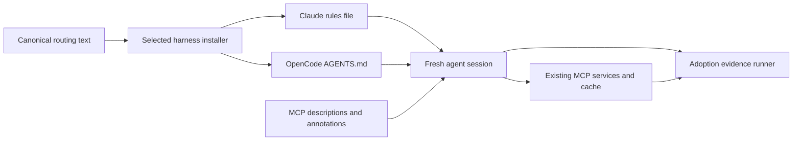

# Technical Design: Agent Tool Routing

## Overview

Make the existing mmhmem read/cache path discoverable during ordinary Claude Code
and OpenCode work. Tool metadata explains selection and side effects; installed,
automatically loaded instructions establish the reading workflow. Controlled live
runs verify adoption separately from deterministic cache and accounting tests.

### Goals
- Prefer authorized `smart_read` for ordinary repository inspection while retaining exact reads for editing and verification.
- Preserve user instructions, checkpoints, permissions, and existing MCP contracts.
- Prove actual tool selection in both harnesses; report missing evidence honestly.

### Non-Goals
Hooks, proxies, new tools, storage migrations, savings formula changes, forced tool
selection, bulk automatic warmup, and guaranteed compliance by arbitrary models.

## Boundary Commitments

### This Spec Owns
- Descriptions and annotations on the nine existing MCP tools and shared routing instructions.
- One canonical routing text, portable skill discoverability, and selected Claude/OpenCode instruction installation/removal.
- Installation safety tests and controlled adoption evidence.

### Out of Boundary
- Service/cache policy, worker authentication, permission enforcement, stats schema, and session checkpoint semantics.
- Automatic instructions for other harnesses; their existing onboarding remains unchanged.
- General migration of custom harness configuration roots or changes to user instruction-disable controls.

### Allowed Dependencies
- Existing rmcp 3.8.0 tool macros, protocol layer, and current service/storage contracts.
- Existing PowerShell/Bash installers, selection/scope flags, marketplace generators, and test runners.
- Native harness instruction loading and CLI event output; existing Rust integration-test infrastructure.
- No new installer runtime dependency on Windows; shell implementation may use its existing Python dependency.

### Revalidation Triggers
- Tool side effects, cache identity, stats attribution, or optional telemetry change: recheck annotations and accounting assertions.
- Harness instruction precedence, environment paths, CLI events, or supported versions change: rerun installer and live adoption tests.
- Canonical skill/checkpoint text changes: regenerate packages and check both guidance contracts.
- Ownership marker or bootstrap payload changes: rerun update, cross-installer, remove, and download-path tests.

## Architecture

### Existing Architecture Analysis
The MCP protocol layer delegates to services; this change keeps that direction.
Current sessions show native reads despite installed skills, while a direct worker
read updates the shared stats store. The gap is instruction discovery/adoption,
not evidence of a broken savings accumulator. Current installers already select
harnesses and scope; new instruction writes join those selected branches.

### Architecture Pattern and Boundary Map

Use native instruction mechanisms and rmcp annotations. Build only the small
owned-Markdown update operation and adoption runner missing from the repository.
Do not introduce a client hook, policy engine, or service-layer routing adapter.

### Technology Stack

| Layer | Choice | Responsibility |
|---|---|---|
| Protocol | Rust, pinned rmcp 3.8.0 | Discovery metadata; no dependency upgrade |
| Installation | Native PowerShell and existing Bash/Python tooling | Safe owned-block updates |
| Guidance | Markdown, existing marketplace generators | Canonical text and portable skill |
| Verification | Rust integration tests, installer scripts, real CLI runs | Contract and behavior evidence |

## File Structure Plan

| Files | Action and responsibility |
|---|---|
| `src/mcp/tools.rs` | Modify descriptions, annotations, and shared initialization guidance; keep handlers thin |
| `tests/local_stdio.rs` | Extend wire-level discovery assertions and preserve argument schemas |
| `tests/tool_routing.rs` | Add focused metadata/accounting regression tests if existing integration files would exceed project size limits |
| `deploy/instructions/mmhmem-routing.md` | Add canonical concise reading/fallback instructions |
| `deploy/manage_routing.ps1`, `deploy/manage_routing.py` | Add equivalent owned-Markdown planning/atomic-write helpers for native installers |
| `deploy/install_local.ps1`, `deploy/install_local.sh` | Integrate selected destinations, preflight, helper invocation, removal, and reload messages |
| `install.ps1`, `install.sh` | Fetch helper payloads also for removal; routing source required only for installation |
| `deploy/skills/unified-memory/SKILL.md` | Improve reading/token-optimization discoverability while preserving checkpoint rules and budget |
| `plugins/unified-memory/skills/unified-memory/SKILL.md` and generated plugin manifests | Regenerate with existing marketplace builders; no independent edits |
| `scripts/test-routing-instructions.ps1`, `scripts/test-routing-instructions.sh` | Add installation safety suites |
| `tests/fixtures/routing-instructions/` | Shared cross-installer UTF-8, marker, and ownership cases with expected results |
| `scripts/test-install.ps1`, `scripts/test-install.sh` | Include routing safety suites in existing installer gates |
| `scripts/check-routing-guidance.py`, `scripts/check-marketplace.py` | Check guidance distribution and semantics alongside existing checkpoint checker |
| `tests/routing_adoption.rs`, `tests/routing_adoption/mod.rs` | Opt-in harness orchestration, isolated synthetic fixture, sanitized evidence report |
| `README.md`, `deploy/README.md` | Document instruction paths, update/removal, fresh-session requirement, overrides, and opt-in acceptance |
| `.kiro/specs/agent-tool-routing/validation.md` | Record final per-requirement evidence and unresolved live prerequisites |

Keep Rust source files under the project size limit. If metadata additions exceed
the limit in `tools.rs`, move existing shared initialization instruction text into
`src/mcp/instructions.rs`, wired through `src/mcp/mod.rs`; do not move service policy.

## Components and Interfaces

### MCP Discovery Metadata

Use `#[tool(annotations(...))]` and existing descriptions. Each description states
purpose, when to select it, and limitations. `smart_read` explicitly covers normal
repository inspection, cached/worker summaries, and exact `offset`/`limit` reads.
Memory search precedes observation retrieval; checkpoint, generation, warmup, and
prune descriptions distinguish their mutations and user intent. No names or input
schemas change. Hints grant no permissions and do not promise agent compliance.

All tools have `read_only_hint=false`, `idempotent_hint=false`, and
`open_world_hint=true`. Reads can append audit/breadcrumb/stat records; optional
OTel exports mean conservative shared metadata must cover external interactions
even for local memory tools. `destructive_hint` is specified individually:

| Tool | Destructive | Reason |
|---|---|---|
| session_resume_or_handoff | true | Can replace checkpoint state |
| smart_read | true | Cache upsert can replace summary/timestamp |
| boilerplate_write | true | Can overwrite destination file |
| mem_search | false | Read plus additive audit/breadcrumb effects |
| mem_get_observations | false | Read plus additive audit/breadcrumb effects |
| mem_record_observation | false | Additive observation and audit records |
| shunt_warmup | true | Cache upserts |
| shunt_prune | true | Deletes cache entries |
| mem_search_breadcrumbs | false | Read plus additive audit/breadcrumb effects |

### Routing Guidance

The canonical text directs authorized inspection through `smart_read` before full
native/shell reads; exact edits and verification use targeted source reads. Search,
build, test, and edit tools remain available. Explicit user preferences prevail.
Summaries are not exact source evidence. Keep project identity stable; retain all
existing checkpoint guidance in its canonical skill/server sources.

If the MCP is absent, proceed with authorized native reads. If a call fails or its
worker is unavailable, use a bounded targeted/native fallback, without retry loops,
permission bypass, or savings claims. Do not infer savings from connection status.
Update the skill description to include file inspection and token optimization;
keep the existing estimated 200-token skill budget and checkpoint checks passing.

### Instruction Destination Resolution

| Harness and scope | Destination |
|---|---|
| Claude global | `HOME/.claude/rules/mmhmem.md` |
| Claude project | `ProjectDir/.claude/rules/mmhmem.md` |
| OpenCode global | `HOME/.config/opencode/AGENTS.md` |
| OpenCode project | `ProjectDir/AGENTS.md` |

Claude rules contain no path frontmatter, so they load unconditionally. Creating a
project `CLAUDE.md` can suppress existing `AGENTS.md` discovery in current Claude;
the rules directory avoids that regression. OpenCode V2 combines global and parent
AGENTS instructions. Initial live evidence targets installed Claude 2.1.302 and
OpenCode 2.2.5, recording actual versions again at execution.

Preflight each selected harness before its MCP, skill, command, or instruction
writes. If overrides (`CLAUDE_CONFIG_DIR`, `OPENCODE_CONFIG_DIR`, `OPENCODE_CONFIG`,
`OPENCODE_CONFIG_CONTENT`, `XDG_CONFIG_HOME`) make the existing hardcoded registration
and instruction destinations inconsistent or unprovable, fail that harness with
the variable name and corrective action. Never print variable contents. Equivalent
default paths may pass after normalization. Do not install routing at an alternate
root while leaving the MCP registration elsewhere.

For OpenCode V1 or an unknown version, refuse creation of AGENTS.md if it could
suppress an existing CLAUDE.md fallback; preserve existing instructions and explain
the conflict. Explicitly disabled/excluded instruction loading is reported, never
overridden. Unknown effective loading remains unverified, not successful adoption.

### Owned Markdown Update Contract

Both helpers implement the same operation:
`plan(path, operation: install|remove, canonical_text) -> unchanged|planned_bytes|error`.
The parser recognizes exact whole-line markers
`<!-- mmhmem:routing:start -->` and `<!-- mmhmem:routing:end -->` identically on both
OSes. Exactly one valid pair may be replaced or removed; zero pairs allows append
on install and no-op on removal. Duplicate, nested, reversed, unmatched, or
marker-like conflicting ownership fails before writing. An existing dedicated
Claude `mmhmem.md` without markers is an ownership conflict; an existing general
AGENTS.md without markers is preserved and receives an appended section.

Read valid UTF-8 (optional BOM); reject undecodable content. Preserve bytes outside
the owned section, including Unicode, BOM, and existing newline style. New files
use UTF-8 without BOM and LF. Own any inserted separator inside the managed section
so removal does not remove user whitespace.

For an appended block requiring a newline before its whole-line start marker,
record that inserted prefix inside the block as an exact metadata comment
`<!-- mmhmem:routing:prefix=lf -->` (or `crlf` or `none`). Removal validates and
removes only that declared inserted prefix; absent metadata owns no preceding
bytes. Reject inconsistent or duplicate prefix metadata. This makes removal
byte-reversible even when the original user file had no final newline.
Reject symlink/reparse destinations and unsupported frontmatter on the dedicated rules file rather than rewriting an
unexpected target or conditional rule. Shared fixtures define exact results.

Plan all selected instruction destinations first, before selected harness writes.
Dry-run performs validation and displays intended actions without directories,
backups, files, or model requests. For a real change, recheck original content,
retain its previous bytes as `<path>.mmhmem.bak`, stage new content beside the target,
then atomically replace using platform-supported operations. A concurrent change
aborts rather than overwrites. A failed backup/stage/replace preserves the original
and reports the path; no delete-then-write fallback. No-op writes do not rotate
backups. Retain one previous instruction version. New-file creation must not
overwrite a file that appeared after preflight.

Removal strips only the owned section. Delete the dedicated rules file only when
the resulting file is empty and ownership is established; retain general AGENTS.md
and all user text. Per-file atomicity is promised, not a cross-file transaction:
report any already completed writes if a later file fails. Re-running converges.
Completion names affected instruction paths and requests a fresh harness session.

## System Flows

1. Resolve selected harness/scope and supported instruction destination.
2. Validate configuration overrides, loading conflicts, and owned file contents.
3. Perform existing onboarding and safe instruction commits for validated harnesses;
   a failed harness is not reported as onboarded.
4. Start a fresh session. Native instruction loading and MCP discovery inform tool selection.
5. Observe actual tool events and existing worker/cache/stats evidence; report results independently.

## Requirements Traceability

| Requirement | Implementation contract | Verification |
|---|---|---|
| 1.1 | Purpose/selection/limitation descriptions | Nine-tool enumeration assertions |
| 1.2 | Summary versus exact-read description | Discovery and targeted-read tests |
| 1.3 | Explicit annotation matrix | Wire serialization and side-effect review |
| 1.4 | Conservative mutation/idempotence hints | Cache/audit/worker regression coverage |
| 1.5 | Unchanged names/schemas; advisory hints | Schema and protocol compatibility tests |
| 2.1 | Native rules/AGENTS destinations | Fresh live sessions for both harnesses |
| 2.2 | Canonical ordinary-read routing | Unforced inspection prompt/tool sequence |
| 2.3 | Exact targeted-read guidance | Exact-source inspection test |
| 2.4 | Bounded authorized fallback | Unavailable/failed-worker scenarios |
| 2.5 | Preserved workflows/checkpoints and skill budget | Marketplace/checkpoint/routing gates |
| 3.1 | Selected, single owned section | Selection/scope/preservation tests |
| 3.2 | Common parser contract and UTF-8 fixtures | Repeat and cross-installer updates |
| 3.3 | Fail-closed preflight | Malformed/ambiguous/override fixtures |
| 3.4 | Backup, concurrent-change check, atomic replace | Injected backup/write/replace failures |
| 3.5 | Owned-only removal, no-write dry-run, reload message | Remove/dry-run/bootstrap tests |
| 4.1 | Real harness ordinary task | Recorded natural tool selection |
| 4.2 | Matching-identity repeat | Hit, worker count, stats deltas |
| 4.3 | Separate negative accounting cases | Direct/targeted/session/worker-failure tests |
| 4.4 | Sanitized evidence contract | Report fields and secret exclusions |
| 4.5 | Explicit live outcome classification | Missing prerequisites and non-adoption tests |

## Data Contracts and Error Handling

No application storage/schema changes. The acceptance report records harness/version,
model identifier, scope, effective instruction paths and canonical text hash, exact
synthetic task prompt, observed tool names/order, cache identity, worker count, and
stats snapshots/deltas. Outcomes are `PASS`, `FAIL`, or `NOT_VERIFIED` per harness and
criterion. Only both successful live runs establish adoption. Deterministic cache
tests cannot substitute for natural tool selection.

Report extraction allowlists these fields; never export whole resolved configs,
auth files, raw private transcripts, API keys, or environment values. CLI failure,
timeout, unsupported event format, unavailable model/auth, and instruction loading
uncertainty get explicit outcomes. Installer errors identify operation/path and
recovery, preserving originals. Do not change runtime worker-error semantics.

## Testing Strategy

### Deterministic Gates
- Enumerate all nine tools over stdio and verify explicit camelCase annotations,
  names, input schemas, and descriptions; also exercise shared HTTP discovery.
- Verify cold summary then same-identity cache hit: first request reaches worker,
  hit adds no worker request, existing stats attribute expected estimated savings.
- Direct/targeted/security-bypass reads, session-only calls, and worker failures
  must not add summary/cache savings. Preserve existing accounting formulas.
- Shared installer fixtures cover global/project, selected/unselected harnesses,
  LF/CRLF/BOM/Unicode, no trailing newline, repeat/update/remove, malformed markers,
  unowned rules files, override conflicts, backups, failed writes, and concurrent edits.
- Cross-installer round trips consume the other implementation's exact output;
  shell tests run through the canonical Dagger distribution gate, native tests in
  Windows PowerShell 5 and PowerShell 7. Include real bootstrap remove payloads.
- Run marketplace, checkpoint and routing guidance checks, Rust tests/formatting,
  strict clippy default and OTel, and existing installer/distribution gates.

### Live Adoption Gate

Add an opt-in test (`E2E_LLM=1 cargo test --test routing_adoption -- --nocapture`)
using explicit model settings for each harness. Setup a disposable synthetic
repository with a large non-sensitive file, test-owned store and worker request
counter. Install guidance through the actual installer, not an injected prompt or
`instructions` override. Retain normal native tools and ordinary permissions.

Use fresh CLI sessions: Claude print/stream-json with bounded turns and no session
persistence; OpenCode standalone JSON run with fixture cwd and timeout. Record
actual CLI support/versions. Test-owned strict MCP config may isolate Claude
registration without replacing instruction loading. Do not copy authentication
files. CI uses isolated config with provided environment credentials; local mode
may retain existing auth/global instructions and must disclose that limitation.

The synthetic task asks to explain a named fixture file's responsibilities and
structure without mentioning mmhmem, smart_read, or skills. Passing requires an
observed smart_read call before a full native/shell read. Repeat the ordinary task
against unchanged content and inspect the actual cache identity, including question.
If the agent changes identity, report that repeat as inconclusive for 4.2; do not
force a tool call and relabel it adoption evidence. A separate deterministic replay
can prove cache mechanics, but all required live evidence must remain explicit.

## Rollout and Implementation Ordering

After design approval, tasks should cover metadata, canonical guidance, safe helper
contracts, installer/bootstrap integration, deterministic verification, then live
adoption and documentation. Metadata and helper work have separate file ownership;
integration depends on both guidance and helpers. No production configs are changed
during specification. No schema migration or service restart is required; updated
binary metadata requires a newly spawned MCP process, and instructions require a
fresh harness session. Rollback removes owned guidance or restores its backup.

## Design Review Gate

Requirements 1.1–4.5 are mapped above. Boundary, dependencies, concrete files,
contracts, failure modes, prerequisites, and executable validation are defined.
Review repaired two local ambiguities before finalization: static open-world hints
cover optional OTel, and live cache repeats must prove matching identity rather than
assume identical prompts imply identical cache keys. Design gate passed; live
adoption remains an implementation acceptance gate, not a design-time claim.
