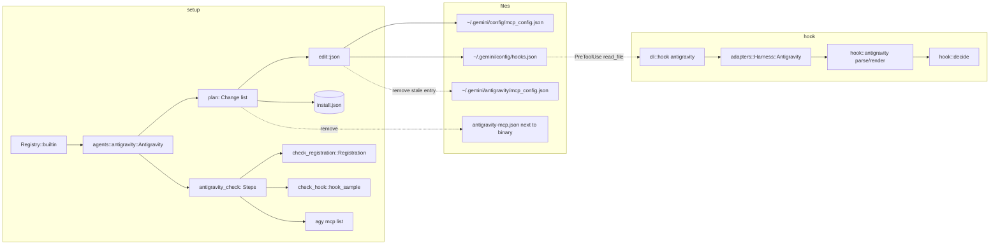
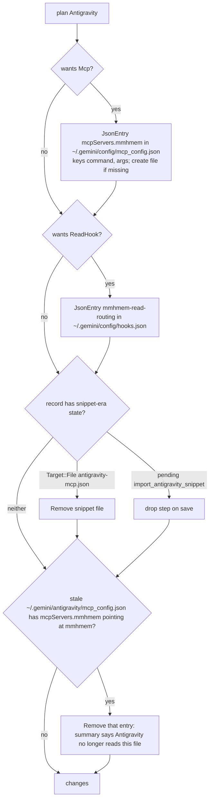
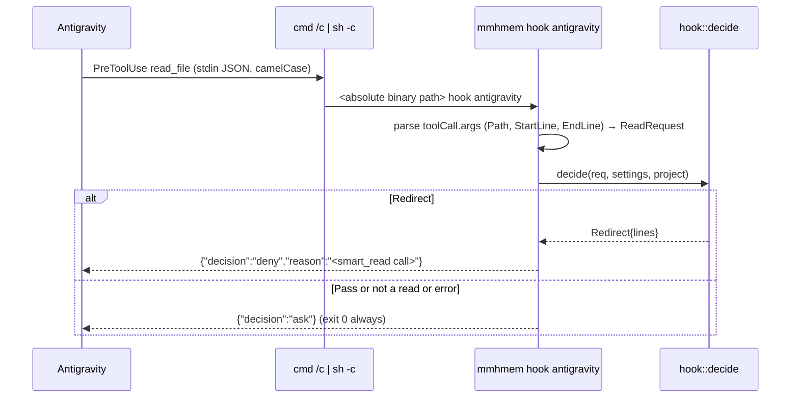

# Design Document: antigravity-native-setup

## Overview

**Purpose**: `mmhmem setup` treats Antigravity like every other agent. It
writes the mmhmem server entry into the file Antigravity loads, installs the
read-routing hook into Antigravity's hook file, proves both with the existing
functional check, and migrates installs made with the earlier paste-a-snippet
integration. The user's only remaining step is to start a new Antigravity
session.

**Users**: anyone running `mmhmem setup`, `mmhmem update` or the removal flow
with Antigravity (CLI `agy` or the IDE) on Linux, macOS or Windows.

**Impact**: replaces the Antigravity agent implementation
(`src/setup/agents/antigravity.rs`), adds an Antigravity hook harness
(`src/hook/antigravity.rs`), extends detection, the check and the UI text,
and retires the snippet file, the snippet text and the
`ImportAntigravitySnippet` pending step.

### Goals
- After setup, `agy mcp list` names mmhmem and a new Antigravity session has
  the mmhmem tools, with nothing pasted by the user.
- With the hook selected, a whole-file `read_file` of a large file in
  Antigravity is answered with a `smart_read` redirect; ranged and
  security-critical reads pass.
- Re-running setup or update on the owner's existing install produces the
  new state and removes the leftovers of the snippet integration.
- The check for Antigravity reads back Antigravity's own file and fails
  when Antigravity could not start mmhmem.

### Non-Goals
- Skill, recap command and routing instructions for Antigravity
  (`Feature::Skill`, `RecapCommand`, `Instructions`): their Antigravity
  locations are unconfirmed. The feature list stays `Mcp` and `ReadHook`.
- The `unified-memory` plugin bundle and `agy plugin install`.
- Workspace-level `.agents/mcp_config.json` or `.agents/hooks.json`
  (setup is per user, as for all agents).
- Changing hook eligibility rules or the redirect text (owned by
  `read-routing-hooks`).

## Boundary Commitments

### This Spec Owns
- The `Antigravity` implementation of the `Agent` trait: detection, plan,
  check, removal, pending steps, migration of the snippet-era record.
- The mmhmem entries in `~/.gemini/config/mcp_config.json`
  (`mcpServers.mmhmem`: keys `command`, `args`) and
  `~/.gemini/config/hooks.json` (the whole top-level key
  `mmhmem-read-routing`).
- The `Harness::Antigravity` hook adapter: parsing Antigravity's
  `PreToolUse` stdin, rendering its stdout, and the `hook antigravity`
  command-line name.
- The sample `PreToolUse` input the check feeds the hook for Antigravity.
- User-facing text for Antigravity in setup, results and status.
- Removal of the mmhmem entry in the stale location
  `~/.gemini/antigravity/mcp_config.json` when it points at mmhmem.

### Out of Boundary
- `edit::json`, `fsx`, the install record, drift detection, the plan and
  apply pipeline, the review screen: used as they are.
- The hook engine (`hook::decide`, settings, state, audit): used as it is.
- Every other agent, the installer bootstraps and the release pipeline.
- The content of `~/.gemini/config/config.json` and any Antigravity
  settings file.

### Allowed Dependencies
- `src/setup/agents/antigravity*.rs` → `edit::json`, `record`, `plan`,
  `check_agent::Steps`, `check_registration::Registration`, `ui::text`,
  `agents::Env` (PATH lookup, home, program version).
- `src/hook/antigravity.rs` → `hook::adapters` (shared parsing helpers),
  `hook::{Decision, ReadRequest}`. It never imports `setup`.
- `src/setup/check_hook.rs` → `hook::adapters::Harness` for the sample
  input, as it does for the other harnesses.
- Dependency direction stays `cli → setup → hook/adapters → hook core`, and
  `setup` never reaches into `hook` internals beyond the public adapter
  surface.

### Revalidation Triggers
- Antigravity moves or renames the global `mcp_config.json` or
  `hooks.json`, or changes the `hooks.json` shape.
- The `read_file` argument names, the `PreToolUse` output vocabulary, the
  treatment of `{}` on stdout, or the whitespace tokenization of the hook
  command change.
- `{"decision":"ask"}` turns out to add a permission prompt to `read_file` in
  interactive sessions (unverified; checked in task 5.3). If it does, the
  pass form must be revisited before the hook ships for Antigravity.
- `agy mcp list` output format changes (check fixture).
- A new Antigravity location for skills or commands is confirmed (would
  reopen the feature list, in a new spec).

## Architecture

### Existing Architecture Analysis
- Agents implement `Agent` (`detect`, `features`, `plan`, `check`,
  `plan_remove`, `pending_steps`) and are listed in
  `Registry::builtin`. Plans are `Change`s with a `Target` recorded in the
  install record; `Target::JsonEntry` with `managed_keys` is the pattern
  for a server entry in a shared JSON file (Claude Desktop).
- Hooks: `Harness` enum in `src/hook/adapters.rs` with per-harness `parse`
  and `render`; `src/cli/hook.rs` maps the command-line name to the
  variant; `src/setup/check_hook.rs` feeds a sample read per harness.
- The check pipeline (`check_agent::Steps`) runs registration → handshake
  → tools_list → status_tool → agent_command → hook_sample → config_load,
  each step reporting pass, skipped or a failure reason.

### Architecture Pattern & Boundary Map



**Architecture Integration**:
- Selected pattern: the existing agent-per-module pattern; Antigravity
  becomes a "two managed JSON entries" agent, the union of Claude
  Desktop's MCP entry and a hook entry.
- Existing patterns preserved: `Target::JsonEntry` with `managed_keys` for
  the server entry; whole-key `Target::JsonEntry` for the hook; the Codex
  `*_check.rs` split; the `Harness` adapter seam.
- New components rationale: `hook::antigravity` because the I/O contract is
  different from all three existing harnesses; `antigravity_check.rs` to
  stay under the 500-line file cap.
- Steering compliance: no new config file format at runtime; the hook
  fails open; nothing is written outside the audit and record paths.

### Technology Stack

| Layer | Choice / Version | Role in Feature | Notes |
|-------|------------------|-----------------|-------|
| CLI / setup | Rust, existing `setup` module | agent, plan, check | No new crates |
| Hook | Rust, existing `hook` module | new harness adapter | No new crates |
| External program | `agy` 1.5.3 (confirmation only) | `agy --version`, `agy mcp list` | Optional; IDE-only machines have none |
| Files | JSON (`edit::json`, jsonc-parser CST) | `mcp_config.json`, `hooks.json` | Byte-preserving edits |

## File Structure Plan

### Directory Structure
```
src/setup/agents/
├── antigravity.rs            # Agent impl: detection, paths, features, plan (MCP + hook), plan_remove, pending steps
├── antigravity_check.rs      # check(): registration read-back, Steps, agy mcp list confirmation; stale-location and snippet-era migration helpers
├── antigravity_tests.rs      # unit tests for detection, plan, remove, migration
└── antigravity_check_tests.rs# unit tests for check and agy fixtures
src/hook/
└── antigravity.rs            # Harness::Antigravity parse (toolCall/read_file) and render (decision JSON)
src/setup/
└── check_hook.rs             # sample PreToolUse input for Harness::Antigravity
tests/fixtures/setup/agents/antigravity/
├── agy-version.txt           # "1.5.3"
├── agy-mcp-list-empty.txt    # "No MCP servers configured."
├── agy-mcp-list-mmhmem.txt   # populated listing (captured in task 1.1)
├── mcp_config-after-agy-mcp-add.json # what `agy mcp add` writes (task 1.1)
├── mcp_config-other-servers.json     # golden input for plan tests (task 3.2)
└── hooks-other-hooks.json            # golden input for plan tests (task 3.3)
tests/fixtures/hook/antigravity/
├── pretooluse-read_file-whole.json                 # live capture, backslash path
├── pretooluse-read_file-whole-forward-slashes.json # live capture, forward-slash path
├── pretooluse-read_file-ranged.json                # live capture, StartLine/EndLine
├── pretooluse-run_command.json                     # not a read
└── pretooluse-call_mcp_tool-smart_read.json        # not a read (must never be denied)
```

### Modified Files
- `src/setup/agents/antigravity.rs` — rewritten per Components below.
- `src/setup/agents/mod.rs` — module doc mentions Antigravity's hook; no
  registry change (already listed).
- `src/setup/record.rs` / `record_types.rs` — `HookHarness::Antigravity`
  (for `codex_command`-style hook command rendering and audit naming);
  `PendingUserStep::ImportAntigravitySnippet` kept for deserialization,
  marked deprecated, dropped on save; new
  `PendingUserStep::StartNewAntigravitySession` is **not** added: "start a
  new session" is the generic next step already shown for Claude Code and
  OpenCode (`text::next_step`).
- `src/hook/adapters.rs` — `Harness::Antigravity` variant, `name()` =
  `"antigravity"`, `agent_harness()` = `"antigravity"`, `parse`/`render`
  branches.
- `src/cli/hook.rs` — `"antigravity"` → `Harness::Antigravity`.
- `src/setup/check_hook.rs` — Antigravity sample input.
- `src/setup/ui/text.rs` — remove `NEXT_ANTIGRAVITY_SNIPPET`,
  `antigravity_snippet`, `PENDING_IMPORT_SNIPPET`; `NEXT_ANTIGRAVITY` =
  "Antigravity: start a new session."
- `src/setup/check_text.rs` — remove the `ImportAntigravitySnippet` arm.
- `src/setup/ui/flow_apply.rs` — remove the Antigravity special case
  (lines 239–245); Antigravity uses `text::next_step`.
- `src/setup/ui/snapshots/*` — snapshots that show Antigravity rows.
- `README.md`, `docs/installation.md`,
  `deploy/examples/antigravity-mcp_config-local.json` (path comment) — text.
- `.kiro/specs/reliable-installers/research.md` section 8 — Antigravity row
  replaced by a pointer to this spec's `research.md`.

## System Flows

### Plan for Antigravity (install, update and re-run)



Gating: the stale-location removal is planned only when the entry's
`command` file name is `mmhmem` or `mmhmem.exe`; any other entry in that
file is never touched. It is shown on the review screen like every other
change and applied only on confirmation.

### Hook call from Antigravity



## Requirements Traceability

| Requirement | Summary | Components | Interfaces | Flows |
|-------------|---------|------------|------------|-------|
| 1.1 | register in the loaded location | Antigravity agent (plan) | `Target::JsonEntry mcpServers.mmhmem` | Plan |
| 1.2 | byte-preserving, backed up | Antigravity agent, `edit::json` | `Change` | Plan |
| 1.3 | create file if missing | Antigravity agent (plan) | `missing_parents`, `created_file` | Plan |
| 1.4 | no snippet, no import step | text, check_text, flow_apply | — | — |
| 1.5 | only "start a new session" | text::next_step | — | — |
| 2.1 | hook before file-read tool | Antigravity agent (plan hook) | `Target::JsonEntry mmhmem-read-routing` | Plan |
| 2.2 | same eligibility rules | hook::antigravity → hook::decide | `ReadRequest` | Hook call |
| 2.3 | fail open | hook::antigravity parse | `ParsedCall.read = None` | Hook call |
| 2.4 | accepted answer, redirect text | hook::antigravity render | decision JSON | Hook call |
| 2.5 | other hooks untouched | Antigravity agent, `edit::json` | whole-key entry | Plan |
| 2.6 | inactive without worker | existing `hook_inactive` text | — | — |
| 3.1 | detect agy or data folders | Antigravity agent (detect) | `Env::find_program`, dirs | — |
| 3.2 | bare ~/.gemini is not proof | Antigravity agent (detect) | — | — |
| 3.3 | show version | Antigravity agent (detect) | `agy --version` | — |
| 4.1 | read registration back | antigravity_check | `Registration::from_claude_json(file bytes)` | — |
| 4.2 | hook sample | check_hook, antigravity_check | `hook_sample(Harness::Antigravity)` | — |
| 4.3 | agy mcp list confirmation | antigravity_check | `run_agent_command` | — |
| 4.4 | rollback on failure | existing verify flow | — | — |
| 5.1 | migrate snippet-era record | Antigravity agent (plan) | `Target::File` removal | Plan |
| 5.2 | stale location cleanup | antigravity_check helpers, plan | JSON entry removal | Plan |
| 5.3 | removal leaves rest intact | Antigravity agent (plan_remove) | `edit::json::remove` | — |
| 5.4 | record reflects new state | record (drop deprecated step) | serde | — |
| 6.1 | README, installation guide | docs | — | — |
| 6.2 | screens free of snippet text | text, check_text, snapshots | — | — |
| 6.3 | recorded agent facts | research.md | — | — |

## Components and Interfaces

| Component | Domain/Layer | Intent | Req Coverage | Key Dependencies (P0/P1) | Contracts |
|-----------|--------------|--------|--------------|--------------------------|-----------|
| Antigravity agent | setup/agents | detect, plan, remove, pending steps | 1.1–1.3, 2.1, 2.5, 3.1–3.3, 5.1–5.3 | edit::json (P0), record (P0), Env (P0) | Service, State |
| Antigravity check | setup/agents | registration read-back, Steps, agy confirmation, migration helpers | 4.1–4.3, 5.2 | check_agent::Steps (P0), Registration (P0), run_agent_command (P1) | Service |
| Antigravity hook adapter | hook | parse PreToolUse, render decision | 2.2–2.4, 4.2 | hook::decide (P0), adapters helpers (P0) | Service |
| Hook sample | setup/check_hook | Antigravity-shaped sample read | 4.2 | Harness (P0) | Service |
| Text and flow | setup/ui | remove snippet text, generic next step | 1.4, 1.5, 6.2 | — | — |

### setup/agents

#### Antigravity agent (`antigravity.rs`)

| Field | Detail |
|-------|--------|
| Intent | The `Agent` for Antigravity: two managed JSON entries in `~/.gemini/config/` |
| Requirements | 1.1, 1.2, 1.3, 2.1, 2.5, 3.1, 3.2, 3.3, 5.1, 5.3 |

**Responsibilities & Constraints**
- Paths: `gemini = home/.gemini`; `config = gemini/config`;
  `mcp = config/mcp_config.json`; `hooks = config/hooks.json`;
  `stale = gemini/antigravity/mcp_config.json`;
  `snippet = <binary dir>/antigravity-mcp.json` (removal only).
- Detection: `Env::find_program("agy")` or any of
  `gemini/antigravity-cli`, `gemini/antigravity`, `gemini/antigravity-ide`
  is a directory. Version: first line of `agy --version` when the program
  is found (`Detection::Found { version: Some("1.5.3"), paths }`); `None`
  when only folders are found.
- Features: `[Feature::Mcp, Feature::ReadHook]`.
- Plan MCP: `Target::JsonEntry { file: mcp, pointer: ["mcpServers","mmhmem"], managed_keys: ["command","args"] }`; leaf values `command = binary`, `args = ["stdio"]`; a missing file is created as `{"mcpServers": {"mmhmem": {...}}}` with `missing_parents` counted like Claude Desktop; user keys inside the entry are kept.
- Plan hook: `Target::JsonEntry { file: hooks, pointer: ["mmhmem-read-routing"], managed_keys: None }` with value exactly the Hook entry contract below; a missing file is created as `{}` + entry. When `hook_command` returns `AgentProblem::HookCommandUnrepresentable`, the hook change is skipped, the problem is reported for the agent, and the MCP change is still planned.
- Migration (5.1): if `rec.managed` has `Target::File { file == snippet }`, plan `Action::Remove` of it. If the record carries `PendingUserStep::ImportAntigravitySnippet`, it is not re-emitted by `pending_steps` and disappears on the next save.
- Stale cleanup (5.2): delegated to the check module's helper `stale_entry(stale_path, binary) -> Option<Change>`; appended to the plan when `Some`.
- Removal: remove `command` and `args` of `mcpServers.mmhmem` and prune parents this install created (`missing_parents`), remove the whole `mmhmem-read-routing` key, remove the snippet file if still managed. Other keys stay byte-identical.
- Pending steps: none (`Vec::new()`); the generic "start a new session" line comes from `text::next_step`.

**Dependencies**
- Outbound: `edit::json` — set/remove at pointer (P0); `record` — targets and entries (P0); `Env` — home, PATH lookup, program version (P0).

**Contracts**: Service [x] / State [x]

##### Service Interface (Rust)
```rust
pub struct Antigravity { pub binary: PathBuf }
impl Antigravity {
    pub fn new(binary: impl Into<PathBuf>) -> Self;
    pub fn mcp_file(env: &Env) -> PathBuf;     // ~/.gemini/config/mcp_config.json
    pub fn hooks_file(env: &Env) -> PathBuf;   // ~/.gemini/config/hooks.json
    pub fn stale_file(env: &Env) -> PathBuf;   // ~/.gemini/antigravity/mcp_config.json
    pub fn hook_entry(&self, os: Os) -> Result<Value, AgentProblem>;
}
impl Agent for Antigravity { /* detect, features, plan, check, plan_remove, pending_steps */ }
pub const HOOK_NAME: &str = "mmhmem-read-routing";
pub const HOOK_MATCHER: &str = "^read_file$";
pub const HOOK_TIMEOUT: u64 = 10;
```
- Preconditions: `binary` is absolute.
- Postconditions: `plan` returns no change when both entries already hold the wanted values and are recorded; `plan_remove` returns only changes for targets in `rec.managed` plus the stale entry when present.
- Invariants: no change ever touches keys outside the two mmhmem entries.

##### Hook entry contract (value at `hooks.json` → `mmhmem-read-routing`)
```json
{
  "PreToolUse": [
    {
      "matcher": "^read_file$",
      "hooks": [
        { "type": "command", "command": "C:\\Users\\<user>\\AppData\\Local\\Programs\\mmhmem\\mmhmem.exe hook antigravity", "timeout": 10 }
      ]
    }
  ]
}
```
Command tokenization (confirmed 2026-11-09, research "Antigravity hooks
contract"): Antigravity splits the string on whitespace and keeps quotes
literally, so the command must consist of whitespace-free tokens and is never
quoted. The helper `hook_command(binary, os) -> Result<String, AgentProblem>`
writes the binary's absolute path as the first token followed by
`hook antigravity`. When the path contains whitespace: on Windows the helper
asks the OS for the 8.3 short form of the path (`GetShortPathNameW`) and uses
it when the result is whitespace-free; otherwise, and on Unix, it returns
`AgentProblem::HookCommandUnrepresentable { file }` (new variant, text: the
hook cannot be installed because Antigravity cannot run a program whose path
contains spaces), and `plan` skips the hook change while still planning the
MCP entry. The `~/` program form observed in the capture is not used: whether
`~` expands before or after the whitespace split is unverified for a home
folder that contains a space (research, Risks).

#### Antigravity check (`antigravity_check.rs`)

| Field | Detail |
|-------|--------|
| Intent | Prove Antigravity can start mmhmem, from Antigravity's own file |
| Requirements | 4.1, 4.2, 4.3, 5.2 |

**Responsibilities & Constraints**
- `check(env, rec)`: read bytes of `mcp_file`; `Registration::from_claude_json(bytes, "mmhmem")` (same shape as Claude Desktop); on `RegistrationError` the registration step fails with the existing reason text. Then `Steps::start(env, AgentId::Antigravity, registration)`; the hook sample runs when `rec.features[ReadHook]`; `agent_command` runs `agy mcp list` when `agy` is on PATH and passes when a line contains `mmhmem`, else `Outcome::Skipped` with reason "Antigravity CLI not found; checked the config file only".
- `stale_entry(stale, binary) -> Option<Change>`: parse `stale` with `edit::json::get(["mcpServers","mmhmem","command"])`; when the value's file name is `mmhmem` or `mmhmem.exe`, return a `Change { action: Remove, target: JsonEntry(stale, ["mcpServers","mmhmem"]), summary: "Antigravity no longer reads this file; remove the mmhmem entry" }`; unreadable or absent file → `None` (never an error: the file is not mmhmem's).

**Contracts**: Service [x]

### hook

#### Antigravity hook adapter (`src/hook/antigravity.rs`)

| Field | Detail |
|-------|--------|
| Intent | Map Antigravity `PreToolUse` stdin/stdout to the harness-neutral hook core |
| Requirements | 2.2, 2.3, 2.4 |

**Responsibilities & Constraints**
- `parse(input) -> ParsedCall`: `session_id = conversationId`, `cwd = workspacePaths[0]` (missing or empty → not a read), `tool = toolCall.name`. For `read_file`: `toolCall.args.Path` (string; absolute with backslashes or forward slashes; a relative path joins `cwd`), optional `StartLine`/`EndLine` (non-negative integers; either present → `range = Some((StartLine or 1, EndLine or 0))` where 0 means "to the end", mirroring the Claude adapter). Any other tool (including `call_mcp_tool` and `run_command`), missing field or wrong type → `read: None`.
- `render(decision, path, project) -> String`: `Redirect` → `{"decision":"deny","reason": <redirect lines joined, ASCII>}`; `Pass` → `{"decision":"ask"}` (confirmed in print mode; interactive prompt behaviour pending task 5.3; `{}` denies). Never `allow`.
- Input over `MAX_INPUT_BYTES` or malformed → not a read (inherited from `load_input`).
- Process contract: `mmhmem hook antigravity` always exits 0 and always prints exactly one JSON object; `src/cli/hook.rs` treats a `None` render for this harness as `{"decision":"ask"}` rather than empty output, because empty or invalid stdout blocks the tool call.

**Contracts**: Service [x]

##### Service Interface (Rust)
```rust
pub(super) fn parse(input: &[u8]) -> ParsedCall;
pub(super) fn render(decision: &Decision, path: &Path, project: &str) -> String;
// adapters.rs
pub enum Harness { Claude, Codex, OpenCode, Antigravity }
// Harness::Antigravity.name() == "antigravity"; agent_harness() == "antigravity"
```

#### Hook sample (`check_hook.rs`)
- Adds the Antigravity-shaped sample: `{"conversationId":"check","workspacePaths":[<tmp dir>],"toolCall":{"name":"read_file","args":{"Path": <sample file, absolute>}},"stepIdx":1}` with `SAMPLE_LINES` lines, expecting `{"decision":"deny",...}` when a worker is configured and `{"decision":"ask"}` otherwise; no answer within the timeout, a non-zero exit or output that is not a JSON object with a `decision` string is `HookNotRun` (any of those would block Antigravity's tools).

### setup/ui

#### Text and flow
- `NEXT_ANTIGRAVITY` = "Antigravity: start a new session."; remove snippet constants and the `flow_apply.rs` special case; `check_text::pending_step` loses the import arm; the deprecated step maps to no text if ever encountered in an old record.

## Data Models

### Install record (`install.json`) for Antigravity after this spec
```json
"antigravity": {
  "features": { "mcp": true, "read_hook": true },
  "managed": [
    { "kind": "json_entry", "file": "<home>/.gemini/config/mcp_config.json", "pointer": ["mcpServers","mmhmem"], "managed_keys": ["command","args"], "sha256": "...", "backup": "...", "state": "done" },
    { "kind": "json_entry", "file": "<home>/.gemini/config/hooks.json", "pointer": ["mmhmem-read-routing"], "sha256": "...", "backup": "...", "state": "done" }
  ],
  "pending_user_steps": [],
  "last_check": { "result": "pass", "details": [ ... "agent_command": "pass" | "skipped" ... ] }
}
```
- `HookHarness::Antigravity` serializes as `"antigravity"`.
- `PendingUserStep::ImportAntigravitySnippet` stays deserializable (`#[deprecated]`, `#[serde(alias)]` not needed) and is filtered out when the record is saved.

## Error Handling

### Error Strategy
- Plan: an invalid `mcp_config.json` or `hooks.json` → `AgentProblem::InvalidJson(file, line, col)`; the agent is skipped with the file named, others continue (reliable-installers 3.4).
- Check: registration unreadable → `AgentFailure::Registration(reason)`; handshake failure → existing failure and rollback of the Antigravity changes (4.4).
- Hook: every parse problem is "not a read" → pass; `render` never panics; a serialization failure falls back to the pass form.
- Stale cleanup: never fails the plan; unreadable stale file is ignored.

### Monitoring
- Hook decisions are audited as today with `agent_harness = "antigravity"`, so `mmhmem stats` shows an Antigravity row.

## Testing Strategy

### Unit Tests
- Detection: `agy` on PATH with version; folders only; bare `~/.gemini` with `settings.json` → not found (3.1–3.3).
- Plan MCP: fixture with other servers and comments → add then remove is byte-identical; missing file created with parents counted; user key inside `mmhmem` entry preserved (1.1–1.3, 5.3).
- Plan hook: fixture with another named hook → only `mmhmem-read-routing` added/removed (2.1, 2.5).
- Migration: record with `Target::File` snippet → removal planned; record with `import_antigravity_snippet` → dropped on save; stale file with mmhmem entry → removal planned; stale file with a foreign `mmhmem` command → nothing (5.1, 5.2, 5.4).
- Hook adapter: captured whole-file payload (backslash and forward-slash variants) → `ReadRequest` with `range: None`; ranged payload → `range: Some((10, 20))`; `run_command` and `call_mcp_tool` payloads → not a read; oversized input → not a read; render redirect → deny JSON with reason naming `smart_read`; render pass → `{"decision":"ask"}`; the CLI prints a JSON object and exits 0 for every fixture (2.2–2.4).
- Hook command helper: whitespace-free absolute path → used as is, no quotes; path with whitespace on Windows → 8.3 short form when the OS returns a whitespace-free one (test with a temp folder containing a space); still whitespace, or Unix with whitespace → `AgentProblem::HookCommandUnrepresentable` and the plan still contains the MCP entry (2.1, 2.3).

### Integration Tests
- `tests/setup_check.rs`: test home with a fake `agy` (prints fixtures for `--version` and `mcp list`) → check passes with `agent_command: pass`; without `agy` → `skipped`; config with wrong command → registration fails and rollback restores bytes (4.1–4.4).
- `tests/hook_cli.rs`: `mmhmem hook antigravity` with the captured payloads and a temp project at threshold → deny; below threshold → pass form (2.2–2.4).
- `tests/setup_cli.rs` update path: start from a snippet-era `install.json` and a stale `~/.gemini/antigravity/mcp_config.json`; after apply, the new entries exist, the snippet file and stale entry are gone, `install.json` has no `import_antigravity_snippet` (5.1–5.4).

### E2E
- The existing installer e2e workflow gains an Antigravity scenario on Windows and Linux runners with the fake `agy` on PATH, asserting `agy mcp list` fixture passes through and the hook sample runs (1.1, 2.1, 4.2, 4.3).
- Live validation on the owner's machine with the real `agy` 1.5.3 (task 5.3): `agy mcp list` names mmhmem; a new `agy` session lists the mmhmem tools; a whole-file `read_file` of a 300-line file is redirected and a ranged read proceeds; in an interactive session, a `read_file` of a short file answered with `{"decision":"ask"}` raises no permission prompt that was not there before the hook.
