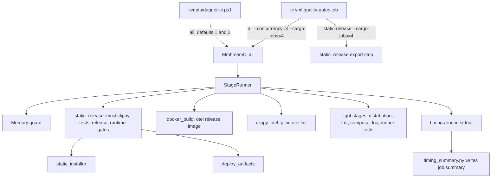
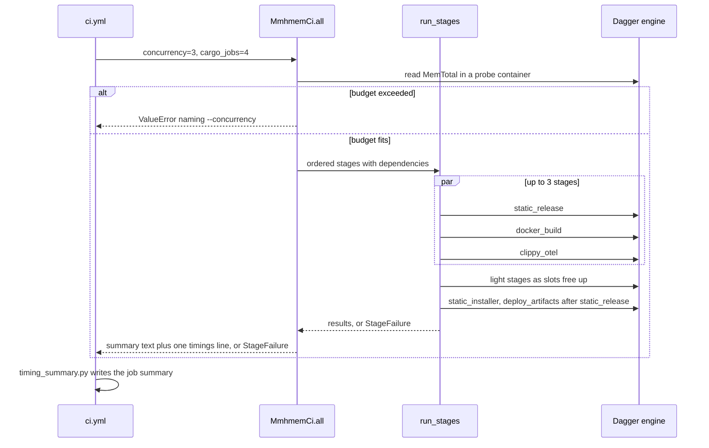

# Design Document: ci-build-time

## Overview

**Purpose:** Cut the blocking CI verdict on `main` from 731 s to 920 s down to
at most 540 s, without weakening any gate, and make release commits as fast
as ordinary commits on the native runners.

**Users:** Maintainers pushing to `main` and the release publisher, which
waits for CI. The developer running the local Dagger gate on the Windows
host with its ~6 GB WSL engine.

**Impact:** The Dagger `all` function stops awaiting stages one after
another. CI runs independent stages concurrently with wider cargo
parallelism, and the local run keeps today's sequential, 2-job behaviour.
Duplicate glibc compilation and the per-run tokei source build leave the
critical path. Native caches survive version bumps. Every run reports
per-stage timings.

### Goals

- Blocking gate median at most 540 s, whole workflow median at most 600 s.
- Identical pass/fail meaning and identical published artifacts.
- One Dagger module, same entrypoints locally and in CI.

### Non-Goals

- Persisting Dagger caches across hosted runs. This is deferred, see Decision 5.
- Larger or self-hosted runners.
- Changes to the release workflow, the E2E job, the Dockerfile or product code.
- Speeding up the native Windows/macOS jobs beyond cache restoration.

## Boundary Commitments

### This Spec Owns

- Stage scheduling, failure aggregation and timing inside the Dagger
  module's `all` function.
- The `concurrency` and `cargo_jobs` options of the Dagger functions that
  compile Rust, and their values in `.github/workflows/ci.yml`.
- How the gate's informational LOC report obtains tokei.
- Native-job cargo cache keys and restore behaviour in `ci.yml`.
- The CI job summary content and the timing baseline file.

### Out of Boundary

- What any individual gate checks. fmt, clippy, tests, size caps, static
  candidate, installer, distribution, Docker, compose and deploy checks keep
  their commands and semantics. The one exception is Decision 3, which
  needs explicit user approval.
- Release bundle contents, manifest schema and artifact names.
- `release.yml`, `publish-ci-release.ps1` and the E2E measurement job.
- The local wrapper's provenance, export and argument-safety logic.

### Allowed Dependencies

- Dagger engine and CLI 0.21.11 and the Dagger Python SDK already in `ci/`.
- `dagger/dagger-for-github@v8.4.1`, `actions/cache/restore@v4`,
  `actions/cache/save@v4`, `actions/checkout@v4`, `actions/upload-artifact@v4`.
- Python 3 standard library on the hosted runner, used for the summary script.
- No new third-party Python packages, no new container images.

### Revalidation Triggers

- Any change to the `linux-static-*` artifact identity or to
  `verification.json` invalidates static-linux-release validation.
- A change of `cargo_jobs` on only one of the two Dagger workflow steps
  forces a second musl compile and voids the timing target.
- A new heavy stage, or a rise in the memory budget constant, requires the
  memory guard values to be re-measured.
- Moving to a different runner class requires new baselines.

## Architecture

### Existing Architecture Analysis

- `MmhmemCi.all` awaits nine stages in a fixed order. A stage failure raises
  immediately through the Dagger SDK and stops the run.
- `rust_container` (glibc) and `musl_container` both hard-code
  `CARGO_BUILD_JOBS=2` as an OOM guard for the WSL engine.
- The musl candidate stage (`build_candidate.py`) runs clippy, tests and the
  release build for the musl target. The glibc stages then run clippy on
  default and otel features and the test suite again.
- Cache volumes are empty on every hosted run because each job starts a
  fresh engine.

### Architecture Pattern & Boundary Map



- **Pattern:** a dependency-aware stage runner with a concurrency limit,
  fed by an ordered stage list. Heavy stages are listed first so the
  critical path starts immediately.
- **Preserved:** single Dagger module, single local wrapper, same-artifact
  bundle verification, all existing standalone functions.
- **New component rationale:** the stage runner is the only new module.
  Scheduling, failure aggregation and timings are one concern.
- **Steering compliance:** one pipeline locally and in CI. The local WSL
  engine keeps sequential stages and 2 cargo jobs by default.

### Technology Stack

| Layer | Choice / Version | Role in Feature | Notes |
|---|---|---|---|
| CI engine | Dagger 0.21.11, Python SDK | Runs stages | Unchanged |
| Scheduling | Python `asyncio` (stdlib) | Concurrency, dependencies, timing | Already used by `static_release.py` |
| Workflow | GitHub Actions, `ubuntu-latest` 4 vCPU / 16 GB | Hosts the engine | Public-repo runner class |
| Native caching | `actions/cache/restore@v4` + `actions/cache/save@v4` | Prefix fallback, matched-key reporting | Replaces `actions/cache@v4` |
| Reporting | Python 3 stdlib script | Job summary | Runs on the runner host |

## File Structure Plan

### Directory Structure

```
ci/
├── src/mmhmem_ci/
│   ├── stages.py              # NEW: run_stages, Stage, StageResult, StageFailure, check_memory; no dagger import
│   ├── main.py                # MODIFIED: all() builds the stage list; options plumbed to containers
│   └── static_release.py      # MODIFIED: musl_container and its callers take cargo_jobs
├── scripts/
│   ├── test_stages.py         # NEW: unit tests for the stage runner and the memory guard
│   ├── timing_summary.py      # NEW: parse timings line, compare baseline, write markdown
│   └── test_timing_summary.py # NEW: unit tests for parsing, marking and missing data
└── timing-baseline.json       # NEW: per-stage baseline seconds from research.md
```

### Modified Files

- `ci/src/mmhmem_ci/main.py`: `all` gains `concurrency: int = 1` and
  `cargo_jobs: int = 2`. It builds the stage list and calls `run_stages`.
  `rust_container(src, cargo_jobs=2)` takes the job count. `loc_report`
  installs tokei from the Debian archive. `static_release`, `release`,
  `static_installer` and `deploy_artifacts` take and forward `cargo_jobs`.
  A private `_clippy_otel` helper replaces the two-pass `clippy` call inside
  `all`. The public `clippy` and `test` functions stay for local use.
- `ci/src/mmhmem_ci/static_release.py`: `musl_container(src, cargo_jobs=2)`,
  with `build_candidate`, `verified_bundle` and `installer_check` forwarding
  `cargo_jobs`. Defaults keep every standalone call identical to today.
- `.github/workflows/ci.yml`: the gate step gets `id: gate` and passes
  `--concurrency=3 --cargo-jobs=4`. The export step passes the same
  `--cargo-jobs=4`. A summary step follows with `if: always()`. Windows and
  macOS replace `actions/cache@v4` with restore and save steps and append
  their cache status to the job summary.
- `scripts/test-dagger-ci.ps1`: asserts both Dagger steps pass the same
  `--cargo-jobs` value and that the gate step passes `--concurrency`.
- `docs/development.md`: documents the two options, the local defaults and
  the memory guard message.

## System Flows



- A failed stage never cancels its siblings. Stages that depend on a failed
  stage are marked `skipped` and do not run.
- After all runnable stages finish, the runner raises one `StageFailure` if
  any stage failed. Its message lists every failed stage with the tail of
  its error output, and every skipped stage.
- With `concurrency=1` the same runner executes stages in list order. The
  local run therefore keeps its sequence and gains the aggregated report.

## Requirements Traceability

| Requirement | Summary | Components | Interfaces | Flows |
|---|---|---|---|---|
| 1.1 | Gate median at most 540 s | Stage runner, cargo_jobs, Decisions 3 and 4 | `all(concurrency, cargo_jobs)` | Gate flow |
| 1.2 | Workflow median at most 600 s | Gate plus native cache steps | ci.yml | Gate flow, native cache |
| 1.3 | Verdict unaffected by slowness | Stage runner has no time-based failure; timing_summary | timings line | Summary |
| 2.1 | Every blocking check stays | Stage list in `all` | Stage list table | Gate flow |
| 2.2 | Coverage matrix kept or approved | Decision 3 | Coverage table | — |
| 2.3 | Failing stage named | StageFailure | `StageFailure.results` | Failure path |
| 2.4 | No masking under concurrency | Run-to-completion runner | `run_stages()` | Failure path |
| 2.5 | Same bundle artifact | static_release output unchanged; same `cargo_jobs` on both steps | ci.yml export step | Export step |
| 3.1 | Same entrypoints | `all` options with defaults | Dagger CLI options | Local and CI |
| 3.2 | Local default sequential and bounded | Defaults `concurrency=1`, `cargo_jobs=2` | `all` signature | Local flow |
| 3.3 | Explicit CI setting | ci.yml arguments | `--concurrency`, `--cargo-jobs` | Gate flow |
| 3.4 | Fail clearly on memory overrun | Memory guard | `check_memory()` | Budget branch |
| 4.1 | Native caches survive version bumps | Restore with prefix fallback | `restore-keys` | Native cache |
| 4.2 | No stale outputs in the final result | Cargo fingerprints; save on exact miss only | Cache key scheme | Native cache |
| 4.3 | No secrets in persisted caches | Cached paths hold no secrets; native jobs read none | Cache path list | Native cache |
| 4.4 | No per-run tool source build on the critical path | `loc_report` source build scheduled to overlap the static chain (Decision 4 fallback; bookworm has no tokei package) | `loc_report` | Light stages |
| 5.1 | Per-stage timings in the summary | Stage runner timings, timing_summary | timings line | Summary |
| 5.2 | Native cache status in the summary | Restore step outputs | `cache-matched-key` | Native cache |
| 5.3 | Mark stages over baseline +50% | timing_summary, timing-baseline.json | Baseline schema | Summary |

## Components and Interfaces

| Component | Layer | Intent | Req Coverage | Key Dependencies | Contracts |
|---|---|---|---|---|---|
| Stage runner (`run_stages`) | ci module | Run named stages with limits, dependencies, timing and aggregated failure | 1.1, 1.3, 2.3, 2.4, 3.2, 5.1 | asyncio (P0) | Service |
| Memory guard (`check_memory`) | ci module | Refuse a concurrency the engine cannot hold | 3.4 | Probe container (P0) | Service |
| `all` stage list | ci module | Declare stages, order and dependencies | 2.1, 2.2, 2.5, 3.1, 3.3 | Stage runner (P0) | Batch |
| timing_summary | runner host | Turn the timings line into a job summary | 1.3, 5.1, 5.3 | timing-baseline.json (P1) | Batch |
| Native cache steps | workflow | Restore by prefix, save on exact miss, report status | 1.2, 4.1, 4.2, 4.3, 5.2 | actions/cache restore and save (P0) | State |

### ci module

#### Stage runner (`ci/src/mmhmem_ci/stages.py`)

| Field | Detail |
|---|---|
| Intent | Execute an ordered list of stages under a concurrency limit, honour dependencies, time each stage, aggregate failures |
| Requirements | 1.1, 1.3, 2.3, 2.4, 3.2, 5.1 |

**Responsibilities & Constraints**
- Pure Python with no `dagger` import, so `ci/scripts/test_stages.py` can
  test it in any Python 3 container.
- Starts stages in list order as slots free up. A stage starts only after
  all its dependencies passed.
- Never cancels a running stage because another failed. Never fails a run
  because of elapsed time.

##### Service Interface

```python
from dataclasses import dataclass
from typing import Awaitable, Callable, Literal

Status = Literal["passed", "failed", "skipped"]

@dataclass(frozen=True)
class Stage:
    name: str                                  # unique, used in reports
    run: Callable[[], Awaitable[str]]          # returns the stage's report text
    needs: tuple[str, ...] = ()                # names of prerequisite stages
    heavy: bool = False                        # counts toward the memory budget

@dataclass(frozen=True)
class StageResult:
    name: str
    status: Status
    started_s: float                           # seconds since runner start
    duration_s: float
    output: str                                # report text, or last 40 lines of the error

class StageFailure(Exception):
    results: list[StageResult]                 # every stage, in list order
    def __str__(self) -> str: ...              # names each failed and skipped stage with duration

async def run_stages(stages: list[Stage], concurrency: int) -> list[StageResult]:
    """Raise StageFailure after all runnable stages finish if any failed."""

def timings_line(results: list[StageResult]) -> str:
    """Return '== timings: ' followed by compact JSON of name, status, started_s, duration_s."""
```

- Preconditions: stage names are unique, every `needs` entry names an
  earlier stage, and `concurrency >= 1`. Violations raise `ValueError`
  before any stage starts.
- Postconditions: one `StageResult` per stage. A dependent of a failed or
  skipped stage is `skipped` with `duration_s == 0`.
- Invariant: at most `concurrency` stages run at once.

#### Memory guard (`ci/src/mmhmem_ci/stages.py`)

| Field | Detail |
|---|---|
| Intent | Fail before any build when the configured concurrency cannot fit engine memory |
| Requirements | 3.4 |

```python
HEAVY_STAGE_BUDGET_GIB: float = 3.0   # per concurrently running heavy stage; measured in implementation
ENGINE_RESERVE_GIB: float = 2.0       # engine, BuildKit and light stages

def check_memory(mem_total_kib: int, concurrency: int, heavy_count: int) -> None:
    """Raise ValueError naming --concurrency when
    min(concurrency, heavy_count) * HEAVY_STAGE_BUDGET_GIB + ENGINE_RESERVE_GIB exceeds MemTotal."""
```

- `all` reads `MemTotal` from `/proc/meminfo` in an `alpine:3.22` container,
  which reports the engine VM's memory, and calls `check_memory`.
- With these constants, `concurrency=1` needs 5 GiB and fits the 6 GB WSL
  engine. `concurrency=2` locally needs 8 GiB and is refused with a message
  naming `--concurrency`. CI at `concurrency=3` needs 11 GiB of 16 GB.

#### `all` stage list (`ci/src/mmhmem_ci/main.py`)

| Order | Stage name | Heavy | Needs | Replaces today's |
|---|---|---|---|---|
| 1 | `static_release` | yes | — | static_release |
| 2 | `docker_build` | yes | — | docker_build (otel) |
| 3 | `clippy_otel` | yes | — | clippy, otel pass |
| 4 | `loc_report` | no | — | loc_report (informational) |
| 5 | `stage_runner_tests` | no | — | new |
| 6 | `distribution` | no | — | distribution |
| 7 | `fmt` | no | — | fmt |
| 8 | `compose_config` | no | — | compose_config |
| 9 | `static_installer` | no | `static_release` | static_installer |
| 10 | `deploy_artifacts` | no | `static_release` | deploy_artifacts |

- Amended in task 2.3: `loc_report` moved from order 10 to order 4. Debian bookworm has no tokei package, so the Decision 4 fallback applies, and position 4 is what makes its source build take the first slot a heavy stage frees.

- The return text keeps today's `== <stage>: ok` lines, the verified bundle
  manifest and the tokei report, followed by one `timings_line`.
- `loc_report` keeps today's status: if it fails, the run fails. Only its
  tokei source changes.

### Runner host

#### timing_summary (`ci/scripts/timing_summary.py`)

| Field | Detail |
|---|---|
| Intent | Write the per-stage timing table to `$GITHUB_STEP_SUMMARY` |
| Requirements | 1.3, 5.1, 5.3 |

##### Batch / Job Contract

- Trigger: a workflow step after the gate step, with `if: always()`.
- Input: the gate step's standard output through an environment variable,
  plus `ci/timing-baseline.json`. The output name (`stdout` in current
  action versions) is confirmed against v8.4.1's `action.yml` first.
- Output: a markdown table of stage, status, start, duration, baseline and a
  marker column. A stage over `1.5 × baseline` gets the marker `slow`.
- Baseline schema: `{"runner": "ubuntu-latest-4vcpu", "stages": {"<name>": <seconds>}}`.
- A missing timings line writes "no stage timings recorded" and exits 0.
  The summary step never changes the job verdict.
- When the gate fails, its output is not captured. The `StageFailure` text
  in the log then carries every failed and skipped stage with its duration.

### Workflow

#### Native cache steps (`.github/workflows/ci.yml`)

| Field | Detail |
|---|---|
| Intent | Keep dependency builds across version-only lockfile changes and report cache status |
| Requirements | 1.2, 4.1, 4.2, 4.3, 5.2 |

##### State Management

- Primary key: `cargo-<os>-1.98.1-${{ hashFiles('Cargo.lock') }}`.
- Restore keys: `cargo-<os>-1.98.1-`, which restores the newest cache from
  an earlier lockfile.
- Paths: `~/.cargo/registry`, `~/.cargo/git`, `target`. These jobs read no
  secrets, so no secret can enter the cache.
- Save: only when the restore step's `cache-hit` is not `true`, and only on
  `push` events. Cargo fingerprints rebuild every crate whose source or
  dependencies changed, so restored outputs never stand in for changed code.
- Summary line per job: `exact`, `fallback (<matched key>)` or `miss`, from
  the restore step's `cache-hit` and `cache-matched-key` outputs.

## Key Decisions

1. **Explicit options, not host probing.** `concurrency` and `cargo_jobs` are
   function options. Defaults are today's local behaviour, and `ci.yml`
   records the CI values (3.2, 3.3).
2. **Run to completion, aggregate failures.** No stage cancels another. This
   gives complete failure reports under concurrency (2.3, 2.4). Locally, a
   failing run now continues through the remaining independent stages.
3. **Drop the glibc default-feature clippy and test passes from `all`. This
   needs user approval at this design gate (2.2).**

   | Combination | Today | After |
   |---|---|---|
   | musl, default features: clippy, tests, release | yes | yes |
   | glibc, default features: clippy | yes | no |
   | glibc, default features: tests | yes | no |
   | glibc, otel: clippy | yes | yes |
   | glibc, otel: release build (Docker) | yes | yes |
   | Windows MSVC and macOS: clippy, tests, release | yes | yes |

   Equivalence argument: `src/` has no `target_env` or Linux-libc `cfg`, so
   the musl passes lint and test the same Rust source. No shipped artifact is
   a glibc default-feature build. The Linux release is musl and the Docker
   image is otel. This saves about 150 s of 2-job compile. If not approved,
   both passes stay as two more heavy stages, the memory budget is
   recomputed, and Requirement 1.1 is re-measured.
4. **tokei from the Debian archive.** `apt-get install tokei` in the
   `loc_report` container replaces `cargo install` (4.4). If the bookworm
   archive lacks the package, the stage keeps `cargo install` and is listed
   right after the heavy stages with no dependents, so it overlaps the static
   chain. Task 2.3 found bookworm has no tokei package and took this fallback. Both outcomes keep
   it off the critical path.
5. **No cross-run Dagger cache in this spec.** The measured lower bound
   without it is about 480 s. Dagger Cloud, sccache with the GitHub cache
   backend, or exported target directories add credentials or large cache
   transfers. They become a follow-up spec only if validation misses 1.1.
   Requirement 4.3 then becomes an acceptance criterion for that work.

## Error Handling

| Condition | Behaviour | Requirement |
|---|---|---|
| A stage raises | Marked failed, siblings continue, dependents skipped, one `StageFailure` at the end | 2.3, 2.4 |
| Memory budget exceeded | `ValueError` before any build, naming `--concurrency` and required versus available GiB | 3.4 |
| Invalid stage graph or `concurrency < 1` | `ValueError` before any stage | 3.3 |
| Timings line missing | Summary says so, step exits 0 | 1.3 |
| Cache service unavailable | Restore and save steps warn, jobs build cold | 1.2 |

## Testing Strategy

- **Unit, `ci/scripts/test_stages.py`:**
  - The concurrency limit holds for 5 stages with `concurrency=2` (2.4).
  - A failure in one stage does not cancel a sibling, and the sibling's
    result is reported (2.4).
  - The dependent of a failed stage is skipped, and the `StageFailure` text
    names both (2.3).
  - `concurrency=1` executes in list order (3.2).
  - `check_memory` passes at 6 GiB with `concurrency=1` and fails at 6 GiB
    with `concurrency=2`, naming `--concurrency` (3.4).
  - Duplicate names and unknown `needs` raise before execution.
- **Unit, `ci/scripts/test_timing_summary.py`:** parses a timings line,
  marks a stage at 1.6 × baseline as slow and one at 1.4 × as normal, and
  handles a missing line without failing (1.3, 5.1, 5.3).
- **Workflow contract, `scripts/test-dagger-ci.ps1`:** both Dagger steps pass
  the same `--cargo-jobs`, the gate passes `--concurrency`, the artifact
  identity string is unchanged, and native jobs use restore keys (2.5, 3.3, 4.1).
- **Integration, local:** `scripts/dagger-ci.ps1` with default options passes
  on the WSL engine (3.1, 3.2). With `-ExtraArgs --concurrency=2` it fails
  with the guard message (3.4).
- **Acceptance, hosted:** record five consecutive green `main` runs. Report
  the gate median, the workflow median, a version-bump commit's native job
  times against their warm medians, the summary tables, and an unchanged
  `verification.json` schema (1.1, 1.2, 2.1, 2.5, 4.1, 5.1, 5.2).

## Expected Timing (to be measured, not promised)

| Segment | Today | Expected |
|---|---|---|
| Engine start and module load | ~50 s | ~50 s |
| static_release chain at 4 jobs, sharing CPU | 365 s + ~48 s | ~260 s to 330 s |
| docker_build, clippy_otel, light stages | sequential, ~330 s | overlapped |
| glibc default clippy and tests | 152 s | 0 s, Decision 3 |
| tokei | 64 s | under 10 s, Decision 4 |
| **Gate total** | **731 s to 920 s** | **~400 s to 480 s** |
