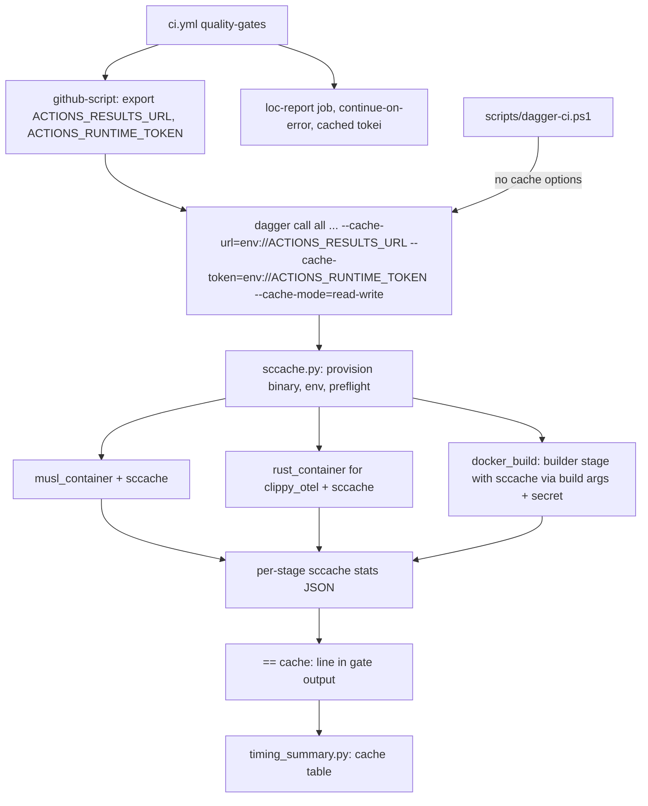
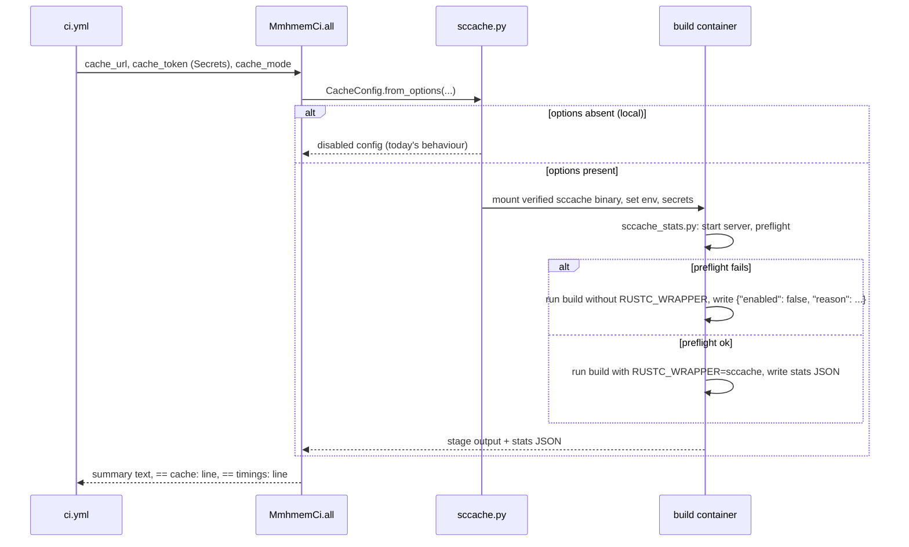

# Design Document: ci-dependency-cache

## Overview

**Purpose:** Make hosted gate runs reuse compiled dependencies from earlier
runs, take the tokei LOC report off the gate, and document the TLS stack,
without changing what any gate checks or what ships.

**Users:** Maintainers pushing to `main` and opening pull requests; the
release publisher, which waits for CI.

**Impact:** Every Rust compile in the hosted gate runs under sccache backed by
the GitHub Actions cache, which also caches the C objects of aws-lc and
SQLite. Local runs stay as they are. The LOC report moves to its own
non-blocking job with a cached tokei binary. The gate summary gains a
compile-cache table.

### Goals

- Warm gate median at most 360 s; cold gate at most 110 percent of 666 s.
- Unchanged verification, artifacts and shipped TLS stack.
- No credential exposure; pull requests cannot poison `main`.

### Non-Goals

- Changing the TLS crypto provider or product code.
- Caching on the native Windows and macOS jobs (they already cache).
- Self-hosted runners, Dagger Cloud, or caches outside GitHub Actions.

## Boundary Commitments

### This Spec Owns

- The sccache integration: binary provisioning, environment, credential
  hand-off, fallback and statistics, for the musl candidate, the otel
  clippy pass and the otel Docker builder stage.
- The optional sccache path in the Dockerfile builder stage.
- The `loc-report` workflow job and removal of `loc_report` from `all`.
- The compile-cache table in the gate job summary.
- The TLS stack section in the development guide.

### Out of Boundary

- What each stage checks, the stage plan semantics, the memory guard and
  the timing table (ci-build-time).
- Same-artifact verification and the bundle manifest (static-linux-release).
- `release.yml`, the publisher scripts and native job caches.
- Cargo dependencies and features.

### Allowed Dependencies

- sccache, an exact pinned release ≥ 0.10 for `x86_64-unknown-linux-musl`,
  fetched by URL and verified by SHA-256 recorded in the Dagger module.
- `actions/github-script@v7` to export the cache credentials;
  `actions/cache@v4` for the tokei binary.
- Dagger 0.21.11 `Secret`, `dag.http` and `Directory.docker_build`
  (`build_args`, `secrets`, `target`).
- No new Cargo dependencies, no new base images.

### Revalidation Triggers

- A change of Rust toolchain, target, or sccache version (cache keys change;
  purge with `SCCACHE_GHA_VERSION` if needed).
- An aws-lc-sys upgrade that switches its default builder to CMake.
- Any change to the Dockerfile builder stage or the bundle manifest.
- GitHub cache service credential changes.

## Architecture

### Existing Architecture Analysis

- `rust_container` (glibc) and `musl_container` mount cargo caches as Dagger
  cache volumes, which are empty on every hosted run.
- `docker_build` calls `src.docker_build()`; the Dockerfile's
  `--mount=type=cache` is equally empty on hosted runs.
- `loc_report` is a light stage of `all` that builds tokei from source.
- The gate step already passes options to `all`; the wrapper accepts
  `--name=value` options locally.

### Architecture Pattern & Boundary Map



- **Pattern:** an optional compile-cache layer applied to the existing
  container factories. When no cache options are given, the factories
  produce exactly today's containers.
- **Steering compliance:** one Dagger pipeline; local runs need no
  credential; WSL memory guard unchanged.

### Technology Stack

| Layer | Choice / Version | Role | Notes |
|---|---|---|---|
| Compile cache | sccache, pinned exact release ≥ 0.10, musl static binary | rustc and cc wrapper | SHA-256 pinned |
| Cache backend | GitHub Actions cache | Cross-run storage | 10 GB repo limit |
| Credential export | `actions/github-script@v7` | Expose results URL and runtime token to the step | Passed to Dagger as secrets |
| LOC tool | tokei 15.0.0 via `cargo install --locked` | Informational report | Binary cached by `actions/cache@v4` |

## File Structure Plan

### Directory Structure

```
ci/
├── src/mmhmem_ci/
│   ├── sccache.py          # NEW: CacheConfig, sccache provisioning, container env, exec wrapper command, stats parsing
│   ├── main.py             # MODIFIED: all() cache options; clippy_otel and docker_build use the cache; loc_report leaves ALL_STAGE_PLAN; == cache: line
│   └── static_release.py   # MODIFIED: musl_container and build_candidate accept the cache config
├── scripts/
│   ├── sccache_stats.py    # NEW: run a command under sccache and write stats JSON (used inside containers)
│   ├── test_sccache.py     # NEW: unit tests for config validation, env, stats parsing and fallback
│   ├── timing_summary.py   # MODIFIED: render the compile-cache table from the == cache: line
│   └── test_timing_summary.py  # MODIFIED
Dockerfile                  # MODIFIED: optional sccache in the builder stage (no-op without build args)
.github/workflows/ci.yml    # MODIFIED: credential export step, cache options, loc-report job
scripts/test-dagger-ci.ps1  # MODIFIED: contract assertions for the above
docs/development.md         # MODIFIED: cache section and TLS stack section
ci/timing-baseline.json     # MODIFIED at acceptance: warm durations, loc_report removed
```

## System Flows



- The wrapper script runs the build in the same exec as the sccache server,
  because the server dies with the exec.
- Fallback never changes the stage verdict: a preflight failure only
  disables the wrapper.

## Requirements Traceability

| Requirement | Summary | Components | Interfaces | Flows |
|---|---|---|---|---|
| 1.1 | Reuse in every gate Rust build incl. Docker | sccache.py, musl/rust containers, Dockerfile builder | `CacheConfig`, build args | Cache flow |
| 1.2 | C objects of build scripts cached; uncacheable named | cc honours `RUSTC_WRAPPER`; validation report | stats JSON | Cache flow |
| 1.3 | Fallback without cache, same verdict | sccache_stats.py preflight, `SCCACHE_IGNORE_SERVER_IO_ERROR=1` | `{"enabled": false}` | Fallback branch |
| 1.4 | Local runs need no credential | Disabled config when options absent | `all()` defaults | Local branch |
| 1.5 | Warm median ≤ 360 s | Whole design; acceptance task | timings | — |
| 1.6 | Cold ≤ 110 % of 666 s | Preflight cost bounded; acceptance task | timings | — |
| 2.1 | Verification and manifest unchanged | static_release flow untouched beyond env | bundle | — |
| 2.2 | PR runs cannot poison main/tag caches | GitHub cache scoping + `READ_ONLY` mode on pull requests | `cache_mode` | Workflow |
| 2.3 | Credential only as secret, never leaked | Dagger `Secret`, `with_secret_variable`, BuildKit secret mount; contract test greps | `CacheConfig` | Cache flow |
| 2.4 | Dockerfile builds standalone | Build args default empty; secret mount `required=false` | Dockerfile | — |
| 2.5 | No reuse across toolchain/target | sccache hashes compiler and target; `SCCACHE_GHA_VERSION` | env | — |
| 3.1 | TLS stack kept | No Cargo change | — | — |
| 3.2 | Guide explains TLS purpose | docs/development.md | — | — |
| 3.3 | Guide: cached not replaced, how to confirm | docs/development.md, cache table | — | — |
| 4.1 | Separate concurrent LOC job | `loc-report` job | ci.yml | Workflow |
| 4.2 | Verdict independent of LOC job | `continue-on-error: true`, no `needs` from gate or release | ci.yml | Workflow |
| 4.3 | No tokei compile when cached | `actions/cache` keyed by tokei version | ci.yml | Workflow |
| 4.4 | Report in job summary | LOC job step | ci.yml | Workflow |
| 4.5 | Gate drops LOC; local on demand | `ALL_STAGE_PLAN`; `loc-report` Dagger function kept | main.py | — |
| 5.1 | Hit/miss counts in summary | `== cache:` line, timing_summary | stats JSON | Summary |
| 5.2 | Disabled state stated | `enabled: false` rows | stats JSON | Summary |
| 5.3 | Baseline updated | acceptance task | timing-baseline.json | — |

## Components and Interfaces

| Component | Layer | Intent | Req Coverage | Key Dependencies | Contracts |
|---|---|---|---|---|---|
| sccache.py | Dagger module | Configure and provision the compile cache | 1.1, 1.3, 1.4, 2.3, 2.5 | dag.http, Secret (P0) | Service |
| sccache_stats.py | In-container script | Run a build under sccache with preflight and stats | 1.2, 1.3, 5.1, 5.2 | sccache binary (P0) | Batch |
| Dockerfile builder path | Image build | Optional sccache in the builder stage | 1.1, 2.3, 2.4 | build args, secret mount (P0) | Batch |
| loc-report job | Workflow | Informational LOC report | 4.1–4.5 | actions/cache (P1) | Batch |
| cache table | timing_summary.py | Show cache effect | 5.1, 5.2 | `== cache:` line (P1) | Batch |

### sccache.py (`ci/src/mmhmem_ci/sccache.py`)

```python
from dataclasses import dataclass
from typing import Literal, Optional
import dagger

SCCACHE_VERSION: str          # exact pinned release, >= 0.10
SCCACHE_URL: str              # x86_64-unknown-linux-musl tarball
SCCACHE_SHA256: str           # verified before use
GHA_CACHE_VERSION: str = "mmhmem-1"   # SCCACHE_GHA_VERSION; bump to purge

CacheMode = Literal["off", "read-only", "read-write"]

@dataclass(frozen=True)
class CacheConfig:
    mode: CacheMode
    url: Optional[dagger.Secret]
    token: Optional[dagger.Secret]

    @staticmethod
    def from_options(mode: str, url: Optional[dagger.Secret], token: Optional[dagger.Secret]) -> "CacheConfig":
        """'off' when both secrets are absent; ValueError when only one is given or mode is unknown."""

def with_cache(ctr: dagger.Container, cfg: CacheConfig) -> dagger.Container:
    """Mount the verified sccache binary and set RUSTC_WRAPPER, SCCACHE_GHA_ENABLED,
    SCCACHE_GHA_VERSION, SCCACHE_GHA_RW_MODE, SCCACHE_IGNORE_SERVER_IO_ERROR=1 and
    the two credentials as secret variables. Identity function when mode is 'off'."""

def cached_exec(cmd: list[str], stats_path: str) -> list[str]:
    """Wrap a build command in sccache_stats.py so stats are written in the same exec."""
```

- Container factories call `with_cache` last, so a disabled config yields
  the same container definition as today, keeping local runs and their
  engine cache unchanged.

### sccache_stats.py (`ci/scripts/sccache_stats.py`)

- Contract: `sccache_stats.py --stats <path> -- <cmd...>`.
- Without `RUSTC_WRAPPER=sccache`: runs the command, writes
  `{"enabled": false, "reason": "not configured"}`.
- With it: starts the server; on failure unsets `RUSTC_WRAPPER`, records
  the reason, runs the command uncached. After the command, writes
  `{"enabled": true, "hits", "misses", "c_hits", "rust_hits", ...}` from
  `sccache --show-stats --stats-format json`. Exit code is the command's.
- The reason text never includes environment values.

### Dockerfile builder path

- New `ARG SCCACHE_URL=` and `ARG SCCACHE_SHA256=` (empty by default).
- The build `RUN` adds `--mount=type=secret,id=sccache_env,required=false`.
- With both args set and the secret present, the step downloads and
  verifies sccache, sources the secret file, sets `RUSTC_WRAPPER`, and
  writes `/build/sccache-stats.json`. Otherwise it runs today's
  `cargo build` unchanged.
- Dagger builds `target="builder"` once to read the stats file, then the
  full image with identical inputs, which reuses the builder stage.

### Workflow

- Gate job: a `github-script` step exports `ACTIONS_RESULTS_URL` and
  `ACTIONS_RUNTIME_TOKEN`. The gate step passes
  `--cache-url=env://ACTIONS_RESULTS_URL --cache-token=env://ACTIONS_RUNTIME_TOKEN`
  and `--cache-mode=read-write` on push or `read-only` on pull requests.
  The exact secret-argument syntax for Dagger 0.21.11 is confirmed in the
  first task.
- Export step: passes the same cache options so the in-session cache
  matches.
- `loc-report` job: `continue-on-error: true`, no `needs`, restores
  `~/.cargo/bin/tokei` keyed `tokei-15.0.0-linux`, installs only on miss,
  appends `tokei --files` output to its summary in a code block.

## Key Decisions

1. **cc wrapper detection instead of `CC` overrides.** cc 1.10 prefixes
   sccache when `RUSTC_WRAPPER` names it; aws-lc-sys and SQLite build
   through cc on both targets. No per-crate configuration.
2. **Credentials as Dagger secrets and a BuildKit secret mount.** Never
   build args, never environment variables in image layers.
3. **Read-only on pull requests.** GitHub's scoping already isolates PR
   writes; read-only also avoids cache churn from PR builds.
4. **Disabled config is an identity transform.** Local runs keep identical
   container definitions and their warm engine cache.
5. **sccache provisioned by pinned URL and SHA-256.** Same trust model as
   other pinned artifacts; no package-manager download.

## Error Handling

| Condition | Behaviour | Requirement |
|---|---|---|
| Only one of url/token given | `ValueError` before any build | 2.3 |
| sccache download checksum mismatch | Stage fails, naming the checksum | 2.3 |
| Server start or backend auth fails | Build runs uncached; stats `enabled: false` with reason | 1.3, 5.2 |
| Backend rate limit or quota | sccache continues, storage may be skipped | 1.3 |
| LOC job fails | Workflow verdict unaffected | 4.2 |

## Testing Strategy

- **Unit, `test_sccache.py`:** config validation (off, both, one missing,
  bad mode); environment mapping; stats parsing of a recorded sccache JSON;
  fallback record without leaking values.
- **Unit, `test_timing_summary.py`:** cache table for enabled and disabled
  stages and a missing cache line.
- **Contract, `test-dagger-ci.ps1`:** credential export step present; gate
  and export pass identical cache options; pull-request mode read-only; no
  `${{ secrets.` or token value in `run:` bodies; `loc-report` job has
  `continue-on-error: true` and no dependants; `loc_report` absent from
  `ALL_STAGE_PLAN`.
- **Standalone Docker:** the local pipeline's `docker_build` stage without
  cache options builds the image exactly as today (2.4).
- **Local regression:** full `scripts/dagger-ci.ps1` run with defaults
  passes and makes no network call to the cache service (1.4).
- **Hosted acceptance:** one populating run, then five consecutive green
  `main` runs: median gate time, cache table per run, C hit counts for
  aws-lc-sys and SQLite, cold-run bound, unchanged `verification.json`
  schema, LOC job summary present.
