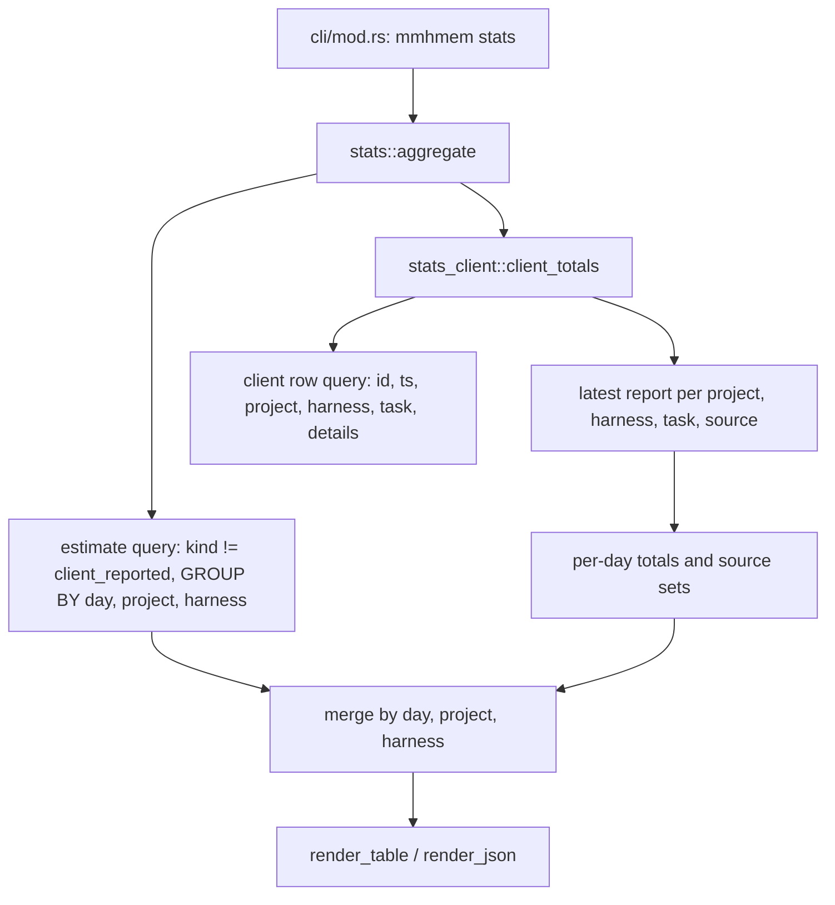
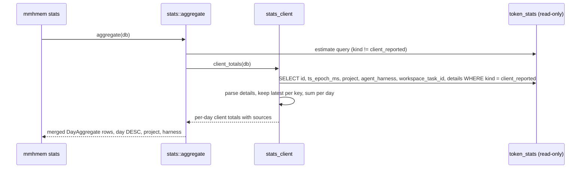

# Design Document: client-usage-stats

## Overview

**Purpose:** Make `mmhmem stats` report the frontier usage that harnesses
send through `client_usage`. The report must label it as tokens spent, count
repeated reports once, and work on stores that already hold client rows.

**Users:** Developers who compare real frontier spend with mmhmem's savings
estimates, and scripts that read `mmhmem stats --json`.

**Impact:** The stats command gains a second read: client-reported rows,
parsed from their stored details and reduced to the latest report per
project, harness, workspace task and source. The client "avoided" column and
JSON field are replaced by frontier prompt and completion values plus a
source list. The `client_usage` contract text says that a report is a
cumulative task total. Nothing on the write path changes.

### Goals

- Client-reported prompt and completion tokens appear per day, project and
  harness, from existing rows, with no migration.
- Repeated cumulative reports are counted once.
- Labels never present spent tokens as avoided.

### Non-Goals

- Schema changes, new columns, or rewriting stored rows.
- Changes to estimate rows, worker token columns, audit events or OTel.
- Detecting whether a harness sends deltas instead of totals.

## Boundary Commitments

### This Spec Owns

- Client-row aggregation for `mmhmem stats`: reading, parsing, latest-report
  selection, per-day totals and source lists.
- The stats table columns and the `--json` field names for client-reported
  values.
- The `client_usage` wording in the `session_resume_or_handoff` tool
  description, `ClientUsageParam` docs, the `stats.rs` module docs and the
  unified-memory skill.
- Amendment notes in cross-agent-memory-server Requirement 10.4 and
  local-mode Requirements 8.2 and 8.4.

### Out of Boundary

- `StatsCollector::record_client_usage` and every other writer. Rows keep
  their current shape.
- The estimate aggregation semantics (estimates stay summed per day,
  project and harness).
- The E2E measurement suite, which keeps sending one report per task.
- `mmhmem stats` argument parsing and the read-only store opening.

### Allowed Dependencies

- `rusqlite` and `serde_json`, already dependencies of the crate.
- `Db::with_conn` on a read-only `Db`.
- No new crates, no SQLite JSON functions.

### Revalidation Triggers

- Any change to the `details` keys written by `record_client_usage`
  (`prompt_tokens`, `completion_tokens`, `source`).
- Any change to the `--json` field names defined here.
- A harness integration that reports deltas rather than cumulative totals.

## Architecture

### Existing Architecture Analysis

- `stats::aggregate` runs one `GROUP BY` query over all `token_stats` rows.
  Its client column sums `avoided_input_tokens_est`, which server-written
  client rows set to 0.
- `DayAggregate` and `Totals` define the JSON contract through serde field
  names. `render_table` uses fixed 7-column arrays.

### Architecture Pattern & Boundary Map



- **Pattern:** two independent reads merged by key. The estimate query stays
  in SQL. Client rows are reduced in Rust.
- **New component rationale:** `src/cli/stats_client.rs` keeps the
  client logic out of `stats.rs`, which is near the 500-line cap.
- **Steering compliance:** no schema change, read-only store, size and
  complexity caps respected.

### Technology Stack

| Layer | Choice / Version | Role in Feature | Notes |
|---|---|---|---|
| CLI | Rust, existing `mmhmem stats` | Aggregation and rendering | Unchanged entrypoint |
| Data | SQLite via `rusqlite` (bundled) | Read client rows | Plain `SELECT`, no JSON functions |
| Parsing | `serde_json` | Parse `details` per row | Malformed rows degrade to zeros |

## File Structure Plan

### Directory Structure

```
src/cli/
├── stats.rs           # MODIFIED: estimate query without the client sum; DayAggregate/Totals fields; merge; 8-column table
└── stats_client.rs    # NEW: client row read, details parsing, latest-report selection, per-day totals
tests/
└── stats_cli.rs       # MODIFIED: client rows written through StatsCollector::record_client_usage
```

### Modified Files

- `src/cli/mod.rs`: declares the `stats_client` module. No behaviour change.
- `src/cli/stats.rs`: drops the client `SUM` from `AGGREGATE_SQL` and adds
  `kind != client_reported` to it. It calls `stats_client::client_totals`
  and merges by (day, project, harness). Rows that only one side has get
  zeros for the other side. It replaces `avoided_client` with three fields
  and widens the table to 8 columns. Its unit tests switch to the new fields
  and production-shaped client rows.
- `src/mcp/tools.rs`: the `session_resume_or_handoff` description says
  `client_usage` is the harness's cumulative frontier usage for the task.
- `src/mcp/params.rs`: `ClientUsageParam` docs say the same.
- `src/services/stats.rs`: the module doc says "cumulative per task" instead
  of "deltas".
- `deploy/skills/unified-memory/SKILL.md`: "Include `client_usage` only when
  reported: cumulative task totals." The packaged copy in
  `plugins/unified-memory/skills/unified-memory/SKILL.md` is regenerated
  with the marketplace build script.
- `.kiro/specs/cross-agent-memory-server/requirements.md` and
  `.kiro/specs/local-mode/requirements.md`: dated amendment notes under
  Requirement 10.4 and Requirements 8.2 and 8.4, pointing to this spec.

## System Flows



- Latest report: highest `ts_epoch_ms`, then highest `id`.
- Day attribution: the UTC day of the counted report's `ts_epoch_ms`.
- A row whose `details` is missing, not JSON, or lacks a numeric value
  contributes 0 for that value. A missing `source` is keyed and listed as
  `unlabelled`.

## Requirements Traceability

| Requirement | Summary | Components | Interfaces | Flows |
|---|---|---|---|---|
| 1.1 | Report client prompt and completion per day, project, harness | stats_client, merge in stats.rs | `client_totals`, `DayAggregate` | Aggregate flow |
| 1.2 | Existing rows work without migration | stats_client reads stored details | client row query | Aggregate flow |
| 1.3 | Missing value counts as 0 | `parse_details` | `ClientReport` | Degrade rule |
| 1.4 | Estimates and client values kept apart | Estimate query excludes client kind | `AGGREGATE_SQL` | Aggregate flow |
| 1.5 | Read-only store | Unchanged `Db::open_read_only` caller, SELECT only | `aggregate` | — |
| 2.1 | Labelled as frontier spent | Table headers and JSON names | `TABLE_HEADERS`, serde names | Render |
| 2.2 | Estimates stay labelled | Existing estimate header | `TABLE_HEADERS` | Render |
| 2.3 | JSON lists sources per row | `client_reported_sources` field | `DayAggregate` | Render |
| 3.1 | Cumulative contract in descriptions and skill | tools.rs, params.rs, SKILL.md | Tool description | — |
| 3.2 | Latest report per key counted | `latest_per_key` | `ReportKey` | Latest rule |
| 3.3 | Different task or source counted separately | `ReportKey` fields | `ReportKey` | Latest rule |
| 3.4 | Day of the counted report | `day_of(ts)` | `client_totals` | Day attribution |
| 3.5 | Storage and audit unchanged | Write path untouched | — | — |
| 4.1 | New JSON fields replace the old one | `DayAggregate`, `Totals` | serde names | Render |
| 4.2 | Other JSON fields unchanged | Existing serde names kept | `DayAggregate`, `Totals` | Render |
| 4.3 | Two table columns, in TOTAL row | 8-column table | `render_table` | Render |
| 5.1 | Tests use the production write path | tests/stats_cli.rs, stats.rs tests | `StatsCollector::record_client_usage` | — |
| 5.2 | Test cases for repeats, keys, missing values, existing rows | stats_client tests, stats_cli tests | — | — |

## Components and Interfaces

| Component | Layer | Intent | Req Coverage | Key Dependencies | Contracts |
|---|---|---|---|---|---|
| stats_client | CLI | Reduce client rows to per-day totals | 1.1, 1.2, 1.3, 1.5, 3.2, 3.3, 3.4 | rusqlite, serde_json (P0) | Service |
| stats merge and render | CLI | Combine estimates and client totals, render | 1.1, 1.4, 2.1, 2.2, 2.3, 4.1, 4.2, 4.3 | stats_client (P0) | Service, API |
| contract wording | MCP and skill | State cumulative semantics | 3.1 | Marketplace build (P1) | — |

### CLI

#### stats_client (`src/cli/stats_client.rs`)

| Field | Detail |
|---|---|
| Intent | Read client-reported rows and return per-day, per-project, per-harness client totals |
| Requirements | 1.1, 1.2, 1.3, 1.5, 3.2, 3.3, 3.4 |

##### Service Interface

```rust
/// Identifies one stream of cumulative reports.
#[derive(Debug, Clone, PartialEq, Eq, Hash, PartialOrd, Ord)]
pub struct ReportKey {
    pub project: String,
    pub harness: String,
    pub task: Option<String>,
    pub source: String,           // "unlabelled" when absent
}

/// One parsed client-reported row.
#[derive(Debug, Clone, PartialEq, Eq)]
pub struct ClientReport {
    pub id: i64,
    pub ts_epoch_ms: i64,
    pub key: ReportKey,
    pub prompt_tokens: i64,       // 0 when missing or not a non-negative integer
    pub completion_tokens: i64,
}

/// Per (day, project, harness) client totals.
#[derive(Debug, Clone, PartialEq, Eq)]
pub struct ClientDay {
    pub day: String,              // YYYY-MM-DD, UTC
    pub project: String,
    pub harness: String,
    pub prompt_tokens: i64,
    pub completion_tokens: i64,
    pub sources: Vec<String>,     // sorted, distinct
}

/// Parses one row's details; never fails.
pub fn parse_details(details: Option<&str>) -> (i64, i64, String);

/// Keeps the latest report per key (highest ts, then highest id).
pub fn latest_per_key(reports: Vec<ClientReport>) -> Vec<ClientReport>;

/// Reads all client rows (SELECT only) and returns per-day totals.
pub async fn client_totals(db: &Db) -> anyhow::Result<Vec<ClientDay>>;
```

- Preconditions: none. Any `details` content is accepted.
- Postconditions: each `ReportKey` contributes exactly once, on the UTC day
  of its latest report.
- Invariant: no writes. The function issues only `SELECT`.

#### stats merge and render (`src/cli/stats.rs`)

##### API Contract (`mmhmem stats --json`)

| Field (day rows and totals) | Meaning | Change |
|---|---|---|
| `day`, `project`, `harness` | Grouping keys (day rows only) | unchanged |
| `avoided_input_tokens_est` | Estimated avoided input tokens | unchanged |
| `frontier_prompt_tokens_client_reported` | Harness-reported frontier prompt tokens | new, replaces `avoided_input_tokens_client_reported` |
| `frontier_completion_tokens_client_reported` | Harness-reported frontier completion tokens | new |
| `client_reported_sources` | Distinct sources behind the client values (day rows only) | new |
| `worker_prompt_tokens`, `worker_completion_tokens` | Worker tokens spent | unchanged |

- Table headers: `DAY`, `PROJECT`, `HARNESS`, `AVOIDED (EST.)`,
  `FRONTIER PROMPT (CLIENT-REPORTED)`, `FRONTIER COMPLETION (CLIENT-REPORTED)`,
  `WORKER PROMPT`, `WORKER COMPLETION`. The TOTAL row sums every numeric
  column.
- Ordering stays day DESC, project, harness.

## Key Decisions

1. **Parse in Rust, not SQL JSON functions.** One malformed row must not
   fail the command (1.3).
2. **Latest report by timestamp, then id.** Ties within one millisecond
   resolve by insertion order (3.2).
3. **Replace, do not keep, the old JSON field.** It never carried a non-zero
   value from server-written rows (4.1). The user accepted this at the
   requirements gate.
4. **Separate module.** Keeps `stats.rs` under the 500-line cap.

## Error Handling

| Condition | Behaviour | Requirement |
|---|---|---|
| `details` NULL or not JSON | Row counts 0 and 0, source `unlabelled` | 1.3 |
| `prompt_tokens` or `completion_tokens` missing, negative or non-integer | That value counts 0 | 1.3 |
| Store missing | Unchanged: existing clear message, exit 0 | 1.5 |
| SQL error | Propagates as today | — |

## Testing Strategy

- **Unit, `stats_client.rs`:**
  - `parse_details` handles complete details, missing keys, non-numeric
    values, negative values, invalid JSON and NULL (1.3).
  - `latest_per_key` keeps the highest timestamp and breaks ties by id
    (3.2), and keeps one report each for different tasks and sources (3.3).
- **Unit, `stats.rs`:**
  - The merge yields zeros on the side a key lacks.
  - Estimates exclude client rows (1.4).
  - Table headers and JSON field names match the contract (2.1, 4.1–4.3).
- **Integration, `tests/stats_cli.rs`:** client rows are written with
  `StatsCollector::record_client_usage` (5.1).
  - Three cumulative reports for one task and source count only the last (3.2).
  - Two tasks and two sources each count (3.3).
  - A report moved to an earlier day by adjusting `ts_epoch_ms` after
    writing is attributed to its own day (3.4).
  - A hand-written row without `completion_tokens` reports prompt only (1.3).
  - `--json` lists the sources (2.3).
  - The store file is unchanged after the command (1.5).
- **Guidance checks:** `check-routing-guidance.py`, `check-marketplace.py`
  and `check-checkpoint-guidance.py` pass after the skill change, with the
  packaged copy regenerated (3.1).
