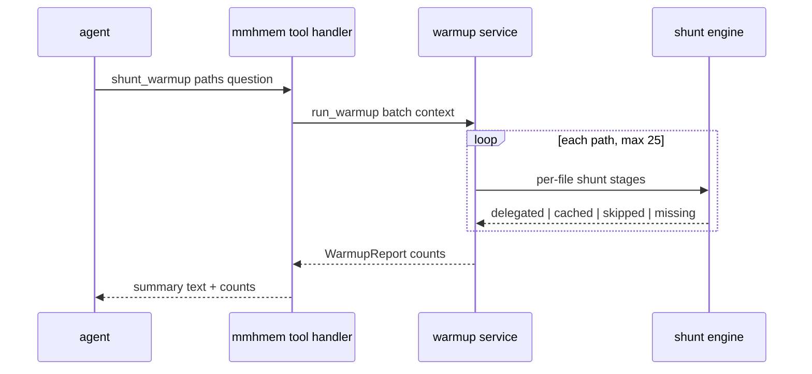

# Design Document

## Overview
**Purpose**: This feature makes the token-savings corpus instantly real on a new project (agent-triggered warmup through the real shunt path) and removes dead shunt-cache weight after big refactors (staleness-based pruning on the CLI and as a tool).

**Users**: Agents in any harness (two new tools), operators (`mmhmem prune`), maintainers (same gates).

**Impact**: The MCP tool surface grows from six to eight tools, identical in serve and local modes (shared handlers — parity by construction, Req 5.2). No schema changes, no new dependencies. The pre-existing suite passes unmodified; this repo's own local-mode tests that pinned the six-tool list are updated (Req 5.4).

### Goals
- `shunt_warmup`: honest corpus bootstrap — real delegation, real cache rows, real statistics rows (Req 1.2), batch-capped, skip/miss tolerant.
- `prune` CLI + `shunt_prune` tool: remove only provably stale cache rows (file missing or content hash changed), with preview modes (Req 3, 4).
- Playbook offers the warmup in one line (Req 2.1); docs list the new surfaces (Req 5.3).

### Non-Goals
- TTL/size-based cache eviction; synthetic statistics rows; schema changes; auto-prune triggers; deleting anything beyond stale cache rows.

## Boundary Commitments

### This Spec Owns
- The warmup orchestration (batch handling, cap, per-file outcomes, report) in `services/warmup.rs` and its tool handler in the MCP layer.
- The stale-scan and deletion logic in `services/prune.rs` plus the `prune` CLI entry in `src/cli/`.
- The tool registrations, help text, README, and SKILL.md playbook line.
- New and updated tests (including the local-mode tool-count assertions).

### Out of Boundary
- The per-file shunt stages (confine, threshold, security bypass, cache lookup, worker delegation, statistics recording) — reused as-is from `services/shunt.rs`.
- The storage layer — tables and pragmas unchanged; prune deletes rows through the existing connection discipline.
- The serve-mode HTTP surface, deployment artifacts, the installer scripts.

### Allowed Dependencies
- Existing services (`shunt`, `shunt_cache`, `stats`), storage (`Db`), audit writer — via their existing public APIs.
- No new crates. `sha2` (already a dependency) for prune's content comparison.

### Revalidation Triggers
- Any change to the shunt cache key shape (file, content hash, fingerprint) → warmup and prune re-run their suites.
- Any change to tool-router registration order or `tools/list` shape → update the tool-count assertions.
- Any statistics-formula change → the honesty tests (estimates labeled) re-run.

## Architecture

### Existing Architecture Analysis
The tool surface is transport-agnostic: `McpServer` (rmcp `ServerHandler`) registers handlers in `mcp/tools.rs` and dispatches into services; both serve and local modes share it, so adding two handlers gives parity for free. `ShuntEngine` already owns the per-file read evaluation: confinement, 150-line threshold (configurable), security-critical bypass, content-hash cache lookup keyed on (file, content_sha256, query_fingerprint), worker delegation, and the `token_stats` recording (`shunt_delegated` / `shunt_cache_hit`, estimates labeled). The audit writer records per-action events. The CLI (`main.rs` match → runner modules) already has the `stats` pattern for a store-optional, read-mostly report command.

### Architecture Pattern & Boundary Map
No new architecture: two service modules behind the existing service layer, two thin tool handlers, one thin CLI runner. Dependency direction unchanged (`mcp` → `services` → `storage`).

### Technology Stack
Unchanged — no new layers. Rust, rmcp (both transports already enabled), rusqlite (bundled), sha2.

## File Structure Plan

### Directory Structure
```
src/
├── cli/
│   ├── (mod.rs)           # modified: prune entry point (run_prune)
│   └── prune.rs           # NEW: mmhmem prune — stale-cache report + deletion
├── services/
│   ├── prune.rs           # NEW: stale-scan + delete + audit summary
│   └── warmup.rs          # NEW: batch orchestration + WarmupReport
├── mcp/
│   └── (tools.rs)          # modified: shunt_warmup + shunt_prune handlers,
│                           # router entries, tool descriptions
├── services/mod.rs         # modified: pub mod prune; pub mod warmup;
└── (main.rs, lib.rs)       # modified: prune arm + help line
```

### Modified Files
- `src/main.rs` — `prune` dispatch arm (`--dry-run` flag parse).
- `src/lib.rs` — help text gains the `prune` command line.
- `tests/local_stdio.rs` — six-tool count assertions updated to eight (Req 5.4; this repo's own test, not a pre-existing one).
- `tests/multiprocess.rs` — no tool-count pin (verified); untouched.
- `deploy/skills/unified-memory/SKILL.md` — one warmup line, still < 200 tokens.
- `README.md` — eight-tool list, prune in day-to-day operation.

## System Flows

### Warmup (Req 1)

Key decision not visible in the diagram: cache hits require the same query fingerprint, so the tool takes an optional `question` (default: the canonical summarization question the playbook also tells agents to use in `smart_read`), keeping warmup rows and later reads aligned.

### Prune (Req 3, 4)
Scan every cache row: file missing → stale(missing); file present but current content hash ≠ stored hash → stale(changed). Preview mode reports counts only; deletion removes exactly those rows, records one audit summary event, and returns grouped counts. Identical logic behind the CLI and the tool; the tool adds a `dry_run` argument.

## Requirements Traceability

| Requirement | Summary | Components | Interfaces |
|-------------|---------|------------|------------|
| 1.1 | tool exists in both modes | tools.rs handler (shared McpServer) | tool router |
| 1.2 | real delegation + cache + stats | warmup.rs → shunt engine (reused) | WarmupReport |
| 1.3 | cached files count as hits, no worker call | warmup.rs | WarmupReport |
| 1.4 | skips (threshold/security) and misses reported per file | warmup.rs | WarmupReport |
| 1.5 | response summarizes counts + worker tokens | tools.rs render + warmup.rs | WarmupReport |
| 1.6 | batch cap 25 → clear error | warmup.rs | WarmupError |
| 1.7 | no worker → smart_read's error | warmup.rs (engine error passthrough) | WarmupError |
| 1.8 | audited like shunt actions | warmup.rs → AuditWriter | audit event |
| 2.1 | playbook line, < 200 tokens | SKILL.md | docs |
| 3.1 | prune subcommand, stale rows only | cli/prune.rs + services/prune.rs | PruneReport |
| 3.2 | dry-run preview | cli/prune.rs flag | PruneReport |
| 3.3 | grouped report; other tables untouched | services/prune.rs | PruneReport |
| 3.4 | missing store → message, exit 0 | cli/prune.rs | — |
| 3.5 | audit summary event | services/prune.rs → AuditWriter | audit event |
| 3.6 | safe under concurrency (busy timeout, atomic deletes) | services/prune.rs via Db | Db |
| 4.1 | shunt_prune tool, both modes | tools.rs handler | tool router |
| 4.2 | preview mode via dry_run arg | tools.rs + services/prune.rs | PruneReport |
| 4.3 | never removes non-stale data | services/prune.rs | scan predicate |
| 5.1 | pre-existing suite unmodified | additive-only design | CI gate |
| 5.2 | identical serve/local behavior | shared handlers | McpServer |
| 5.3 | help/README/playbook list new surfaces | lib.rs, README.md, SKILL.md | docs |
| 5.4 | local-mode tool-count tests updated | tests/local_stdio.rs | tests |
| 6.1, 6.2, 6.3, 6.4, 6.5 | house caps | clippy.toml + loc_caps gate + task generation | CI gate |

## Components and Interfaces

| Component | Layer | Intent | Req Coverage | Key Dependencies | Contracts |
|-----------|-------|--------|--------------|------------------|-----------|
| Warmup service | services | batch orchestration over the shunt path | 1.2-1.8 | ShuntEngine, AuditWriter (P0) | Service |
| Warmup tool handler | mcp | thin JSON arg mapping + report render | 1.1, 1.5 | warmup service (P0) | Service |
| Prune service | services | stale scan, delete, audit summary | 3.1-3.6, 4.2, 4.3 | Db, AuditWriter (P0) | Service |
| Prune CLI | cli | `mmhmem prune [--dry-run]` | 3.1-3.4 | prune service (P0) | Service |
| Prune tool handler | mcp | thin handler with dry_run arg | 4.1-4.3 | prune service (P0) | Service |
| Docs | docs | playbook + README + help | 2.1, 5.3 | — | — |

### services/warmup.rs
| Field | Detail |
|-------|--------|
| Intent | run a curated file list through the real shunt path, count outcomes |
| Requirements | 1.2, 1.3, 1.4, 1.6, 1.7, 1.8 |

**Responsibilities & Constraints**
- Per file: reuse the shunt engine's evaluation. Outcomes: `delegated` (worker called, cache row + stats row), `cached` (fingerprint + content hit, no worker call), `skipped_below_threshold`, `skipped_security`, `missing` (file unreadable — counted, not fatal). One audit event per warmup batch summarizing the counts (Req 1.8) — per-file events already come from the delegated path.
- Batch cap: `MAX_WARMUP_PATHS = 25`; exceeding → error before any work.
- No worker + any delegable file → the engine's worker-unconfigured error propagates unchanged (Req 1.7).

**Contracts**: Service [x]

```rust
/// Outcome counters for one warmup batch (Req 1.5).
#[derive(Debug, Default, Serialize)]
pub struct WarmupReport {
    pub delegated: u32,
    pub cached: u32,
    pub skipped_below_threshold: u32,
    pub skipped_security: u32,
    pub missing: u32,
    pub worker_prompt_tokens: u64,
    pub worker_completion_tokens: u64,
}

pub const MAX_WARMUP_PATHS: usize = 25;

/// Runs each path through the shunt stages; never fatal on a bad path.
pub async fn run_warmup(
    engine: &ShuntEngine,
    paths: Vec<String>,
    question: &str,
    ctx: /* call context */,
) -> Result<WarmupReport, WarmupError>;
```

**Implementation Notes**
- Validation: unit tests cover cap, cached, skipped, missing, no-worker (orchestration); the delegated path itself is already covered by the shunt/worker suites — one integration test drives a real delegation through a stub worker endpoint.

### services/prune.rs
| Field | Detail |
|-------|--------|
| Intent | find and delete provably stale cache rows |
| Requirements | 3.1, 3.3, 3.5, 3.6, 4.3 |

**Responsibilities & Constraints**
- Staleness predicate: row is stale iff its file_path does not exist, or the file's current SHA-256 ≠ the stored content hash. Only `shunt_file_cache` rows are ever selected or deleted (Req 4.3).
- Deletions run inside the existing short-transaction discipline; the busy timeout bounds contention (Req 3.6). One audit event records the post-run counts by reason (Req 3.5).

**Contracts**: Service [x]

```rust
/// Grouped staleness counts (Req 3.3).
#[derive(Debug, Default, Serialize)]
pub struct PruneReport {
    pub removed_missing: u32,
    pub removed_changed: u32,
    pub kept_fresh: u32,
}

/// Counts stale rows without deleting (preview, Req 3.2/4.2).
pub async fn scan_stale(db: &Db) -> anyhow::Result<PruneReport>;
/// Deletes the stale rows and records the audit summary (Req 3.1/3.5).
pub async fn delete_stale(db: &Db, audit: &AuditWriter, ctx: /* context */) -> anyhow::Result<PruneReport>;
```

### mcp/tools.rs — `shunt_warmup`, `shunt_prune`
| Field | Detail |
|-------|--------|
| Intent | thin handlers: JSON args → service calls → text response |
| Requirements | 1.1, 1.5, 4.1, 4.2, 5.2 |

- `shunt_warmup` args: `{project, agent_harness, paths: [..], question?}`; response: a compact table (per outcome counts + worker tokens) plus a hint when files were skipped (threshold/security reasons are per-file in a details list, capped in the response).
- `shunt_prune` args: `{project, agent_harness, dry_run?}`; response: grouped counts, marked PREVIEW when `dry_run`.
- Registered in the shared router; descriptions match the existing style; `tools/list` grows to eight.

### cli/prune.rs
| Field | Detail |
|-------|--------|
| Intent | `mmhmem prune [--dry-run]` against the local profile store |
| Requirements | 3.1-3.4 |

- Store missing → clear message, exit 0 (mirror of the stats contract). Store present → open read-write, run scan (dry-run) or delete, print the grouped report. Help line in `lib.rs`.

## Data Models
No DDL change. `WarmupReport`/`PruneReport` are response-only structs (Serialize for potential JSON reuse). Prune's sha comparison reuses the audit module's SHA-256 helper on file bytes.

## Error Handling
- Warmup: cap exceeded → tool error before side effects; worker-unconfigured → the engine's existing actionable error; per-file misses never abort the batch (Req 1.4).
- Prune: unreadable file during hashing → treated as stale-missing (the row can never be served); store busy beyond the timeout → the existing clear store-busy error.
- CLI: missing store → friendly exit 0; other failures → error + exit 1.

## Testing Strategy
- Unit (`services/warmup.rs`): cap error; seeded cache → cached count; below-threshold and security skips; missing file counted; no-worker error propagation.
- Unit (`services/prune.rs`): seeded rows (fresh, changed, missing-file) → scan counts correct; delete removes exactly the stale ones; audit event recorded; fresh rows survive.
- Integration (`tests/warmup_prune.rs`): stdio child + in-test stub worker → `shunt_warmup` with one big file delegates for real (delegated=1, worker tokens > 0, `shunt_delegated` stats row exists); `shunt_prune` dry_run then real run against a seeded stale row; `mmhmem prune` CLI child with a temp store (report, rows gone, dry-run no-op, missing-store message); `tools/list` returns all eight tools.
- Regression: full suite green; pre-existing tests untouched (`git diff` proof at final validation); `tests/local_stdio.rs` count assertions updated to eight.

## Security Considerations
- Warmup honors confinement and the security-critical bypass (it reuses the shunt stages — no new path handling).
- Prune reads files only to hash them; it deletes only cache rows, never observations/stats/sessions; audited.
- No new network egress: warmup uses the existing worker endpoint only.

## Migration Strategy
None — no schema or data changes; new tools appear with the binary.
