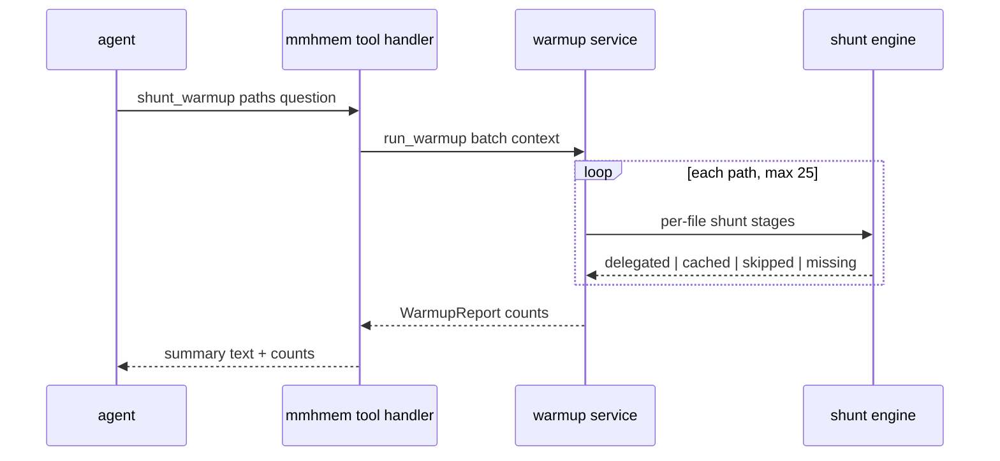

# Design Document

## Overview
**Purpose**: This feature makes the token-savings corpus instantly real on a new project (agent-triggered warmup through the real shunt path) and removes dead shunt-cache weight after big refactors (staleness-based pruning on the CLI and as a tool).

**Users**: Agents in any harness (two new tools), operators (`mmhmem prune`), maintainers (same gates).

**Impact**: The MCP tool surface grows from six to nine tools, identical in serve and local modes (shared handlers — parity by construction, Req 5.2). No schema changes, no new dependencies. The local installers additionally write `.mmhmem.json` (Req 7.6) and ship the on-demand `/mmhmem-recap` command templates (Req 9), both through their existing seams. The pre-existing suite passes unmodified; this repo's own local-mode tests that pinned the six-tool list are updated (Req 5.4).

### Goals
- `shunt_warmup`: honest corpus bootstrap — real delegation, real cache rows, real statistics rows (Req 1.2), batch-capped, skip/miss tolerant.
- `prune` CLI + `shunt_prune` tool: remove only provably stale cache rows (file missing or content hash changed), with preview modes (Req 3, 4).
- `mem_search_breadcrumbs`: keyword search over the project's breadcrumb history — literal substring, no FTS index, no schema change (Req 10).
- `/mmhmem-recap`: installer-shipped, on-demand session-recap command for Claude Code and OpenCode — no hooks, no store access (Req 9).
- Playbook offers the warmup in one line and carries the recap wording (Req 2.1, 9.6); docs list the new surfaces (Req 5.3).

### Non-Goals
- TTL/size-based cache eviction; synthetic statistics rows; schema changes; auto-prune triggers; deleting anything beyond stale cache rows; automatic recap triggers or hooks of any kind (the recap is strictly on-demand); full-text indexing of breadcrumbs (a substring scan is the honest size of that problem).

## Boundary Commitments

### This Spec Owns
- The warmup orchestration (batch handling, cap, per-file outcomes, report) in `services/warmup.rs` and its tool handler in the MCP layer.
- The stale-scan and deletion logic in `services/prune.rs` plus the `prune` CLI entry in `src/cli/`.
- The `.mmhmem.json` loader (`config/mmhmem_file.rs`) and the installers' write side of that contract (Req 7.1-7.6).
- The breadcrumb search service (`services/breadcrumbs.rs`) and its thin tool handler (Req 10).
- The `deploy/commands/` recap templates and the installers' copy/remove/dry-run wiring for them (Req 9).
- The tool registrations, help text, README, and SKILL.md playbook lines.
- New and updated tests (including the local-mode tool-count assertions).

### Out of Boundary
- The per-file shunt stages (confine, threshold, security bypass, cache lookup, worker delegation, statistics recording) — reused as-is from `services/shunt.rs`.
- The storage layer — tables and pragmas unchanged; prune deletes rows through the existing connection discipline.
- The serve-mode HTTP surface and the deployment artifacts beyond `deploy/commands/`; the installer scripts' pre-existing behavior is untouched except the `.mmhmem.json` write (Req 7.6) and the recap command-template copy/remove (Req 9), both mirroring their existing skill-copy seams.

### Allowed Dependencies
- Existing services (`shunt`, `shunt_cache`, `stats`), storage (`Db`), audit writer — via their existing public APIs.
- No new crates. `sha2` (already a dependency) for prune's content comparison.

### Revalidation Triggers
- Any change to the shunt cache key shape (file, content hash, fingerprint) → warmup and prune re-run their suites.
- Any change to tool-router registration order or `tools/list` shape → update the tool-count assertions.
- Any statistics-formula change → the honesty tests (estimates labeled) re-run.

## Architecture

### Existing Architecture Analysis
The tool surface is transport-agnostic: `McpServer` (rmcp `ServerHandler`) registers handlers in `mcp/tools.rs` and dispatches into services; both serve and local modes share it, so adding three handlers gives parity for free. `ShuntEngine` already owns the per-file read evaluation: confinement, 150-line threshold (configurable), security-critical bypass, content-hash cache lookup keyed on (file, content_sha256, query_fingerprint), worker delegation, and the `token_stats` recording (`shunt_delegated` / `shunt_cache_hit`, estimates labeled). The audit writer records per-action events. The CLI (`main.rs` match → runner modules) already has the `stats` pattern for a store-optional, read-mostly report command.

### Architecture Pattern & Boundary Map
No new architecture: three service modules behind the existing service layer (warmup, prune, breadcrumbs), one config loader module, three thin tool handlers, one thin CLI runner, two installer-side file additions. Dependency direction unchanged (`mcp` → `services` → `storage`).

### Technology Stack
Unchanged — no new layers. Rust, rmcp (both transports already enabled), rusqlite (bundled), sha2.

## File Structure Plan

### Directory Structure
```
src/
├── cli/
│   ├── (mod.rs)           # modified: prune entry point (run_prune)
│   └── prune.rs           # NEW: mmhmem prune — stale-cache report + deletion
├── config/
│   └── mmhmem_file.rs     # NEW: .mmhmem.json loader (global + project, JSON)
├── services/
│   ├── breadcrumbs.rs     # NEW: breadcrumb history search (literal substring)
│   ├── prune.rs           # NEW: stale-scan + delete + audit summary
│   └── warmup.rs          # NEW: batch orchestration + WarmupReport
├── mcp/
│   ├── (tools.rs)          # modified: shunt_warmup + shunt_prune +
│   │                       # mem_search_breadcrumbs handlers, router entries,
│   │                       # tool descriptions, worker-unconfigured session
│   │                       # notice (Req 8)
│   └── (params.rs)         # modified: WarmupParams, PruneParams,
│                           # BreadcrumbSearchParams
├── services/mod.rs         # modified: pub mod breadcrumbs; pub mod prune; pub mod warmup;
└── (main.rs, lib.rs)       # modified: prune arm + help line
deploy/
├── commands/
│   ├── claude/mmhmem-recap.md    # NEW: /mmhmem-recap template (Req 9)
│   └── opencode/mmhmem-recap.md  # NEW: /mmhmem-recap template (Req 9)
├── (install_local.sh, install_local.ps1)  # modified: .mmhmem.json write
│                                           # (Req 7.6) + recap command
│                                           # copy/remove/dry-run (Req 9)
└── skills/unified-memory/(SKILL.md)       # modified: warmup + recap lines
```

### Modified Files
- `src/main.rs` — `prune` dispatch arm (`--dry-run` flag parse).
- `src/lib.rs` — help text gains the `prune` command line and the ninth tool.
- `src/config.rs` — module root: `mod mmhmem_file;` declaration + re-export, `ConfigError::InvalidMmhmemFile` variant (enum lives here, research.md F3).
- `src/config/profile.rs` — `Config::load_local` gains the merged env→project-file→global-file lookup closure (Req 7.1); `from_env_local`'s pure parsing is reused unchanged (research.md F2).
- `src/mcp/server.rs` — `Services` gains the breadcrumb-search service field + one construction line in `AppState::build` (research.md F3).
- `src/services/mod.rs` — `pub mod breadcrumbs; pub mod prune; pub mod warmup;`.
- `src/mcp/params.rs` — three new parameter structs (warmup, prune, breadcrumb search).
- `tests/local_stdio.rs` — six-tool count assertions updated to nine (Req 5.4; this repo's own test, not a pre-existing one).
- `tests/audit_redaction.rs` — event-type count 15→16 after the new `WARMUP` batch event (Req 1.8; this repo's own test, a declared spec-driven update).
- `tests/shunt.rs` — the `ReadOutcome::Shunted` match gains `..` for the new `usage` field (Req 1.5; declared spec-driven update).
- `tests/multiprocess.rs` — no tool-count pin (verified, research.md F5); untouched.
- `deploy/install_local.sh` + `deploy/install_local.ps1` — worker config moves from env embedding to `.mmhmem.json` writing with file-pointing notices (Req 7.6); recap command copy/remove/dry-run (Req 9).
- `deploy/skills/unified-memory/SKILL.md` — one warmup line + one recap line, still < 200 tokens.
- `README.md` — nine-tool list, prune + recap in day-to-day operation, `.mmhmem.json` section.

## System Flows

### Warmup (Req 1)

Key decision not visible in the diagram: cache hits require the same query fingerprint, so the tool takes an optional `question` (default: the canonical summarization question the playbook also tells agents to use in `smart_read`), keeping warmup rows and later reads aligned.

### Prune (Req 3, 4)
Scan every cache row: file missing → stale(missing); file present but current content hash ≠ stored hash → stale(changed). Preview mode reports counts only; deletion removes exactly those rows, records one audit summary event, and returns grouped counts. Identical logic behind the CLI and the tool; the tool adds a `dry_run` argument.

### Breadcrumb search (Req 10)
Project-scoped literal-substring scan over `session_breadcrumbs` (tool name, target resource, action summary), LIKE wildcards escaped, `ORDER BY created_at_epoch DESC, id DESC`, limit clamped (default 20, max 100), optional harness filter; blank query lists the project's crumbs newest first (the `mem_search` blank-query precedent). Read-only: no row in any table changes; one audit event + its own breadcrumb per call (mem_search parity). Deliberately no FTS index and no schema change — crumbs are short, recent-biased, per-project rows; a scan under `idx_breadcrumbs_proj` is the honest size of the problem.

### Recap command (Req 9)
Static templates in `deploy/commands/{claude,opencode}/mmhmem-recap.md`; the installers copy them into the harness's command directory (user-global or project scope, mirroring the skill-copy seam), `--remove` removes them, `--dry-run` lists them. Invoking `/mmhmem-recap` makes the agent call `session_resume_or_handoff` WITHOUT `updated_working_state_md` and present the returned working state, objective, and breadcrumbs as a recap. No hooks, no server changes, no store writes; the recap works identically after `/clear`, a client restart, or a fresh MCP connection because the session state is SQLite-backed.

## Requirements Traceability

| Requirement | Summary | Components | Interfaces |
|-------------|---------|------------|------------|
| 1.1 | tool exists in both modes | tools.rs handler (shared McpServer) | tool router |
| 1.2 | real delegation + cache + stats | warmup.rs → shunt engine (reused) | WarmupReport |
| 1.3 | cached files count as hits, no worker call | warmup.rs | WarmupReport |
| 1.4 | skips (threshold/security) and misses reported per file | warmup.rs | WarmupReport |
| 1.5 | response summarizes counts + worker tokens | tools.rs render + warmup.rs | WarmupReport |
| 1.6 | batch cap 25 → clear error | warmup.rs | WarmupError |
| 1.7 | no worker → smart_read's error | warmup.rs (engine error passthrough) | WarmupError |
| 1.8 | audited like shunt actions | warmup.rs → AuditWriter | audit event |
| 2.1 | playbook line, < 200 tokens | SKILL.md | docs |
| 3.1 | prune subcommand, stale rows only | cli/prune.rs + services/prune.rs | PruneReport |
| 3.2 | dry-run preview | cli/prune.rs flag | PruneReport |
| 3.3 | grouped report; other tables untouched | services/prune.rs | PruneReport |
| 3.4 | missing store → message, exit 0 | cli/prune.rs | — |
| 3.5 | audit summary event | services/prune.rs → AuditWriter | audit event |
| 3.6 | safe under concurrency (busy timeout, atomic deletes) | services/prune.rs via Db | Db |
| 4.1 | shunt_prune tool, both modes | tools.rs handler | tool router |
| 4.2 | preview mode via dry_run arg | tools.rs + services/prune.rs | PruneReport |
| 4.3 | never removes non-stale data | services/prune.rs | scan predicate |
| 5.1 | pre-existing suite unmodified | additive-only design | CI gate |
| 5.2 | identical serve/local behavior | shared handlers | McpServer |
| 5.3 | help/README/playbook list new surfaces | lib.rs, README.md, SKILL.md | docs |
| 5.4 | local-mode tool-count tests updated | tests/local_stdio.rs | tests |
| 6.1, 6.2, 6.3, 6.4, 6.5 | house caps | clippy.toml + loc_caps gate + task generation | CI gate |
| 7.1 | env > project > global > defaults per setting | config/mmhmem_file.rs + Config::load_local | MmhmemFile |
| 7.2 | no file / absent setting → unchanged defaults | config/mmhmem_file.rs | Option-based merge |
| 7.3 | invalid JSON → fail fast naming the file | config/mmhmem_file.rs | ConfigError::InvalidMmhmemFile |
| 7.4 | serve stays environment-only | from_env untouched (local-only loader) | Profile |
| 7.5 | worker API key never logged | config.rs Debug redaction | Debug impl |
| 7.6 | installers write .mmhmem.json, notices point to it | install_local.sh/.ps1 | JSON merge helpers |
| 7.7 | docs + .gitignore ignore .mmhmem.json | README.md, .gitignore | docs |
| 8.1 | worker-unconfigured session-start notice | tools.rs session handler (state.services worker presence) | response text |
| 8.2 | notice absent when worker configured | tools.rs session handler | response text |
| 9.1 | templates under deploy/commands, resume-call content | deploy/commands templates | static markdown |
| 9.2 | claude template → .claude/commands/ per scope | install_local.sh/.ps1 copy seam | file copy |
| 9.3 | opencode template → .opencode/command/ per scope | install_local.sh/.ps1 copy seam | file copy |
| 9.4 | no command changes for desktop/antigravity; playbook carries it | installers + SKILL.md | docs |
| 9.5 | remove removes templates only; dry-run lists actions | installers remove/dry-run seams | file remove |
| 9.6 | playbook recap line within token cap | SKILL.md | docs |
| 10.1 | tool exists in both modes | tools.rs handler (shared McpServer) | tool router |
| 10.2 | substring search, newest first, limit default 20/max 100, blank lists all | services/breadcrumbs.rs | CrumbRow |
| 10.3 | optional harness filter | services/breadcrumbs.rs | SQL filter |
| 10.4 | clear no-match message | tools.rs render | response text |
| 10.5 | read-only over stored rows; audit + crumb per call | services/breadcrumbs.rs | audit event |

## Components and Interfaces

| Component | Layer | Intent | Req Coverage | Key Dependencies | Contracts |
|-----------|-------|--------|--------------|------------------|-----------|
| Warmup service | services | batch orchestration over the shunt path | 1.2-1.8 | ShuntEngine, AuditWriter (P0) | Service |
| Warmup tool handler | mcp | thin JSON arg mapping + report render | 1.1, 1.5 | warmup service (P0) | Service |
| Prune service | services | stale scan, delete, audit summary | 3.1-3.6, 4.2, 4.3 | Db, AuditWriter (P0) | Service |
| Prune CLI | cli | `mmhmem prune [--dry-run]` | 3.1-3.4 | prune service (P0) | Service |
| Prune tool handler | mcp | thin handler with dry_run arg | 4.1-4.3 | prune service (P0) | Service |
| MmhmemFile loader | config | read + merge `.mmhmem.json` worker settings | 7.1-7.3, 7.5 | serde, fs (P0) | Service |
| Installer config write | deploy | installers write `.mmhmem.json`, notices point to it | 7.6 | installers (P0) | — |
| Breadcrumb search service | services | literal-substring search over session_breadcrumbs | 10.2, 10.3, 10.5 | Db, AuditWriter, SessionBus (P0) | Service |
| Breadcrumb search handler | mcp | thin args → rows render | 10.1, 10.2, 10.4 | breadcrumbs service (P0) | Service |
| Recap command templates | deploy | installer-copied on-demand recap | 9.1-9.5 | installers (P0) | — |
| Docs | docs | playbook + README + help | 2.1, 5.3, 9.6 | — | — |

### services/warmup.rs
| Field | Detail |
|-------|--------|
| Intent | run a curated file list through the real shunt path, count outcomes |
| Requirements | 1.2, 1.3, 1.4, 1.6, 1.7, 1.8 |

**Responsibilities & Constraints**
- Per file: reuse the shunt engine's evaluation. Outcomes: `delegated` (worker called, cache row + stats row), `cached` (fingerprint + content hit, no worker call), `skipped_below_threshold`, `skipped_security`, `missing` (file not found or unreadable — counted, not fatal), `denied` (path outside the allowed roots — the per-file denial is already audited by the shunt path; counted, not fatal), `failed` (worker call failed for this file — counted so one flaky call cannot waste the tokens already spent on the rest of the batch). One audit event per warmup batch summarizing the counts (Req 1.8) — per-file events already come from the delegated path.
- Batch cap: `MAX_WARMUP_PATHS = 25`; exceeding → error before any work.
- No worker + any delegable file → the engine's worker-unconfigured error propagates unchanged (whole-batch error, Req 1.7).
- Error mapping (fresh-verified against `ShuntError`, research.md F1): `FileNotFound`/`Io` → `missing`; `OutsideAllowedRoots` → `denied`; `Worker(String)` → `failed` (batch continues); `WorkerNotConfigured` → propagate (Req 1.7).

**Contracts**: Service [x]

```rust
/// Outcome counters for one warmup batch (Req 1.5).
#[derive(Debug, Default, Serialize)]
pub struct WarmupReport {
    pub delegated: u32,
    pub cached: u32,
    pub skipped_below_threshold: u32,
    pub skipped_security: u32,
    pub missing: u32,
    pub denied: u32,
    pub failed: u32,
    pub worker_prompt_tokens: u64,
    pub worker_completion_tokens: u64,
}

pub const MAX_WARMUP_PATHS: usize = 25;

/// Runs each path through the shunt stages; never fatal on a bad path.
/// The shared audit writer records one WARMUP batch summary (Req 1.8).
pub async fn run_warmup(
    engine: &ShuntEngine,
    audit: &AuditWriter,
    paths: Vec<String>,
    question: &str,
    ctx: /* call context */,
) -> Result<WarmupReport, WarmupError>;
```

**Implementation Notes**
- Validation: unit tests cover cap, cached, skipped, missing, denied, failed, no-worker (orchestration); the delegated path itself is already covered by the shunt/worker suites — one integration test drives a real delegation through a stub worker endpoint.
- The response render labels `missing`/`denied`/`failed` separately — together they are AC 1.5's "failed count", each with its reason visible.

### services/prune.rs
| Field | Detail |
|-------|--------|
| Intent | find and delete provably stale cache rows |
| Requirements | 3.1, 3.3, 3.5, 3.6, 4.3 |

**Responsibilities & Constraints**
- Staleness predicate: row is stale iff its file_path does not exist, or the file's current SHA-256 ≠ the stored content hash. Only `shunt_file_cache` rows are ever selected or deleted (Req 4.3).
- Deletions run inside the existing short-transaction discipline; the busy timeout bounds contention (Req 3.6). One audit event records the post-run counts by reason (Req 3.5).

**Contracts**: Service [x]

```rust
/// Grouped staleness counts (Req 3.3).
#[derive(Debug, Default, Serialize)]
pub struct PruneReport {
    pub removed_missing: u32,
    pub removed_changed: u32,
    pub kept_fresh: u32,
}

/// Counts stale rows without deleting (preview, Req 3.2/4.2).
pub async fn scan_stale(db: &Db) -> anyhow::Result<PruneReport>;
/// Deletes the stale rows and records the audit summary (Req 3.1/3.5).
pub async fn delete_stale(db: &Db, audit: &AuditWriter, ctx: /* context */) -> anyhow::Result<PruneReport>;
```

### mcp/tools.rs — `shunt_warmup`, `shunt_prune`, `mem_search_breadcrumbs`
| Field | Detail |
|-------|--------|
| Intent | thin handlers: JSON args → service calls → text response |
| Requirements | 1.1, 1.5, 4.1, 4.2, 5.2, 8.1, 8.2, 10.1, 10.2, 10.4 |

- `shunt_warmup` args: `{project, agent_harness, paths: [..], question?}`; response: a compact table (per outcome counts + worker tokens) plus a hint when files were skipped (threshold/security reasons are per-file in a details list, capped in the response).
- `shunt_prune` args: `{project, agent_harness, dry_run?}`; response: grouped counts, marked PREVIEW when `dry_run`.
- `mem_search_breadcrumbs` args: `{project, agent_harness, query, harness?, limit?}`; response: newest-first list (timestamp, harness, tool, resource, summary) or a clear no-match message.
- Session-start notice: the `session_resume_or_handoff` resume path appends a one-line worker-unconfigured notice naming the missing setting and `.mmhmem.json` when no worker model is configured (Req 8.1); absent when one is (Req 8.2). No other response content changes.
- Registered in the shared router; descriptions match the existing style; `tools/list` grows to nine.

### cli/prune.rs
| Field | Detail |
|-------|--------|
| Intent | `mmhmem prune [--dry-run]` against the local profile store |
| Requirements | 3.1-3.4 |

- Store missing → clear message, exit 0 (mirror of the stats contract). Store present → open read-write, run scan (dry-run) or delete, print the grouped report. Help line in `lib.rs`.

### config/mmhmem_file.rs
| Field | Detail |
|-------|--------|
| Intent | read worker settings from `.mmhmem.json` (global + project) for the local profile |
| Requirements | 7.1, 7.2, 7.3, 7.5 |

**Responsibilities & Constraints**
- `MmhmemFile { worker_model, worker_api_url, worker_api_key }` — serde-derived, every field `Option<String>`; absent settings and absent files are normal (Req 7.2).
- `load()` reads the global `~/.mmhmem.json` and the per-project `./.mmhmem.json`; a file that exists but is not valid JSON fails fast at startup with `ConfigError::InvalidMmhmemFile(path)` naming the offending file (Req 7.3).
- Per-setting merge in `Config::load_local`: environment > project file > global file > built-in defaults, computed per setting (Option-based), so a project file may override only the model while inheriting the global key (Req 7.1). Reference seam: `Config::load_local()`/`from_env_local()` in `src/config/profile.rs`; the parser helpers `present()`/`optional()` are reused.
- Serve profile untouched: the loader is called only on the local path (Req 7.4).
- Redaction: the worker API key from any source never appears in logs or diagnostics — `redacted_debug()` treats `worker_api_key` exactly like the bearer token (Req 7.5; the Debug impl is verified by test, not assumed).
- The installers WRITE this file (Req 7.6) — global or project per the scope selection; this loader is the read side of that contract.

**Contracts**: Service [x]

```rust
/// Worker settings from `.mmhmem.json` — every field optional (Req 7.2).
#[derive(Debug, Clone, Default, Deserialize)]
pub struct MmhmemFile {
    pub worker_model: Option<String>,
    pub worker_api_url: Option<String>,
    pub worker_api_key: Option<String>,
}

impl MmhmemFile {
    /// Loads project-over-global; missing files → defaults (Req 7.2).
    /// Invalid JSON → ConfigError::InvalidMmhmemFile naming the file (Req 7.3).
    pub fn load(global: &Path, project: &Path) -> Result<MmhmemFile, ConfigError>;
}
```

**Implementation Notes**
- Validation: unit tests cover the full per-setting precedence matrix, absent-everywhere defaults, invalid-JSON fail-fast naming the file, and Debug-redaction of `worker_api_key`.

### services/breadcrumbs.rs
| Field | Detail |
|-------|--------|
| Intent | keyword search over the project's breadcrumb history, read-only |
| Requirements | 10.2, 10.3, 10.4, 10.5 |

**Responsibilities & Constraints**
- Literal-substring search over `session_breadcrumbs` (tool name, target resource, action summary), project-scoped, `ORDER BY created_at_epoch DESC, id DESC`, limit default 20 clamped to 100 (Req 10.2); a blank query lists all crumbs newest first (the `mem_search` blank-query precedent).
- LIKE wildcards in the query are escaped (`ESCAPE '\'`) so `%`/`_` are literal; stored text is already redacted at write time.
- Optional harness filter restricts matches to one calling harness (Req 10.3); an empty result is rendered as a clear no-match message by the handler (Req 10.4).
- Read-only over stored rows: no UPDATE/DELETE/INSERT into any table (Req 10.5); one audit event per call plus its own breadcrumb — exactly the `mem_search` discipline. Crumbing needs the bus: constructed like `MemoryService::new(db, audit, Some(bus))`, wired in `AppState::build`.
- No FTS index and no schema change, deliberately: crumbs are short, recent-biased, per-project rows; a scan under `idx_breadcrumbs_proj` is the honest size of the problem.

**Contracts**: Service [x]

```rust
/// One matched breadcrumb (Req 10.2).
#[derive(Debug, Clone)]
pub struct CrumbRow {
    pub harness: String,
    pub tool: String,
    pub resource: Option<String>,
    pub summary: String,
    pub created_at_epoch: i64,
}

/// Breadcrumb search input (bundled, house arg-limit style).
pub struct BreadcrumbSearch<'a> {
    pub project: &'a str,
    pub harness: &'a str,
    pub task: Option<&'a str>,
    pub query: &'a str,
    pub filter_harness: Option<&'a str>,
    pub limit: u16,
}

/// Newest-first matching crumbs, limit-clamped (Req 10.2-10.4).
pub async fn search(db: &Db, req: &BreadcrumbSearch<'_>) -> anyhow::Result<Vec<CrumbRow>>;
```

**Implementation Notes**
- Validation: unit tests against a seeded store cover substring matches across all three fields, wildcard escaping, the harness filter, the limit clamp, blank-query listing, no-match, project isolation, and a proof that no existing row changes.

### deploy/commands/ — `/mmhmem-recap` templates + installer seam (Req 9)
| Field | Detail |
|-------|--------|
| Intent | on-demand session recap after a context clear — no hooks |
| Requirements | 9.1, 9.2, 9.3, 9.4, 9.5 |

- Two static templates: `deploy/commands/claude/mmhmem-recap.md` and `deploy/commands/opencode/mmhmem-recap.md`. Description-only frontmatter; body: call `session_resume_or_handoff` WITHOUT `updated_working_state_md` (agent_harness = the template's harness; project = the current project string) and present the returned working state, objective, and breadcrumbs as a concise recap of the last session.
- Installers mirror the existing skill seam (`install_skill`/`Set-Skill`): copy on install — Claude Code to `.claude/commands/`, OpenCode to `.opencode/command/`, user-global or project per the scope selection (Req 9.2, 9.3); `--remove` removes exactly the copied template, never the store or `.mmhmem.json` (Req 9.5); `--dry-run` lists every command-file action (Req 9.5); Claude Desktop and Antigravity get no command files — the playbook carries the recap wording (Req 9.4).
- No server changes: the command only steers the agent toward the existing session tool; it works after `/clear`, client restarts, and fresh MCP connections because session state is SQLite-backed.

## Data Models
No DDL change. `WarmupReport`/`PruneReport`/`CrumbRow` are response-only structs (Serialize for potential JSON reuse). `MmhmemFile` is a read-only serde view of `.mmhmem.json`; the file itself is created by the installers, never by the server. Prune's sha comparison reuses the audit module's SHA-256 helper on file bytes.

## Error Handling
- Warmup: cap exceeded → tool error before side effects; worker-unconfigured → the engine's existing actionable error (whole batch, Req 1.7); per-file `FileNotFound`/`Io`/`OutsideAllowedRoots`/`Worker` failures are counted into the `missing`/`denied`/`failed` buckets and never abort the batch (Req 1.4, research.md F1).
- Prune: unreadable file during hashing → treated as stale-missing (the row can never be served); store busy beyond the timeout → the existing clear store-busy error.
- Config file: `.mmhmem.json` present but invalid → fail fast at startup naming the file (Req 7.3); absent → unchanged defaults (Req 7.2).
- Breadcrumb search: escaped LIKE + clamped limit leave no injection or runaway surface; empty results are a normal outcome, rendered as a clear no-match message.
- CLI: missing store → friendly exit 0; other failures → error + exit 1.

## Testing Strategy
- Unit (`services/warmup.rs`): cap error; seeded cache → cached count; below-threshold and security skips; missing, denied, and failed counts; no-worker error propagation.
- Unit (`services/prune.rs`): seeded rows (fresh, changed, missing-file) → scan counts correct; delete removes exactly the stale ones; audit event recorded; fresh rows survive.
- Unit (`config/mmhmem_file.rs`): precedence matrix per setting, absent-everywhere defaults, invalid-JSON fail-fast naming the file, `worker_api_key` Debug-redaction, serve profile untouched.
- Unit (`services/breadcrumbs.rs`): substring matches across all three fields, wildcard escaping, harness filter, limit clamp, blank-query listing, no-match, project isolation, no-row-changes proof.
- Integration (`tests/warmup_prune.rs`): stdio child + in-test stub worker → `shunt_warmup` with one big file delegates for real (delegated=1, worker tokens > 0, `shunt_delegated` stats row exists); `shunt_prune` dry_run then real run against a seeded stale row; `mmhmem prune` CLI child with a temp store (report, rows gone, dry-run no-op, missing-store message); `mem_search_breadcrumbs` finds crumbs generated by real checkpoint/read calls (keyword + harness filter, newest first); `tools/list` returns all nine tools.
- Installers: dry-run lists the `.mmhmem.json` write and the recap command-file actions on host PowerShell and WSL bash; `--remove` removes registrations, skill, and command templates while the store and `.mmhmem.json` survive; the worker API key never appears in installer output.
- Regression: full suite green; pre-existing tests untouched (`git diff` proof at final validation); `tests/local_stdio.rs` count assertions updated to nine.

## Security Considerations
- Warmup honors confinement and the security-critical bypass (it reuses the shunt stages — no new path handling).
- Prune reads files only to hash them; it deletes only cache rows, never observations/stats/sessions; audited.
- Breadcrumb search is read-only, project-scoped, and LIKE-escaped; it never returns another project's crumbs and never modifies stored rows.
- The recap templates are static, reviewable repo files copied verbatim; they grant no new capability — they steer the agent to an existing tool.
- The worker API key lives only in `.mmhmem.json` (gitignored), env, or defaults — never in logs, audit, installer output, or breadcrumbs (redaction parity, Req 7.5).
- No new network egress: warmup uses the existing worker endpoint only.

## Migration Strategy
None — no schema or data changes; new tools appear with the binary.
