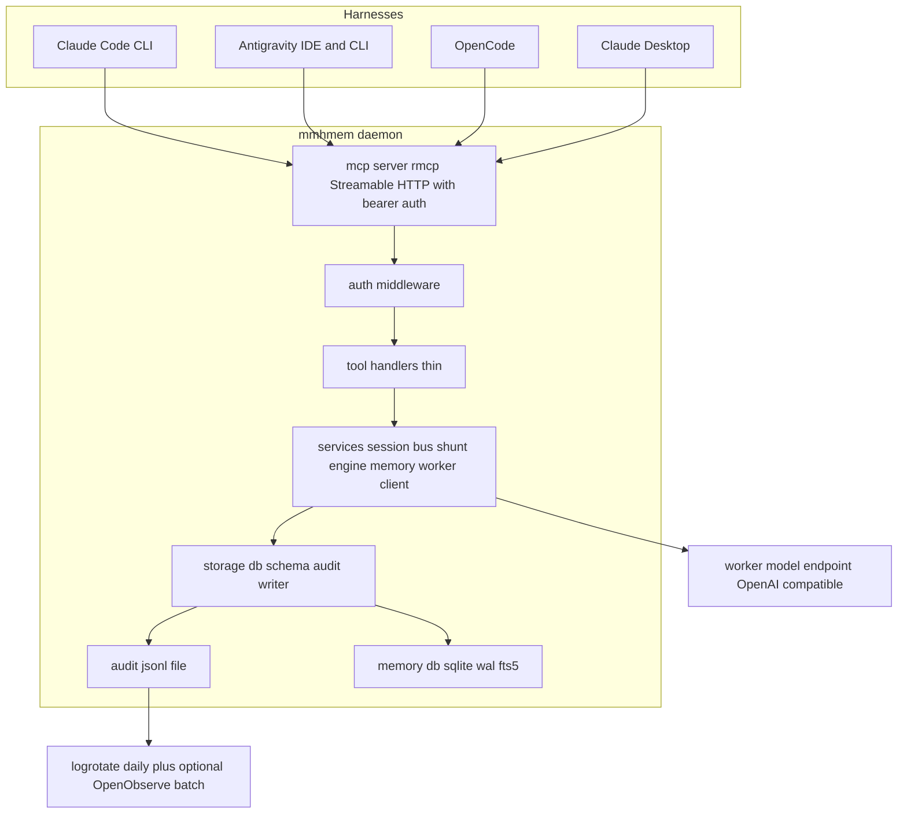
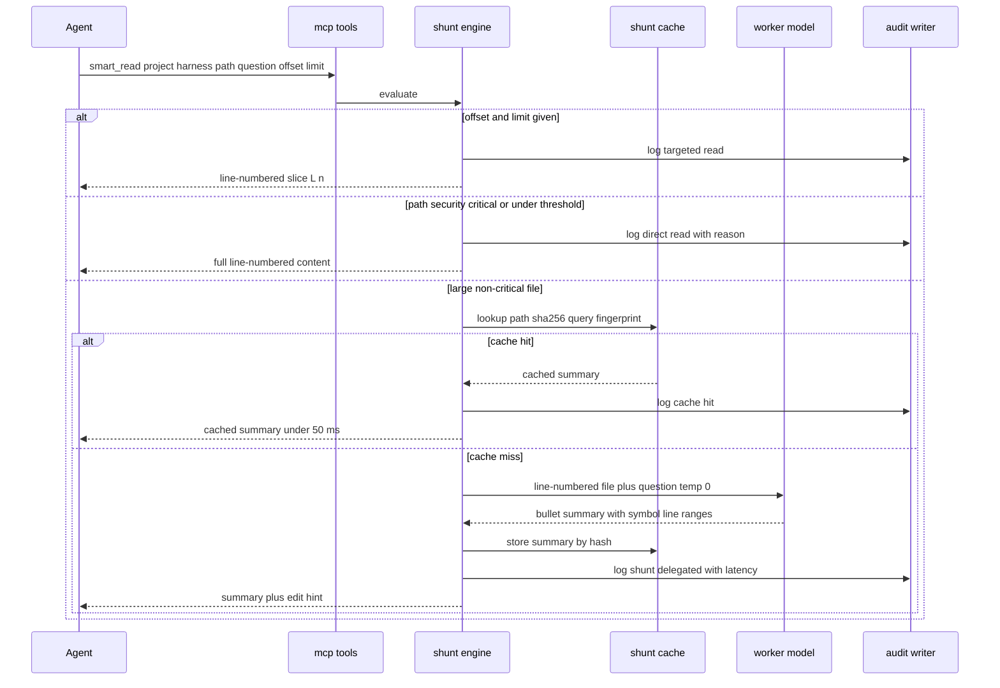
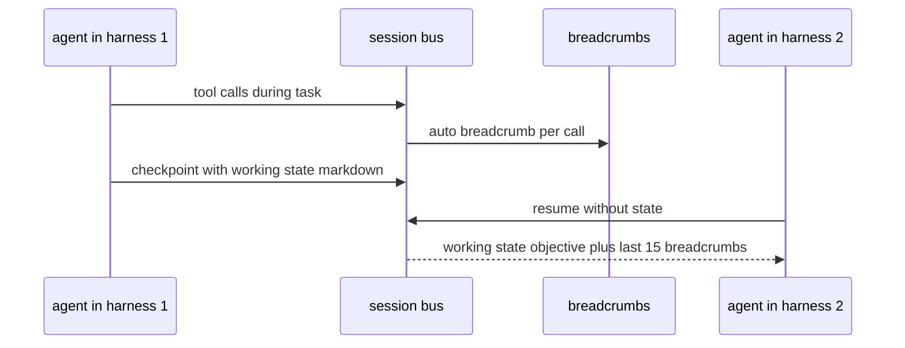

# Design Document: cross-agent-memory-server (mmhmem)

## Overview

**Purpose**: mmhmem delivers a single self-hosted Linux daemon that gives heterogeneous AI coding harnesses (Claude Code, Google Antigravity, OpenCode, Claude Desktop) one shared memory and I/O-optimization endpoint, replacing per-harness client hooks and SaaS-coupled plugins.

**Users**: infrastructure operators and engineers running multiple agent harnesses who need lossless mid-task handoff between tools, deterministic token-cost reduction, and a tamper-evident local audit trail.

**Impact**: Greenfield. Creates a new Rust binary plus deployment artifacts. No existing system is modified.

### Goals
- Remote MCP (Streamable HTTP) tool surface with Bearer auth, consumed hook-free by all four harnesses
- Live cross-agent session bus with automatic breadcrumbs and zero-LLM handoff
- Deterministic server-side shunt of large reads and boilerplate writes to a configurable worker model, with SHA-256 content-addressed caching and a security-critical bypass
- Progressive-disclosure long-term memory (compact FTS index → batch detail fetch)
- Secret-redacted, hash-verified JSONL audit log that logrotate can rotate live
- Single static binary deployable via systemd; English spec artifacts

### Non-Goals
- Harness client code, worker-LLM hosting, TLS certificate issuance, web viewer UI
- Forking/patching claude-mem; MITM LLM proxies; client-side hooks
- Real-time SIEM streaming (batch ship of rotated logs only); multi-host clustering/replication

## Boundary Commitments

### This Spec Owns
- The mmhmem daemon binary: MCP tool handlers, session bus, shunt engine, memory service, worker client, audit writer, embedded storage schema
- Bearer-token authentication on the MCP endpoint and per-request harness identity
- The audit log format, redaction rules, and record hashing
- Deployment artifacts: systemd unit, logrotate config, SKILL.md playbook, example harness connection configs
- All automated tests for the above

### Out of Boundary
- The four agent harnesses and their configuration UX (we only ship example configs)
- The worker model endpoint itself (local vLLM/Ollama or API) — we only call it
- TLS termination hardware/certs (assumed terminating reverse proxy in front; see Security Considerations)
- Any telemetry/analytics/SaaS egress — the binary makes no network calls except to the configured worker endpoint and the optional OpenObserve batch ship from logrotate

### Allowed Dependencies
- MCP protocol spec 2026-07-28 via the official rmcp Rust SDK (Streamable HTTP server transport)
- Embedded SQLite via rusqlite `bundled` (WAL, FTS5) — local state only, no external DB
- OpenAI-compatible chat completions endpoint for the worker model (configurable)
- Linux host primitives: systemd, logrotate, O_APPEND file writes

### Revalidation Triggers
- MCP spec or rmcp major-version change altering the Streamable HTTP contract
- Audit record schema change (breaks forensic tooling and OpenObserve ingestion)
- MCP tool name/signature change (breaks installed SKILL.md playbooks in harnesses)
- Storage schema change (breaks on-disk state at the data dir)

## Architecture

### Architecture Pattern & Boundary Map

Layered single-process daemon. Dependency direction is strict: `mcp` → `services` → `storage`; `config` is imported by all; nothing imports upward.



- Selected pattern: layered daemon (protocol → services → storage), one static binary, systemd-managed
- Domain boundaries: session bus (live), memory store (durable), shunt cache (content-addressed), audit (append-only) are separate tables owned by separate services
- Steering compliance: thin handlers, policy in services, env-only config, snake_case, audit-only writes

### Technology Stack

| Layer | Choice / Version | Role in Feature | Notes |
|-------|------------------|-----------------|-------|
| Language / runtime | Rust stable, tokio 1.x | async daemon runtime | pinned via rust-toolchain.toml |
| MCP protocol | rmcp 3.x, MCP spec 2026-07-28 | Streamable HTTP server, tool registration | official modelcontextprotocol rust-sdk |
| HTTP | axum 0.8.x (via rmcp transport) | bearer auth middleware | no parallel framework |
| Data / storage | rusqlite with bundled feature (SQLite, WAL, FTS5) | all durable state | single binary, no system sqlite |
| Worker client | reqwest + serde_json | OpenAI-compatible chat completions | temperature 0, explicit timeouts |
| Audit | sha2 + serde_json, O_APPEND writes | redacted hash-verified JSONL | logrotate-safe |
| Infrastructure / runtime | systemd unit + logrotate config | operations | deploy/ directory |
| Container deployment | multi-stage Dockerfile (runtime image = dedicated `mmhmem` binary only, non-root, minimal base) + docker-compose.yml | ops alternative to systemd; volumes for data/log/allowed-roots; host-side logrotate on the mounted log dir | repo root |
| Observability (optional) | opentelemetry + opentelemetry-otlp behind cargo feature `otel` (Docker image only) | OTLP spans/metrics/logs to self-hosted OpenObserve | inert unless `OTEL_EXPORTER_OTLP_ENDPOINT` set |

### Complexity Budget
Adopt-don't-build: ~12 crates total (details in `research.md` → "Minimal dependency set"). Single process; one SQLite connection behind a `tokio::sync::Mutex` serviced via `spawn_blocking` (WAL, no pool; lock never held across an await); synchronous tool logic (only the worker-model HTTP call awaits); env-only config; bearer auth via one small axum middleware + constant-time compare (`subtle`); TLS at a reverse proxy, not in-process; logrotate owns rotation; schema via `CREATE TABLE IF NOT EXISTS` + `PRAGMA user_version` (no migration framework); no background workers/queues; no `unsafe`; `clippy -D warnings`; committed `Cargo.lock`; the optional `otel` cargo feature (opentelemetry-otlp) is compiled only into the Docker image, keeping the plain release binary at the minimal dependency set. Build order: port the Python reference 1:1, one tool E2E first, then the rest plus workspace path confinement.

Code-metrics caps (Req 13 — enforced by CI and baked into every task's acceptance criteria): cognitive complexity ≤ 15 per function via clippy's `cognitive_complexity` lint + `clippy.toml` threshold + `[lints.clippy]` warn + `-D warnings` (on clippy ≥ 1.98 the `cyclomatic_complexity` lint is a deprecated alias, so the cognitive cap is the machine-enforced McCabe-style guard; no unjustified `#[allow]`); ≤ 500 lines per `src/` file and ≤ 80 lines per function (split by responsibility at the cap; test files ≤ 800 lines); each implementation task ≤ 400 added non-test lines — larger work is split at task-generation time; CI also prints an informational `tokei` LOC report. Rationale: McCabe-style caps keep every function auditable on one screen, which matters most on the security-critical paths (path confinement, redaction, bearer auth); the LOC caps force the layered module split already in this design instead of god-modules. Task-generation note: `/kiro-spec-tasks` shall copy Req 13 into every implementation task's acceptance criteria.

## File Structure Plan

```
Cargo.toml                     # deps pinned; features: rmcp streamable-http-server, rusqlite bundled; optional `otel` feature (Docker image only)
rust-toolchain.toml            # pinned stable toolchain
clippy.toml                    # lint threshold (Req 13): cognitive-complexity-threshold = 15 (clippy >= 1.98: the cyclomatic key is a deprecated alias, kept as a comment; the cognitive cap is the enforced McCabe-style guard, complemented by the 80-LOC/fn cap)
Dockerfile                     # multi-stage: rust builder -> minimal non-root runtime image containing ONLY the mmhmem binary
docker-compose.yml             # env_file config, MCP port, volumes: data dir, audit log dir (host logrotate), allowed roots (ro), healthcheck
src/
├── main.rs                    # entrypoint: load config, init storage, start server, graceful shutdown
├── lib.rs                     # module wiring
├── config.rs                  # env-only config: AGENT_MEM_DATA_DIR, AGENT_MEM_LOG_FILE, AGENT_MEM_ALLOWED_ROOTS, SHUNT_MIN_LINES, WORKER_API_URL, WORKER_MODEL, WORKER_API_KEY, AGENT_MEM_TOKEN, port/path, OTEL_EXPORTER_OTLP_ENDPOINT / OTEL_EXPORTER_OTLP_HEADERS / OTEL_SERVICE_NAME (optional)
├── telemetry.rs               # optional OTel (cargo feature `otel`, compiled into the Docker image only): OTLP spans/metrics/logs, same redaction filter
├── mcp/
│   ├── mod.rs
│   ├── server.rs              # rmcp Streamable HTTP server setup, bearer auth middleware, tool registration
│   └── tools.rs               # thin handlers: parse args, call services, format markdown responses
├── services/
│   ├── mod.rs
│   ├── session_bus.rs         # resume/handoff/checkpoint + breadcrumb append, 1500-token cap
│   ├── shunt.rs               # four-stage smart_read evaluation, security regex, cache lookup/store
│   ├── boilerplate.rs         # code-writer shunt: prompt, fence strip, write to disk, checksum reply
│   ├── memory.rs              # mem_search FTS, mem_get_observations batch, mem_record_observation
│   ├── worker.rs              # typed worker client, system prompts, timeouts, error mapping, returns WorkerUsage (token counts)
│   └── stats.rs               # token-savings accounting: server estimates (chars/4) + client-reported deltas -> token_stats, audit events, OTel metrics
├── storage/
│   ├── mod.rs
│   ├── schema.rs              # DDL: active_sessions, session_breadcrumbs, shunt_file_cache, observations, observations_fts + trigger
│   ├── db.rs                  # connection management (WAL, synchronous NORMAL), migrations on startup
│   └── audit.rs               # redaction filter, record sha256, atomic O_APPEND single-line JSON writer
deploy/
├── systemd/mmhmem.service     # systemd unit, env file reference, restart policy
├── logrotate.d/agent-memory   # daily rotate, 90 days, compress, dateext, 0640, optional OpenObserve postrotate ship
├── skills/unified-memory/SKILL.md   # under-200-token harness playbook
└── examples/                  # claude-code mcp add snippet, antigravity mcp_config json, opencode config, claude-desktop connector
tests/
├── common/mod.rs              # test harness: ephemeral port, temp data dir, test token
├── mcp_tools.rs               # end-to-end MCP tool tests
├── shunt.rs                   # threshold, security bypass, cache hit/miss, invalidation tests
├── handoff.rs                 # session resume/checkpoint/breadcrumb tests
├── audit_redaction.rs         # secret patterns never reach disk; record hash verifies
├── security_paths.rs          # path traversal and allowed-roots confinement tests
└── e2e/                       # agent-driven measurement (gated by E2E_LLM=1, needs model access): compose stack + scripted OpenCode (Mistral) sessions on a fixture repo, baseline vs mmhmem mode, asserts MEASURED token deltas from harness-reported usage
```

New files only; nothing existing is modified (greenfield).

## System Flows

### smart_read decision flow



### Cross-agent handoff flow



Flow-level decisions: every tool invocation appends a breadcrumb automatically (no checkpoint command needed); handoff itself performs zero LLM calls; shunt decisions are fully deterministic and audit-logged with reasons.

## Requirements Traceability

| Requirement | Summary | Components | Interfaces | Flows |
|-------------|---------|------------|------------|-------|
| 1.1 | Streamable HTTP MCP at configurable path port | mcp/server.rs | MCP endpoint | — |
| 1.2 | Reject missing or invalid bearer token | mcp/server.rs auth | HTTP 401 | — |
| 1.3 | Works with all four harnesses | mcp/server.rs + deploy/examples | MCP client configs | — |
| 1.4 | Six tools exposed | mcp/tools.rs | tool schemas | — |
| 1.5 | No client hooks or proxies required | whole design | — | — |
| 2.1 | Resume returns state plus 15 breadcrumbs | services/session_bus.rs | session_resume_or_handoff | handoff |
| 2.2 | Checkpoint upserts by project and task | services/session_bus.rs | session_resume_or_handoff | handoff |
| 2.3 | New task id when no session | services/session_bus.rs | session_resume_or_handoff | handoff |
| 2.4 | Auto breadcrumb on every tool call | services/session_bus.rs + mcp/tools.rs | internal | handoff |
| 2.5 | Working state capped at 1500 tokens | services/session_bus.rs | tool schema | — |
| 2.6 | Handoff without LLM calls | services/session_bus.rs | — | handoff |
| 3.1 | offset limit targeted slice | services/shunt.rs | smart_read | smart_read |
| 3.2 | under threshold direct read | services/shunt.rs | smart_read | smart_read |
| 3.3 | security-critical bypass with audited reason | services/shunt.rs + storage/audit.rs | smart_read | smart_read |
| 3.4 | cache lookup by path sha256 fingerprint | services/shunt.rs + storage/db.rs | smart_read | smart_read |
| 3.5 | worker prompt format bullets line ranges | services/worker.rs | worker client | smart_read |
| 3.6 | cache store, sub 50 ms, zero LLM on hit | services/shunt.rs + storage/db.rs | smart_read | smart_read |
| 3.7 | hash change invalidates cache | services/shunt.rs | smart_read | smart_read |
| 3.8 | missing file error | services/shunt.rs | smart_read | — |
| 3.9 | env threshold default 150 | config.rs | env | — |
| 4.1 | boilerplate via worker with reference | services/boilerplate.rs + worker.rs | boilerplate_write | — |
| 4.2 | fence strip, direct write, one-line confirm | services/boilerplate.rs | boilerplate_write | — |
| 4.3 | missing reference errors, no write | services/boilerplate.rs | boilerplate_write | — |
| 4.4 | audit plus breadcrumb on write | storage/audit.rs + session_bus.rs | internal | — |
| 5.1 | compact FTS index table | services/memory.rs | mem_search | — |
| 5.2 | type filter | services/memory.rs | mem_search | — |
| 5.3 | no-match message | services/memory.rs | mem_search | — |
| 5.4 | batch detail by ids | services/memory.rs | mem_get_observations | — |
| 5.5 | record and immediately searchable | services/memory.rs + storage/schema.rs trigger | mem_record_observation | — |
| 5.6 | index search under 15 ms | storage/db.rs | mem_search | — |
| 6.1 | configurable OpenAI-compatible endpoint | config.rs + services/worker.rs | env | — |
| 6.2 | temperature 0 | services/worker.rs | worker client | — |
| 6.3 | worker failure explicit error plus audit | services/worker.rs + storage/audit.rs | worker client | — |
| 6.4 | model and latency audited | storage/audit.rs | internal | — |
| 7.1 | redact before persist | storage/audit.rs | internal | — |
| 7.2 | redaction pattern list | storage/audit.rs | internal | — |
| 7.3 | single-line JSON record with sha256 digest | storage/audit.rs | audit schema | — |
| 7.4 | append-per-write, logrotate-safe | storage/audit.rs + deploy/logrotate.d | file contract | — |
| 7.5 | env-configurable paths | config.rs | env | — |
| 8.1 | systemd process, env config | deploy/systemd + config.rs | env | — |
| 8.2 | shipped logrotate config 90 days OpenObserve | deploy/logrotate.d/agent-memory | file contract | — |
| 8.3 | SKILL.md under 200 tokens | deploy/skills | skill file | — |
| 8.4 | example connection configs | deploy/examples | configs | — |
| 8.5 | no telemetry or SaaS calls | whole binary | — | — |
| 9.1 | concurrent harnesses no corruption | storage/db.rs WAL + tokio | internal | — |
| 9.2 | cached paths under 50 ms | services/shunt.rs + session_bus.rs | internal | — |
| 9.3 | local state only | storage/db.rs | internal | — |
| 9.4 | works without worker when not needed | services/worker.rs lazy | internal | — |
| 8.6 | Docker image with dedicated binary + compose | Dockerfile, docker-compose.yml | deploy | — |
| 8.7 | logrotate on bind-mounted log volume, no container restart | docker-compose.yml + deploy/logrotate.d | file contract | — |
| 10.1–10.3 | server-side token estimates + worker usage into token_stats and audit | services/stats.rs + storage/schema.rs | token_stats, audit | smart_read |
| 10.4 | optional client-reported usage in checkpoint args | services/session_bus.rs + stats.rs | session_resume_or_handoff | handoff |
| 10.5 | estimates labelled; no invented frontier tokens | services/stats.rs | internal | — |
| 11.1–11.3 | optional redacted OTLP export, off by default, feature-gated | src/telemetry.rs (feature `otel`) | OTLP endpoint | — |
| 11.4 | data-lifecycle table (what passes, what remains, retention) | design.md "Data Lifecycle" section | doc | — |
| 11.5 | agent-side OTel configured in the harness, documented only | deploy/examples/ | docs | — |
| 12.1–12.3 | E2E measured savings with real harness, gated by E2E_LLM | tests/e2e/ + docker-compose.yml | compose + OpenCode | — |
| 13.1–13.2 | cognitive ≤ 15 per function via clippy.toml + [lints.clippy] + -D warnings (McCabe-style guard; cyclomatic lint is a deprecated alias on clippy ≥ 1.98) | clippy.toml + CI gate | lint config | — |
| 13.3 | ≤ 500 LOC/src file, ≤ 80 LOC/function, ≤ 800 LOC/test file | module split rule | internal | — |
| 13.4 | ≤ 400 non-test LOC per task; split at generation time | tasks.md acceptance criteria | process | — |
| 13.5–13.6 | blocking clippy gate + tokei report; caps copied into every task | CI + /kiro-spec-tasks | process | — |

## Components and Interfaces

| Component | Layer | Intent | Req Coverage | Key Dependencies | Contracts |
|-----------|-------|--------|--------------|------------------|-----------|
| Config | config | env-only runtime configuration | 3.9, 6.1, 7.5, 8.1 | none | State |
| McpServer | mcp | Streamable HTTP MCP endpoint + bearer auth + tool registration | 1.1–1.5 | rmcp, Config, services | API |
| ToolHandlers | mcp | thin arg parsing and markdown formatting | 1.4, 2.4 | services | Service |
| SessionBus | services | live cross-agent state and breadcrumbs | 2.1–2.6 | storage | Service |
| ShuntEngine | services | deterministic read routing and cache | 3.1–3.9 | storage, WorkerClient | Service |
| BoilerplateWriter | services | code generation straight to disk | 4.1–4.4 | WorkerClient, storage | Service |
| MemoryService | services | progressive-disclosure search and recording | 5.1–5.6 | storage | Service |
| WorkerClient | services | typed calls to OpenAI-compatible worker endpoint | 3.5, 4.1, 6.1–6.4, 10.2 | reqwest, Config | Service |
| StatsCollector | services | token-savings accounting: per-event estimates + optional client-reported deltas | 10.1–10.5 | storage, Telemetry | Service |
| Telemetry | infra (feature `otel`) | optional OTLP spans/metrics/logs, redaction applied, off by default | 11.1–11.3 | opentelemetry-otlp | API |
| Db | storage | WAL connection management and schema migrations | 2, 3, 5, 9.1, 9.3 | rusqlite bundled | State |
| AuditWriter | storage | redaction, hashing, append-only JSONL | 3.3, 4.4, 6.3, 6.4, 7.1–7.4 | sha2, serde_json | State |

### mcp layer

#### McpServer
- Intent: expose the six tools over Streamable HTTP MCP with bearer auth.
- Requirements: 1.1, 1.2, 1.3, 1.4, 1.5
- **Service Interface**
  ```rust
  struct McpServer { config: Config, services: Services }
  impl McpServer {
      async fn run(self) -> anyhow::Result<()>;            // binds host/port/path, serves until shutdown
  }
  // Auth: every request must carry Authorization: Bearer <AGENT_MEM_TOKEN>;
  // comparison in constant time; failure returns HTTP 401 before tool dispatch.
  // Tools registered: session_resume_or_handoff, smart_read, boilerplate_write,
  // mem_search, mem_get_observations, mem_record_observation
  // GET /healthz (no auth) -> 200, used by the compose healthcheck; everything else requires the bearer token
  ```
- Preconditions: config valid, token set, storage initialized.
- Postconditions: graceful shutdown on SIGTERM.

#### ToolHandlers
- Intent: parse tool arguments, invoke services, format markdown responses, append breadcrumbs and audit events around every call.
- Requirements: 1.4, 2.4
- All handlers are async, take validated typed args, return `Result<String, ToolError>`; errors map to MCP tool errors with actionable messages (3.8, 4.3, 6.3).

### services layer

#### SessionBus
- Intent: own the live cross-agent session bus.
- Requirements: 2.1, 2.2, 2.3, 2.4, 2.5, 2.6
- **Service Interface**
  ```rust
  struct SessionBus { db: Db, audit: AuditWriter }
  impl SessionBus {
      async fn resume(&self, project: &str, harness: &str, task: Option<&str>) -> Result<ResumeView>;
      async fn checkpoint(&self, project: &str, harness: &str, task: &str, objective: &str, state_md: &str, client_usage: Option<ClientUsage>) -> Result<CheckpointAck>;
      // ClientUsage { prompt_tokens: u64, completion_tokens: u64, source: String } — optional harness-reported
      // frontier totals, stored in token_stats with kind=client_reported (Req 10.4); never required
      async fn breadcrumb(&self, project: &str, task: &str, harness: &str, tool: &str, resource: &str, summary: &str);
  }
  struct ResumeView { task_id: String, objective: String, working_state_md: String, last_harness: String, breadcrumbs: Vec<Breadcrumb> } // last 15
  ```
- Invariants: working_state_md truncated to a 1,500-token budget on write — measured as ~4 chars/token (a 6,000-character budget, no tokenizer dependency), truncated at the last complete line before the limit; resume performs no LLM calls; breadcrumbs are append-only.

#### ShuntEngine
- Intent: deterministic four-stage smart_read evaluation with security bypass and content-addressed cache.
- Requirements: 3.1–3.9
- **Service Interface**
  ```rust
  struct ShuntEngine { db: Db, audit: AuditWriter, worker: WorkerClient, config: Config }
  impl ShuntEngine {
      async fn smart_read(&self, project: &str, harness: &str, path: &Path, question: &str, offset: Option<u32>, limit: Option<u32>) -> Result<ReadOutcome>;
  }
  enum ReadOutcome { Targeted { text: String }, Direct { text: String, reason: BypassReason }, Cached { summary: String }, Shunted { summary: String, latency_ms: u64 } }
  enum BypassReason { SecurityCritical, BelowThreshold }
  ```
- Decision order: targeted slice → security-critical or under-threshold direct → cache hit → worker shunt + cache store.
- Security-critical regex (case-insensitive): auth, crypto, secret, token, rbac, jwt, tls, cert, mutex, lock, concurrency, permission, sudo, pam.
- Path confinement: canonicalized path must lie under one of `AGENT_MEM_ALLOWED_ROOTS`; otherwise reject and audit.

#### BoilerplateWriter
- Intent: generate boilerplate via the worker and write straight to disk.
- Requirements: 4.1, 4.2, 4.3, 4.4
- **Service Interface**
  ```rust
  impl BoilerplateWriter {
      async fn write(&self, project: &str, harness: &str, target: &Path, reference: &Path, spec: &str) -> Result<WriteAck>; // WriteAck { sha256, lines, latency_ms }
  }
  ```
- Strips markdown fences, creates parent dirs, writes file, returns one-line confirmation. **Both** the target path and the reference path are canonicalized and confined to `AGENT_MEM_ALLOWED_ROOTS`; a reference outside the roots is rejected and audited before any file content is sent to the worker endpoint (prevents arbitrary-file exfiltration to the worker model).

#### MemoryService
- Intent: progressive-disclosure long-term memory.
- Requirements: 5.1–5.6
- **Service Interface**
  ```rust
  impl MemoryService {
      async fn search(&self, project: &str, harness: &str, query: &str, obs_type: Option<&str>, limit: u16) -> Result<Vec<IndexRow>>;
      async fn get(&self, project: &str, harness: &str, ids: &[i64]) -> Result<Vec<Observation>>;
      async fn record(&self, project: &str, harness: &str, obs_type: &str, title: &str, narrative: &str, facts: &str, files: &str) -> Result<i64>;
  }
  ```
- search escapes double quotes and wraps the query as a quoted FTS5 phrase to prevent injection; results are the compact index rows only.

#### WorkerClient
- Intent: typed client for the OpenAI-compatible worker endpoint.
- Requirements: 3.5, 4.1, 6.1, 6.2, 6.3, 6.4, 9.4
- **Service Interface**
  ```rust
  impl WorkerClient {
      async fn summarize_file(&self, file_xml: &str, question: &str) -> Result<(String, WorkerUsage)>;   // 30 s timeout
      async fn generate_code(&self, reference_xml: &str, spec: &str) -> Result<(String, WorkerUsage)>;   // 45 s timeout
  // struct WorkerUsage { prompt_tokens: u64, completion_tokens: u64 } — from the worker API `usage` field, fed to StatsCollector (10.2)
  }
  // POST {WORKER_API_URL} with Bearer WORKER_API_KEY, model WORKER_MODEL, temperature 0.0
  // Err variant WorkerError propagates to the agent as a clear message and to the audit log.
  ```
- Instantiated lazily; all non-worker paths (9.4) never touch it.

### storage layer

#### Db
- Intent: own connections, WAL pragmas, and schema migrations.
- Requirements: 2, 3, 5, 9.1, 9.3
- rusqlite bundled; `PRAGMA journal_mode=WAL`, `PRAGMA synchronous=NORMAL`; the single `Connection` lives behind a `tokio::sync::Mutex` and is only ever touched inside `spawn_blocking`, so blocking SQLite calls never run on async worker threads (single-writer is fine at this scale and eliminates locking bugs). **Invariant: the DB lock is never held across an `.await`** — e.g. on a shunt cache miss, the cache lookup, the worker-model call, and the cache store are three separate locked sections. Schema applied idempotently at startup.

#### AuditWriter
- Intent: the only component that writes the audit log.
- Requirements: 3.3, 4.4, 6.3, 6.4, 7.1, 7.2, 7.3, 7.4
- **State contract**: one JSON object per line: `ts` (ISO-8601 UTC), `epoch_ms`, `event_type`, `agent_harness`, `project`, `details` (redacted), `record_sha256` (SHA-256 over the record without the digest field, sorted keys).
- Redaction before serialization: key-assigned secrets (api_key, secret, token, password, MYSQL_PWD, dbPassword, authorization), Bearer headers, xapp-/xoxe- Slack tokens, and `<private>...</private>` spans.
- Opens the log file with append mode per write; no persistent locked handle.

## Data Models

### Logical Data Model
- **active_sessions** (live tier, one row per project): project (PK), workspace_task_id, active_objective, working_state_md (capped), last_harness, updated_at_epoch.
- **session_breadcrumbs** (live tier, append-only ring): id PK, project, workspace_task_id, agent_harness, tool_name, target_resource, action_summary, created_at_epoch; index on (project, created_at_epoch DESC); resume reads last 15.
- **shunt_file_cache** (content-addressed): PK (file_path, content_sha256, query_fingerprint), structural_summary, line_count, created_at_epoch.
- **observations** (durable tier): id PK, project, workspace_task_id, agent_harness, type, title, narrative, facts, files_touched, created_at_epoch.
- **observations_fts**: FTS5 external-content virtual table over observations, synced by an AFTER INSERT trigger.
- **token_stats** (durable tier): per-event token-savings statistics — kind (shunt_delegated | shunt_cache_hit | code_write | client_reported), avoided input/output token estimates, worker prompt/completion tokens, redacted details; indexed on (project, agent_harness, ts_epoch_ms).

### Physical Data Model (SQLite, WAL)

```sql
CREATE TABLE active_sessions (
  project TEXT PRIMARY KEY,
  workspace_task_id TEXT NOT NULL,
  active_objective TEXT,
  working_state_md TEXT NOT NULL,
  last_harness TEXT NOT NULL,
  updated_at_epoch INTEGER NOT NULL
);
CREATE TABLE session_breadcrumbs (
  id INTEGER PRIMARY KEY AUTOINCREMENT,
  project TEXT NOT NULL,
  workspace_task_id TEXT NOT NULL,
  agent_harness TEXT NOT NULL,
  tool_name TEXT NOT NULL,
  target_resource TEXT,
  action_summary TEXT NOT NULL,
  created_at_epoch INTEGER NOT NULL
);
CREATE INDEX idx_breadcrumbs_proj ON session_breadcrumbs(project, created_at_epoch DESC);
CREATE TABLE observations (
  id INTEGER PRIMARY KEY AUTOINCREMENT,
  project TEXT NOT NULL,
  workspace_task_id TEXT NOT NULL,
  agent_harness TEXT NOT NULL,
  type TEXT NOT NULL,
  title TEXT NOT NULL,
  narrative TEXT NOT NULL,
  facts TEXT,
  files_touched TEXT,
  created_at_epoch INTEGER NOT NULL
);
CREATE VIRTUAL TABLE observations_fts USING fts5(
  title, narrative, facts, files_touched,
  content='observations', content_rowid='id'
);
CREATE TRIGGER obs_ai AFTER INSERT ON observations BEGIN
  INSERT INTO observations_fts(rowid, title, narrative, facts, files_touched)
  VALUES (new.id, new.title, new.narrative, new.facts, new.files_touched);
END;
CREATE TABLE shunt_file_cache (
  file_path TEXT NOT NULL,
  content_sha256 TEXT NOT NULL,
  query_fingerprint TEXT NOT NULL,
  structural_summary TEXT NOT NULL,
  line_count INTEGER NOT NULL,
  created_at_epoch INTEGER NOT NULL,
  PRIMARY KEY (file_path, content_sha256, query_fingerprint)
);
CREATE TABLE token_stats (
  id INTEGER PRIMARY KEY AUTOINCREMENT,
  project TEXT NOT NULL,
  workspace_task_id TEXT,
  agent_harness TEXT NOT NULL,
  kind TEXT NOT NULL,               -- shunt_delegated | shunt_cache_hit | code_write | client_reported
  ts_epoch_ms INTEGER NOT NULL,
  avoided_input_tokens_est INTEGER NOT NULL DEFAULT 0,   -- chars/4 heuristic, labelled estimate
  avoided_output_tokens_est INTEGER NOT NULL DEFAULT 0,
  worker_prompt_tokens INTEGER,     -- from worker API `usage`, NULL for client_reported
  worker_completion_tokens INTEGER,
  details TEXT,                     -- redacted JSON (paths, hashes, source label)
  PRIMARY KEY (id)
);
CREATE INDEX idx_token_stats_proj ON token_stats(project, agent_harness, ts_epoch_ms);
```

### Audit record contract
Single-line JSON per event; `record_sha256` computed over the record with sorted keys before the digest field is added. Event types: SESSION_RESUME, SESSION_CHECKPOINT, IO_TARGETED_READ, IO_DIRECT_READ, IO_SHUNT_CACHE_HIT, IO_SHUNT_DELEGATED, IO_SHUNT_CODE_WRITE, MEM_SEARCH_INDEX, MEM_GET_DETAILS, MEM_RECORD_OBS, TOKEN_STATS (server-computed estimate), TOKEN_STATS_CLIENT (client-reported frontier delta), plus error variants.

## Error Handling

- **User/agent errors** (bad input): missing file (3.8), missing reference file (4.3), any path (read target, write target, write reference) outside allowed roots, malformed args → MCP tool error with an actionable message; audited.
- **Auth errors**: missing/invalid bearer token → HTTP 401 before any tool dispatch (1.2); audited with harness unknown.
- **Worker errors** (6.3): timeout (30 s read, 45 s write), non-2xx, unreachable endpoint → explicit error to the agent, `WORKER_ERROR` audit event; never return stale or empty content as a fresh summary.
- **Storage errors**: SQLite failures → 500-class tool error, audit event, no partial writes (WAL + single-writer mutex).
- **Fail-fast validation**: all tool args validated (paths canonicalized and confined, sizes bounded, enums checked) before any state mutation.

## Testing Strategy

- **Unit tests**: redaction filter against every pattern class (7.2) plus `<private>` spans; FTS5 query escaping (5.1); security-critical regex per pattern class (3.3); fence stripping (4.2); config parsing defaults (3.9, 7.5); working-state truncation at the 6,000-char / 1,500-token budget at a line boundary (2.5).
- **Integration tests** (spin server on ephemeral port, drive MCP end-to-end): full handoff flow resume→work→checkpoint→resume in second harness (2.1–2.6); smart_read four stages incl. cache hit returns identical summary with zero worker calls and sub-50 ms (3.4–3.6); cache invalidation on content change (3.7); boilerplate write round-trip (4.1–4.4); mem search→get→record cycle (5.1–5.5); bearer rejection (1.2).
- **Security tests**: path traversal attempts rejected and audited; `boilerplate_write` with a reference path outside allowed roots rejected and audited with zero bytes sent to the worker; bearer comparison rejects wrong tokens; every audit line parses as JSON and its `record_sha256` verifies (7.3); secret patterns appear nowhere in the raw log bytes (7.2).
- **Performance tests**: concurrent harness sessions (9.1) with no state corruption; cached read and resume under 50 ms (9.2); FTS index search under 15 ms (5.6).
- **E2E measurement tests** (gated by `E2E_LLM=1`, require model access): bring up the compose stack, run scripted OpenCode sessions (configured model, e.g. Mistral) on a fixture repo in baseline mode vs mmhmem mode, collect harness-reported prompt/completion tokens, assert the configured input-token reduction threshold on read-heavy tasks, and persist the measured numbers as `client_reported` stats (12.1–12.3).
- **Stats tests**: estimate arithmetic per shunt kind (10.1), worker `usage` captured (10.2), client-reported delta stored and labelled (10.4–10.5), OTel inert without endpoint (11.1).
- **Lint/metrics gate (blocking)**: CI runs `cargo clippy --all-targets -- -D warnings` — including the `cyclomatic_complexity` ≤ 10 and `cognitive_complexity` ≤ 15 caps from `clippy.toml` — plus an informational `tokei` per-file LOC report; cap violations block merge (13.1–13.5).

## Security Considerations
- Bearer token required on every MCP request, compared in constant time; token supplied via env, never logged (redacted anyway).
- Path confinement: every agent-supplied path — `smart_read` target, `boilerplate_write` target **and** reference — is canonicalized and must lie under `AGENT_MEM_ALLOWED_ROOTS`; violations rejected and audited.
- Redaction is mandatory and centralized in AuditWriter before any persistence (7.1, 7.2); the audit trail is append-only and self-verifying via per-record SHA-256.
- Worker SLM output is treated as untrusted text: summaries are data, never executed; generated code is written only to confined paths and always reviewed by the calling agent.
- TLS termination is expected at a reverse proxy in front of the daemon (cert issuance out of boundary); the daemon binds per config and never initiates egress except the worker endpoint.
- No telemetry, no SaaS, no analytics egress (8.5).
- Optional OTel export (cargo feature `otel`, Docker image) is inert unless `OTEL_EXPORTER_OTLP_ENDPOINT` is set, targets only the configured self-hosted endpoint, and reuses the audit redaction filter on every span/metric/log payload; the JSONL audit remains the system of record (11.1–11.3).

## Performance & Scalability
- Cache-hit reads and session resumes: under 50 ms (9.2); FTS index search under 15 ms (5.6) — verified by tests.
- Single-writer WAL SQLite with a mutex: correct under concurrent harnesses (9.1); vertical scaling only, clustering out of scope.
- Worker latency on cache misses (10–30 s typical) bounded by explicit timeouts and made invisible on repeats by the content-addressed cache (3.6).
- Working-state payloads capped at 1500 tokens (2.5) and breadcrumbs read-limited to 15, keeping handoff responses small.

## Data Lifecycle: what passes through the server and what remains

| Data class | Passes through server? | Persisted where | Retention |
|---|---|---|---|
| MCP tool args (question, spec, narrative, working state, optional client usage) | yes, in memory per request | redacted subsets in audit `details`; full text only where a tool stores it (observations, working_state_md, client usage in token_stats) | audit: 90 days rotated (0640, compressed); DB: durable |
| File contents (smart_read target, boilerplate reference) | yes, read from disk | never persisted by the server; only SHA-256 + line counts in audit | n/a — source files remain in the workspace |
| Shunted worker summaries | yes (worker → server → agent) | shunt_file_cache (content-addressed) + audit metadata | until file hash changes; DB lifetime |
| Worker request/response payloads | yes, transient | never; only `usage` token counts land in token_stats/audit | n/a |
| Frontier prompts and native harness tool I/O | **never** (no hooks) | nowhere on this server | n/a |
| Bearer token | yes (auth header) | never logged (redacted regardless) | n/a |
| Audit records | written by the server | audit.jsonl + rotated archives (optional batch ship to OpenObserve or an S3-compatible store) | 90 days compressed |
| Token statistics | computed/received by the server | token_stats table + TOKEN_STATS audit events + OTel counters | DB lifetime; OTel per OpenObserve retention |
| OTel spans/metrics/logs | emitted only when enabled | OpenObserve only (operator's retention); not stored locally | per OpenObserve config |
