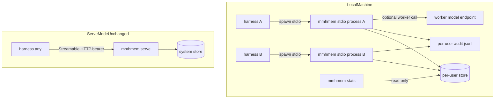
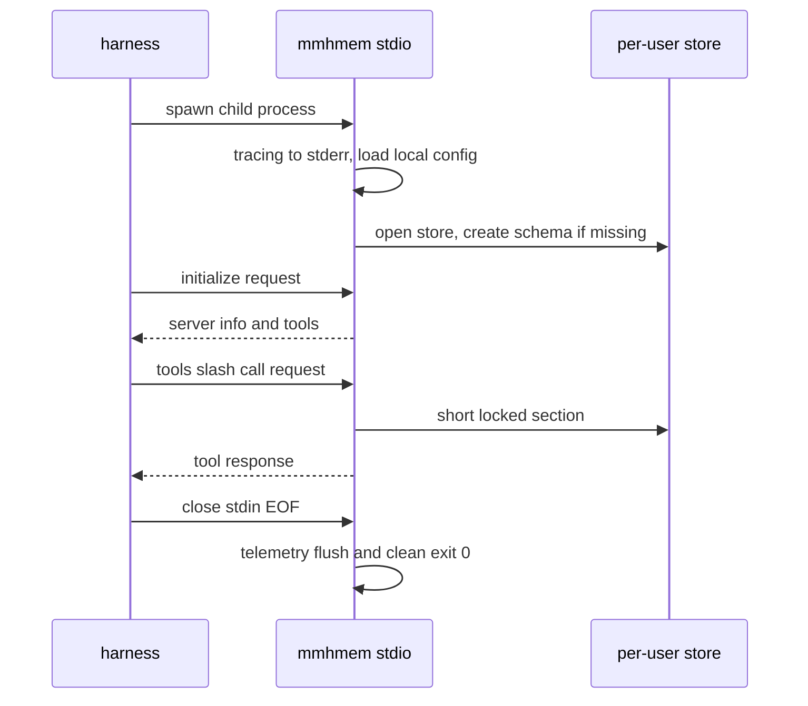

# Design Document

## Overview
**Purpose**: This feature makes the full mmhmem token-efficiency layer usable without the server: the same binary runs `mmhmem stdio` as a per-harness local MCP server over the stdio transport, backed by a per-user shared store, plus a `mmhmem stats` CLI for local token-savings insight.

**Users**: Local adopters on Windows, Linux, and macOS running one or more harnesses (Claude Code, Google Antigravity, OpenCode, Claude Desktop); existing server operators (unchanged); maintainers (same codebase, same gates).

**Impact**: Extends the validated `cross-agent-memory-server` feature with a second serving transport, a config profile dimension, a multi-process-safe storage access model (superseding the single-connection invariant), one new CLI surface, and cross-platform release builds. Serve mode is untouched: its configuration contract, deployment artifacts, and 97/97 deterministic test suite pass unmodified.

### Goals
- Every harness can spawn `mmhmem stdio` with zero configuration and get all six tools with identical semantics.
- Multiple harnesses on one machine share one per-user store: session handoff, shunt cache, memory, and token stats work across processes with no server.
- `mmhmem stats` reports human-readable (and `--json`) token savings from the local store.
- Release binaries for Windows, Linux, and macOS from the same codebase, under the same blocking quality gates.
- The existing suite, serve contract, and deployment artifacts stay green and unchanged.

### Non-Goals
- Cross-machine operation in local mode (server's job); new MCP tools; harness clients; remote stats aggregation.
- Multi-user auth in local mode; OTel in the plain binary; cross-machine sync/replication.
- A local-to-server data migration story (schema parity makes it possible later; not promised here).

## Boundary Commitments

### This Spec Owns
- The `stdio` and `stats` CLI entries and the `serve` alias (`src/main.rs` dispatch, `src/cli/`, `src/mcp/stdio.rs`).
- The local config profile: per-OS user-level defaults, optional token/roots semantics, new env knobs (`AGENT_MEM_BUSY_TIMEOUT_MS`, `AGENT_MEM_AUDIT_MAX_BYTES`, `AGENT_MEM_AUDIT_ROTATE_KEEP`).
- The multi-process-safe storage access model in `src/storage/db.rs` (busy_timeout; per-process connections) — the supersession of the upstream invariant.
- Local audit trail behavior: record parity, per-user default path, size-bounded rotation (`src/storage/audit_rotate.rs`).
- The read-only stats aggregation and rendering (`src/cli/stats.rs`).
- Cross-platform release delivery: GH Actions native-runner jobs for Windows/macOS beside the Dagger Linux pipeline.
- Documentation restructure: client-first README, per-harness stdio examples, SKILL.md update.
- New test suites covering stdio serving, multi-process sharing, stats, rotation, and per-OS defaults.

### Out of Boundary
- The six tool handlers and services (`src/mcp/tools.rs`, `src/services/*` logic) — reused as-is; only `AllowedRoots` gains an explicit unconfined state (empty configured roots).
- The serve-mode HTTP server (`src/mcp/server.rs`), deployment artifacts (Dockerfile, compose, systemd, logrotate), and the OTel feature gating — untouched.
- The SQLite schema — unchanged; no migration.
- The worker-model client — unchanged (optional in both modes).
- In-flight uncommitted work in `ci/src/mmhmem_ci/main.py` and `src/lib.rs` from a parallel session — implementation tasks touching those files rebase on the then-current state.

### Allowed Dependencies
- Upstream spec components: `AppState::build`, `McpServer`/ServerHandler, all services, `Db`, `AuditWriter` — via their existing public APIs only.
- rmcp `=3.8.0` with the added `transport-io` feature (no version change, no other new crate features).
- rusqlite `=0.41.1` (bundled) — `busy_timeout`, `SQLITE_OPEN_READ_ONLY`.
- No new crates. `std::env` (not the `dirs` crate) resolves per-OS user directories.
- GH Actions native runners (windows-latest, macos-latest) — build/test environments only; the Dagger module remains the single source for all container work.

### Revalidation Triggers
- Any change to `Db`'s public API or pragmas → re-run the unmodified 97-test suite (Req 9.1) plus the new multiprocess tests.
- Any change to the `token_stats` schema or `stats.rs` recording → re-run stats CLI tests.
- Any rmcp version bump → re-run stdio transport tests (EOF shutdown, malformed-input resilience).
- Any change to serve-mode config validation or defaults → treat as a serve regression (out of boundary here).
- Any change to SKILL.md or deploy examples → re-check the <200-token cap and per-harness accuracy.

## Architecture

### Existing Architecture Analysis
Layered daemon: `mcp` (tool handlers + transports) → `services` (session bus, shunt, memory, stats, worker, confinement) → `storage` (Db, schema, audit); env-only config; tracing; optional OTel behind a cargo feature. The serving path today is exactly one: `main.rs run_daemon → Config::load → AppState::build → server::run` (Streamable HTTP + bearer auth middleware). `AppState::build(config)` already takes a `Config` and wires the full service graph; `McpServer` implements rmcp's `ServerHandler` (tool router + `get_info` in `mcp/tools.rs`), which is transport-agnostic. `Db` is one connection in `Arc<Mutex<Connection>>` accessed only inside `spawn_blocking` via `with_conn` — the invariant this spec supersedes cross-process. Audit writes are append-per-write (O_APPEND, no persistent handle). These seams are respected and extended, not reworked.

### Architecture Pattern & Boundary Map

Key decisions carried by the diagram: two harness-spawned processes share one per-user store and one audit file; `mmhmem stats` reads the same store; the serve-mode path is a separate, unchanged silo.

**Architecture Integration**:
- Selected pattern: transport-agnostic handler reuse — the stdio entry constructs the same `AppState`/`McpServer` and serves it over rmcp's stdio transport; no handler or service fork exists, so parity is structural (Req 4).
- Domain boundaries: new code lands in a `cli` layer (dispatch + stats), `config` profile submodule, `mcp/stdio.rs`, and two storage additions (busy_timeout, rotation). No existing layer changes its dependency direction (`cli`/`main` → `mcp` → `services` → `storage`).
- Existing patterns preserved: env-only config with injected-lookup parsing; append-per-write audit; short locked sections via `with_conn`; conventional commits; feature-gated OTel.
- New components rationale: each new file isolates one responsibility (dispatch, per-OS dirs, profile parsing, stdio serving, rotation, stats reporting) so the Req 13 LOC caps hold.

### Technology Stack

| Layer | Choice / Version | Role in Feature | Notes |
|-------|------------------|-----------------|-------|
| CLI / entry | existing std-only arg match | `serve` / `stdio` / `stats` dispatch | no CLI framework added |
| MCP transport (local) | rmcp `=3.8.0` + `transport-io` (`stdio_pipes`) | stdio MCP serving, EOF shutdown | same pinned rmcp, one added feature |
| Serving (serve mode) | rmcp `transport-streamable-http-server` + axum `=0.8.9` | unchanged | not modified by this spec |
| Config | `std::env` + existing parsers | profile dimension, per-OS user dirs, new knobs | `dirs` crate rejected (research.md) |
| Storage | rusqlite `=0.41.1` (bundled SQLite, WAL, FTS5) | per-user store; `busy_timeout`; read-only stats open | no schema change |
| Audit | existing AuditWriter + new `audit_rotate` | per-user audit file, size-bounded rotation | logrotate stays serve-only |
| CI | Dagger module (Linux containers) + GH Actions native runners | 3-OS release builds, per-OS clippy/tests | deliberate exception, documented (research.md) |

## File Structure Plan

### Directory Structure
```
src/
├── cli/
│   ├── mod.rs              # subcommand runners: serve wiring, stats entry, dispatch helpers
│   └── stats.rs            # mmhmem stats: read-only SQL aggregation, table + --json rendering
├── config/
│   ├── (mod = src/config.rs)  # existing Config; unchanged from_env semantics; new additive fields
│   ├── profile.rs          # Profile enum, load_local/from_env_local, local validation rules
│   └── local_dirs.rs       # per-OS user data dir + audit path resolution (pure, env-injected)
├── mcp/
│   └── stdio.rs            # stdio serving entry: stderr tracing, stdio_pipes, EOF shutdown
└── storage/
    ├── (db.rs)             # modified: busy_timeout at open; add open_read_only
    ├── (audit.rs)          # modified: rotation hook before append (local profile only)
    └── audit_rotate.rs     # size-check + rename cascade (audit.jsonl → .1 … .N)
```

### Modified Files
- `src/main.rs` — dispatch gains `serve` (calls the existing daemon path), `stdio`, `stats` arms; flag handling unchanged.
- `src/lib.rs` — `pub mod cli`; `help_text()` gains the three subcommands (additive lines).
- `src/config.rs` — additive: `Profile`, `busy_timeout_ms`, `audit_max_bytes`, `audit_rotate_keep` fields + env consts + parsers with defaults; `from_env` behavior byte-identical.
- `src/storage/db.rs` — set `busy_timeout` in `open_at` (default 5,000 ms; config override via `open_for_config`); new `Db::open_read_only`.
- `src/storage/audit.rs` — call `audit_rotate::rotate_if_needed` before append when rotation is configured; record format and redaction untouched.
- `src/services/paths.rs` — `AllowedRoots`: empty configured root set = unconfined (allow-all); serve never sees empty (config fail-fast), so serve behavior is unchanged.
- `Cargo.toml` — rmcp features `+= ["transport-io"]`.
- `.github/workflows/ci.yml` — new `windows-latest` and `macos-latest` jobs: clippy `-D warnings`, deterministic test suite, release build, artifact upload.
- `ci/src/mmhmem_ci/main.py` — no behavioral change to existing calls (coordinate with the parallel session's in-flight edits).
- `README.md`, `deploy/README.md` — client-first restructure; local quickstart; server as optional upgrade.
- `deploy/examples/*` — stdio connection examples for Claude Code, Antigravity, OpenCode, Claude Desktop (new/updated files beside the HTTP ones).
- `deploy/skills/unified-memory/SKILL.md` — connection-neutral wording (local or server), still < 200 tokens.

### New Test Files
- `tests/local_stdio.rs` — child-process stdio MCP: initialize, tools/list (six tools), smart_read direct read, EOF → exit 0, malformed-then-valid line (Req 2.4).
- `tests/multiprocess.rs` — two stdio children on one temp store: cross-process handoff, seeded cache hit without a worker, shared token_stats rows.
- `tests/stats_cli.rs` — seeded token_stats → table + `--json`; empty store message + exit 0; store bytes unchanged after stats (read-only).
- `tests/local_config.rs` — per-OS defaults via injected env (HOME/XDG_DATA_HOME/APPDATA), zero-mandatory-env, optional confinement, serve validation unchanged.
- `tests/audit_rotation.rs` — small `AGENT_MEM_AUDIT_MAX_BYTES`: rotation count ≤ keep, every record present and digest-verified.

## System Flows

### stdio lifecycle (Req 2.1–2.4)

Decisions not visible in the diagram: the transport is `rmcp::transport::stdio_pipes()` (non-blocking pipes on Linux, blocking handles elsewhere); stdout carries only MCP frames; shutdown needs no signal handler because the serve future completes on EOF.

### Same-machine handoff through the shared store (Req 5)
Two harnesses each spawn their own `mmhmem stdio`; both processes open the same `<user-dir>/mmhmem/memory.db` (per-process connection). Harness A checkpoints working state (write transaction, WAL); harness B resumes and reads the row, sees A's breadcrumbs, and hits the shared shunt cache — no worker call, no server. Cross-process serialization is SQLite's (WAL + busy_timeout); no component coordinates beyond the store.

## Requirements Traceability

| Requirement | Summary | Components | Interfaces | Flows |
|-------------|---------|------------|------------|-------|
| 1.1 | `serve` subcommand starts today's daemon | main.rs + existing run_daemon | CLI dispatch | — |
| 1.2 | `stdio` subcommand starts local mode | main.rs + mcp/stdio.rs | CLI dispatch | stdio lifecycle |
| 1.3 | `stats` subcommand prints local savings | main.rs + cli/stats.rs | CLI dispatch | — |
| 1.4 | help documents serve, stdio, stats | lib.rs help_text (additive) | CLI surface | — |
| 2.1 | six tools over stdio, no network listener | mcp/stdio.rs + mcp/tools.rs (reused) | rmcp stdio transport | stdio lifecycle |
| 2.2 | diagnostics to stderr only | mcp/stdio.rs (tracing writer) | — | stdio lifecycle |
| 2.3 | stdin close → flush, clean exit | mcp/stdio.rs (EOF completes serve) | — | stdio lifecycle |
| 2.4 | malformed input does not terminate | mcp/stdio.rs (+ fallback reader wrapper) | — | stdio lifecycle |
| 2.5 | zero mandatory env, no network to ready | config/profile.rs (no required vars) | env contract | — |
| 2.6 | first run auto-creates the store | storage/db.rs open path (unchanged) | Db | — |
| 3.1 | per-OS user dir defaults | config/local_dirs.rs | env contract | — |
| 3.2 | no token in local mode | config/profile.rs (token optional-empty) | env contract | — |
| 3.3 | confinement optional, enforced when set | config/profile.rs + services/paths.rs | AllowedRoots | — |
| 3.4 | existing env overrides honored | config/profile.rs reuses parsers | env contract | — |
| 4.1, 4.2, 4.3 | identical tool semantics and responses | mcp/stdio.rs reuses AppState + McpServer; handlers unchanged | ServerHandler | stdio lifecycle |
| 4.4 | worker optional; clear error when shunt required | services (unchanged lazy worker) | — | — |
| 5.1 | all local processes share one store | config/local_dirs.rs default + db.rs per-process connections | Db | same-machine handoff |
| 5.2 | cross-process session handoff | storage/db.rs (multi-process) + services (unchanged) | Db | same-machine handoff |
| 5.3 | cross-process cache hit, zero worker calls | storage/db.rs + shunt cache (unchanged) | Db | same-machine handoff |
| 5.4 | cross-process memory visibility | storage/db.rs + memory (unchanged FTS) | Db | same-machine handoff |
| 5.5 | shared token_stats accumulation | storage/db.rs + stats recording (unchanged) | Db | — |
| 6.1 | no corruption or lost updates under concurrency | storage/db.rs WAL + busy_timeout | Db | same-machine handoff |
| 6.2 | bounded busy wait, default 5 s | storage/db.rs + config.busy_timeout_ms | env contract | — |
| 6.3 | lock timeout → clear error, no partial state | storage/db.rs error mapping + services (unchanged) | tool error | — |
| 6.4 | no extra setup or coordination service | whole design (no lock files, no daemons) | — | — |
| 7.1 | same audit records at per-user path | storage/audit.rs (unchanged writer) + profile default | audit record | — |
| 7.2 | same secret-redaction classes | storage/audit.rs (unchanged filter) | — | — |
| 7.3 | size rotation 10 MiB, keep 5 | storage/audit_rotate.rs + config fields | rotation | — |
| 7.4 | audit write failure fails the action | storage/audit.rs semantics (unchanged) | — | — |
| 8.1 | human table by day/project/harness | cli/stats.rs | stats output | — |
| 8.2 | avoided (est vs client) + worker tokens | cli/stats.rs SQL aggregation | stats output | — |
| 8.3 | estimates labeled, never as measured | cli/stats.rs rendering | stats output | — |
| 8.4 | `--json` emits the same aggregates | cli/stats.rs | stats output | — |
| 8.5 | empty store → clear message, exit 0 | storage/db.rs open_read_only + cli/stats.rs | Db | — |
| 8.6 | stats is read-only | storage/db.rs open_read_only (no create/schema) | Db | — |
| 9.1 | 97/97 suite passes unmodified | additive-only design; blocking gate unchanged | CI gate | — |
| 9.2 | serve config contract unchanged | config.rs from_env (byte-identical semantics) | env contract | — |
| 9.3 | no-arg/version/help/healthcheck unchanged | main.rs (additive arms) + lib.rs | CLI surface | — |
| 9.4 | single-process semantics preserved | storage/db.rs public API unchanged | Db | — |
| 9.5 | deployment artifacts unchanged | no changes to Dockerfile/compose/systemd/logrotate | — | — |
| 10.1 | release builds for Linux, Windows, macOS | ci.yml native jobs + Dagger release (Linux) | CI pipeline | — |
| 10.2 | self-contained binaries | rusqlite bundled (unchanged); no runtime deps | — | — |
| 10.3 | same behavior on all three OS | per-OS clippy + deterministic suite in runner jobs | CI pipeline | — |
| 10.4 | gates apply without reduced strictness | identical clippy/test commands on runners | CI gate | — |
| 10.5 | Linux and container builds unchanged | ci module existing calls untouched | CI pipeline | — |
| 11.1 | client-first README and install docs | README.md + deploy/README.md | docs | — |
| 11.2 | stdio connection examples per harness | deploy/examples/* | docs | — |
| 11.3 | SKILL.md connection-neutral, < 200 tokens | deploy/skills/unified-memory/SKILL.md | docs | — |
| 11.4 | trust boundary and egress documented | README.md security section | docs | — |
| 11.5 | local install alone delivers the layer | README.md quickstart validated by doc-following checks | docs | — |
| 12.1 | no listening socket in stdio | mcp/stdio.rs (no axum router) | — | — |
| 12.2 | worker endpoint is the only egress | unchanged egress set + existing guards | — | — |
| 12.3 | no OTel code paths in the plain binary | unchanged cargo feature gating + cargo tree guard | — | — |
| 12.4 | redacted config logging in local mode | config.rs Debug impl (unchanged) + stdio init | — | — |
| 12.5 | confinement denial reason audited | services/paths.rs error → audit (existing pattern) | audit record | — |
| 13.1, 13.2, 13.3, 13.4, 13.5 | complexity and LOC caps, copied into tasks | clippy.toml + loc_caps test (unchanged) + task generation | CI gate | — |

## Components and Interfaces

| Component | Layer | Intent | Req Coverage | Key Dependencies | Contracts |
|-----------|-------|--------|--------------|------------------|-----------|
| CLI dispatch | entry | subcommand routing | 1.1–1.4, 9.3 | mcp, config, cli/stats (P0) | Service |
| Local profile config | config | local-mode Config resolution | 2.5, 3.1–3.4, 12.4 | config parsers, local_dirs (P0) | Service, State |
| Local dirs resolver | config | per-OS user paths | 3.1 | std::env (P0) | Service |
| Stdio serving entry | mcp | serve McpServer over stdio | 2.1–2.4, 4.1–4.3, 12.1 | AppState/McpServer, rmcp transport-io (P0) | Service |
| Multi-process Db | storage | shared-store access | 5.1–5.4, 6.1–6.4, 9.4 | rusqlite WAL (P0) | Service, State |
| Local audit + rotation | storage | bounded per-user audit | 7.1–7.4 | audit_rotate, config (P0) | Service, State |
| Stats CLI | cli | read-only local savings report | 8.1–8.6, 1.3 | Db open_read_only (P0) | Service |
| Cross-platform pipeline | infra | 3-OS release builds + gates | 10.1–10.5 | Dagger module, GH runners (P1) | Batch |
| Docs & onboarding | docs | client-first install story | 11.1–11.5, 12.2 documented | — | — |

### Entry layer

#### CLI dispatch (`src/cli/mod.rs`)
| Field | Detail |
|-------|--------|
| Intent | route subcommands to runners without touching flag paths |
| Requirements | 1.1, 1.2, 1.3, 9.3 |

**Responsibilities & Constraints**
- `main.rs` keeps the arg match; each arm calls one runner. `serve` calls the existing daemon path unchanged; `stdio` and `stats` call their modules. No shared mutable state; each runner owns its process lifetime.

**Contracts**: Service [x]

```rust
/// Entry for `mmhmem stats [--json]` (Req 1.3, 8.1-8.6).
pub fn run_stats(json: bool) -> std::process::ExitCode;
```
- Preconditions: none (local profile config loads with zero mandatory env).
- Postconditions: exits 0 after printing a table, JSON, or the empty-store message; never mutates the store.
- Invariants: help/usage text goes to stdout for `--help`, errors to stderr.

### Config layer

#### Local profile config (`src/config/profile.rs`)
| Field | Detail |
|-------|--------|
| Intent | local-mode Config with per-OS defaults, no required vars |
| Requirements | 2.5, 3.2, 3.3, 3.4, 12.4 |

**Responsibilities & Constraints**
- `Profile::{Serve, Local}`; `Config::load_local()` / `from_env_local(get)` reuse the existing parse helpers with local rules: token optional (empty string when unset — unused, no HTTP listener exists in stdio), `AGENT_MEM_ALLOWED_ROOTS` optional (empty = unconfined), data dir and audit file default to the per-OS user paths, host/port/mcp_path parsed but unused. `busy_timeout_ms`, `audit_max_bytes`, `audit_rotate_keep` parse with defaults in both profiles. `Config::from_env` (serve) is byte-identical in behavior.

**Dependencies**
- Outbound: `config::local_dirs` (P0) — default paths; existing parsers (P0).
- Inbound: `main.rs`/stdio entry/stats CLI (P0).

**Contracts**: Service [x] / State [x]

```rust
#[derive(Debug, Clone, Copy, PartialEq, Eq)]
pub enum Profile { Serve, Local }

impl Config {
    /// Local-mode config (Req 2.5, 3.1-3.4): zero mandatory env vars.
    pub fn load_local() -> Result<Self, ConfigError>;
    pub fn from_env_local(get: &dyn Fn(&str) -> Option<String>) -> Result<Self, ConfigError>;
}
```
- Preconditions: none for local; serve `from_env` unchanged (token + roots required).
- Postconditions: a `Config` whose `profile == Local` resolves user-level paths unless overridden; secrets stay out of `Debug` output (existing impl).
- Invariants: serve-profile validation outcomes (incl. error variants) are exactly the pre-change ones — the 97 suite pins them.

**Implementation Notes**
- Integration: `AppState::build` accepts the local `Config` unchanged (same struct).
- Validation: `tests/local_config.rs` (injected env per OS); serve validation covered by the existing inline tests.
- Risks: field-type drift would break the suite — the design forbids changing existing field types; additions only.

#### Local dirs resolver (`src/config/local_dirs.rs`)
| Field | Detail |
|-------|--------|
| Intent | resolve the per-user store/audit locations per OS |
| Requirements | 3.1, 7.1 |

**Responsibilities & Constraints**
- Pure, env-injected (same closure pattern as `Config::from_env`): Linux `$XDG_DATA_HOME` else `$HOME/.local/share`; Windows `%APPDATA%`; macOS `$HOME/Library/Application Support`; each joined with `mmhmem`. Missing HOME/APPDATA is a clear `ConfigError` at startup (fail fast, no fallback guesses). Audit default = `<data_dir>/audit.jsonl`.

**Contracts**: Service [x]

```rust
/// Per-OS per-user data dir (Req 3.1); pure over the injected lookup.
pub fn local_data_dir(get: &dyn Fn(&str) -> Option<String>) -> Result<PathBuf, ConfigError>;
/// Default local audit file (Req 7.1): <data_dir>/audit.jsonl.
pub fn local_audit_file(data_dir: &Path) -> PathBuf;
```

### MCP layer

#### Stdio serving entry (`src/mcp/stdio.rs`)
| Field | Detail |
|-------|--------|
| Intent | run the full MCP tool surface over stdio as a child process |
| Requirements | 2.1–2.4, 4.1–4.3, 12.1, 12.4 |

**Responsibilities & Constraints**
- Sequence: init tracing with a stderr writer (stdout stays pure MCP); `Config::load_local()`; `AppState::build` (opens/creates the store, wires services); serve `McpServer` over `rmcp::transport::stdio_pipes()` inside the runtime; on serve completion (stdin EOF) flush telemetry and exit 0. No axum router, no listener, no auth middleware — bearer auth is an HTTP-only concern.

**Dependencies**
- Outbound: `AppState::build` + `McpServer` (P0) — full reuse; rmcp `stdio_pipes` (P0).
- External: none at startup (worker only on demand, Req 2.5).

**Contracts**: Service [x]

```rust
/// `mmhmem stdio` (Req 2.1-2.4): serve MCP over stdin/stdout until EOF.
pub fn run_stdio() -> std::process::ExitCode;
```
- Preconditions: process run with stdio connected to the harness (piped or console).
- Postconditions: exit 0 on clean EOF; non-zero with a stderr message on init failure (e.g., unwritable data dir).
- Invariants: nothing but MCP frames is ever written to stdout.

**Implementation Notes**
- Integration: the transport must be constructed inside the Tokio runtime (`stdio_pipes` panics off-runtime on Linux).
- Validation: `tests/local_stdio.rs` (real child process, hand-rolled JSON-RPC lines — no new dev-deps, matching the house stub style).
- Risks: rmcp's behavior on undecodable lines is unpinned — the test asserts survive-then-serve; fallback is a filtering reader wrapper in this module (no other component affected).

### Storage layer

#### Multi-process Db (`src/storage/db.rs`, modified)
| Field | Detail |
|-------|--------|
| Intent | safe shared-store access from multiple processes |
| Requirements | 2.6, 5.1–5.5, 6.1–6.4, 8.5, 8.6, 9.4 |

**Responsibilities & Constraints**
- Superseded invariant → new invariant: each process opens its own connection; within a process one connection behind the existing mutex, lock never held across an `.await` (unchanged); across processes, WAL + `busy_timeout` + short locked sections serialize access; no lock files or coordination services. `open_at` sets `busy_timeout` (default 5,000 ms; `AGENT_MEM_BUSY_TIMEOUT_MS` via `open_for_config`). Public API shapes are unchanged (`open`, `open_at`, `open_for_config`, `with_conn`) so the 97 suite runs unmodified.

**Contracts**: Service [x] / State [x]

```rust
impl Db {
    /// Read-only open (Req 8.5/8.6): no create, no schema apply.
    /// Ok(None) signals "store file does not exist" to the caller.
    pub fn open_read_only(db_path: &Path) -> anyhow::Result<Option<Db>>;
}
```
- Preconditions: `open`/`open_at` create + schema as today (Req 2.6); `open_read_only` never writes.
- Postconditions: busy store waits up to the timeout, then surfaces the existing error mapping as a clear tool error (Req 6.3); no partial transactions.
- Invariants: WAL + `synchronous=NORMAL` on every open; schema versioning guard unchanged.

**Implementation Notes**
- Integration: `open_for_config` passes `config.busy_timeout_ms`; default constant shared with config.
- Validation: `tests/multiprocess.rs` (two children, one store); concurrent fresh-open test.
- Risks: pathological contention > timeout → clear error by design (Req 6.3); accepted.

#### Local audit + rotation (`src/storage/audit.rs` modified, `src/storage/audit_rotate.rs` new)
| Field | Detail |
|-------|--------|
| Intent | identical audit records locally, bounded growth |
| Requirements | 7.1–7.4, 12.5, 3.2 default path |

**Responsibilities & Constraints**
- `AuditWriter` record format, redaction, digest, and append-per-write semantics are untouched. New: before append, when `audit_max_bytes > 0`, check the file size and run the rename cascade `audit.jsonl → .1 … .N` (N = `audit_rotate_keep`). Serve-mode config keeps `audit_max_bytes = 0` → rotation disabled → today's logrotate contract unaffected.

**Contracts**: Service [x]

```rust
/// Rotate when the audit file exceeds `max_bytes` (Req 7.3).
/// Pure filesystem operation; keeps at most `keep` rotated files.
pub fn rotate_if_needed(path: &Path, max_bytes: u64, keep: u32) -> std::io::Result<()>;
```
- Preconditions: called between writes (append-per-write makes this race-free in-process).
- Postconditions: the active file is always append-ready; rotated files each contain only complete self-verifying records.
- Invariants: no record is ever truncated or rewritten; per-record SHA-256 digests are preserved.

**Implementation Notes**
- Integration: one call in the write path, gated on the config value; rotation lives in its own file for the LOC caps.
- Validation: `tests/audit_rotation.rs`; existing redaction/digest tests keep running unmodified.
- Risks: cross-process rotation race may place one extra complete line in a just-renamed file — benign (per-record digests), documented in research.md.

### CLI layer

#### Stats CLI (`src/cli/stats.rs`)
| Field | Detail |
|-------|--------|
| Intent | human/JSON token-savings report from the local store |
| Requirements | 8.1–8.6, 1.3 |

**Responsibilities & Constraints**
- Load the local profile config; `Db::open_read_only` on the store path; if absent → print a clear no-statistics message, exit 0 (Req 8.5). One aggregation query groups `token_stats` by day (`date(ts_epoch_ms/1000, 'unixepoch')`), project, harness, summing: estimated avoided input (`kind != 'client_reported'`), client-reported avoided input (`kind = 'client_reported'`), worker prompt and completion tokens. Render a fixed-width table (day/project/harness rows + totals) with `est.` labels (Req 8.3); `--json` emits the same aggregates (Req 8.4).

**Dependencies**
- Outbound: `Db::open_read_only` (P0); serde_json (P0, existing dep).

**Contracts**: Service [x]

```rust
pub struct DayAggregate { pub day: String, pub project: String, pub harness: String,
    pub avoided_est: i64, pub avoided_client: i64,
    pub worker_prompt: i64, pub worker_completion: i64 }

pub fn aggregate(db: &Db) -> anyhow::Result<Vec<DayAggregate>>;
pub fn render_table(rows: &[DayAggregate]) -> String;
pub fn render_json(rows: &[DayAggregate]) -> String;
```
- Preconditions: store opened read-only or reported absent.
- Postconditions: stdout is the report; nothing on disk changes (Req 8.6).
- Invariants: computed sums are labeled estimates; client-reported sums keep their kind label; no value is invented (Req 8.3).

**Implementation Notes**
- Validation: `tests/stats_cli.rs` seeds rows via the lib API, then runs the real binary.
- Risks: SQLite date functions are compiled in the bundled build — verified by the integration test itself.

### Infrastructure

#### Cross-platform pipeline (`.github/workflows/ci.yml` + `ci/` module)
| Field | Detail |
|-------|--------|
| Intent | release binaries for Windows/macOS under the same gates |
| Requirements | 10.1–10.5 |

**Responsibilities & Constraints**
- The Dagger module keeps all container work and the Linux release unchanged (Req 10.5). The workflow adds `windows-latest` and `macos-latest` jobs that run the same gate commands (`cargo clippy --all-targets -- -D warnings`, the deterministic suite via nextest/cargo) and a release build, uploading artifacts (Req 10.1, 10.3, 10.4). Artifacts: `mmhmem-<version>-x86_64-pc-windows-msvc.zip`, `mmhmem-<version>-x86_64-apple-darwin.tar.gz`, `mmhmem-<version>-aarch64-apple-darwin.tar.gz`.

**Contracts**: Batch [x]
- Trigger: every push/PR (same triggers as today); artifacts per run.
- Input/validation: pinned toolchain from `rust-toolchain.toml`; cargo cache for the bundled-SQLite build.
- Output/destination: workflow artifacts; publishing to a GitHub Release stays tag-triggered.
- Idempotency & recovery: jobs are pure builds/tests — rerun-safe.

**Implementation Notes**
- Risks: runner minutes (private repo billing) — documented in dev-environment notes; `cfg(windows)` code would otherwise escape clippy, which is why the native jobs run clippy too (Req 10.4).

### Docs & onboarding (README.md, deploy/)
| Field | Detail |
|-------|--------|
| Intent | client-first install story with server as optional upgrade |
| Requirements | 11.1–11.5, 12.2 documented |

**Responsibilities & Constraints**
- README: local quickstart first (download binary → `claude mcp add --transport stdio mmhmem -- mmhmem stdio` style per harness → optional worker model for shunting → optional server upgrade with its cross-machine/central-audit/multi-user rationale). Trust boundary and egress paragraph (Req 11.4). deploy/examples gains stdio entries per harness; SKILL.md wording stays connection-neutral under 200 tokens (Req 11.3). A doc-following check validates the quickstart (Req 11.5).

## Data Models

### Domain Model
No aggregate, entity, or relationship changes: the six-tool domain (sessions, breadcrumbs, observations + FTS, shunt cache, token stats) is reused as-is. The store location becomes a per-user path in the local profile — a deployment fact, not a model change.

### Logical Data Model
`token_stats` (existing columns) is the sole source for the stats CLI: `kind ∈ {shunt_delegated, shunt_cache_hit, code_write, client_reported}`, `ts_epoch_ms`, `project`, `agent_harness`, `avoided_input_tokens_est`, `worker_prompt_tokens`, `worker_completion_tokens`. Aggregation keys: day bucket, project, harness. No writes occur from the stats path.

### Physical Data Model
- No DDL changes; `SCHEMA_VERSION` stays 1; `schema::apply` untouched (both profiles open the identical schema — Req 2.6 parity by construction).
- Pragmas per connection: WAL, `synchronous=NORMAL` (unchanged) + `busy_timeout` (new, default 5000 ms).
- Audit rotation file set: `audit.jsonl`, `audit.jsonl.1` … `audit.jsonl.<keep>` under the user data dir; each file a complete-record JSONL.

### Data Contracts & Integration
- Stats JSON shape (Req 8.4): `{"days":[{"day":"2026-11-01","project":"...","harness":"...","avoided_input_tokens_est":n,"avoided_input_tokens_client_reported":n,"worker_prompt_tokens":n,"worker_completion_tokens":n}],"totals":{...}}`.
- No cross-service data movement; no event schemas; no synchronization (single-user, same-machine).

## Error Handling

### Error Strategy
Fail fast at startup (config/store/audit-path errors → clear stderr message, non-zero exit, no partial initialization); map runtime store errors through the existing tool-error envelope (Req 6.3 unchanged semantics); keep stdout protocol-clean in stdio mode under all error paths.

### Error Categories and Responses
- **Startup errors (local)**: unwritable/missing user dir, unset HOME/APPDATA, store open failure → stderr message naming the offending env var or path, exit 1 (Req 2.5 fail-fast parity).
- **Store contention**: busy beyond `AGENT_MEM_BUSY_TIMEOUT_MS` → existing 500-class tool error; no partial writes (Req 6.3).
- **Audit write failure**: disk full etc. → the mutating tool action fails with a clear error; no unaudited state (Req 7.4, existing semantics).
- **stdio protocol errors**: undecodable input → logged to stderr, process and stream continue (Req 2.4; fallback wrapper if rmcp disagrees).
- **Stats**: missing store → friendly message, exit 0 (empty ≠ error); unreadable store → error, exit 1.
- **Worker unconfigured/unreachable in local mode**: unchanged behavior — tools not needing it work; shunting-requiring calls return the existing clear error (Req 4.4).

### Monitoring
Local mode logs to stderr via tracing (default INFO, `RUST_LOG` override) — the harness capture surface. No OTel in the plain binary (Req 12.3). The audit trail remains the system of record.

## Testing Strategy

### Unit Tests
- `config/profile.rs` + `local_dirs.rs`: per-OS default resolution with injected env (HOME/XDG_DATA_HOME/APPDATA present/absent); token-optional and roots-optional parsing; busy-timeout and rotation knob parsing (defaults + invalid values).
- `storage/audit_rotate.rs`: rotation triggers at threshold, keeps ≤ N files, zero-ended when disabled.
- `cli/stats.rs`: aggregation SQL against a seeded temp store; table/JSON rendering; labeling.
- `services/paths.rs`: empty roots = unconfined; non-empty roots unchanged (deny-by-default preserved).

### Integration Tests
- `tests/local_stdio.rs`: real child process over piped stdio — initialize handshake, six tools listed, direct smart_read, EOF → exit 0, malformed-line resilience.
- `tests/multiprocess.rs`: two stdio children on one temp data dir — A checkpoint → B resume sees state+breadcrumbs; seeded cache → B cache hit with no worker; both processes' token_stats rows visible.
- `tests/stats_cli.rs`: seeded stats → table + `--json` parse; empty dir → message + exit 0; store bytes identical before/after.
- `tests/audit_rotation.rs`: small threshold → rotated files within keep count; every record digest-verifies.
- `tests/local_config.rs`: zero-mandatory-env spawn succeeds; optional confinement enforced when set.

### E2E / Platform Tests
- GH native-runner jobs run the full deterministic suite on Windows and macOS (Req 10.3); Linux coverage stays in the Dagger pipeline. Doc quickstart followed as a scripted check (Req 11.5).

### Non-Regression
- The existing 97/97 suite runs unmodified as the blocking gate on every change (Req 9.1); `tests/loc_caps.rs` keeps enforcing Req 13 caps on all new files.

## Security Considerations
- **Trust boundary**: stdio is a spawned child inside the user's session; no listener exists (Req 12.1), so there is no remote surface to authenticate; the token is not required (Req 3.2) and is never read on the stdio path.
- **Egress**: unchanged — only the optional worker endpoint; no telemetry/SaaS (Req 12.2); plain binary carries no OTel code paths, guarded by the existing `cargo tree` check (Req 12.3).
- **Redaction**: same filter, same digest discipline, redacted config logging in both modes (Req 12.4); audit records identical (Req 7.1–7.2).
- **Confinement**: optional in local mode; when set, identical deny-by-default semantics and audited denials (Req 3.3, 12.5). Empty configured roots = unconfined is local-only reachable.
- **Read-only surface**: `mmhmem stats` cannot create or mutate anything (read-only SQLite flags; Req 8.6).

## Performance & Scalability
- **Spawn readiness**: no network, no schema work beyond first-run DDL; typical readiness in well under a second on all three OS (asserted qualitatively in tests; no new numeric target).
- **Contention**: short locked sections + busy_timeout keep multi-process waits rare; worst case is a clear bounded error (Req 6.2/6.3), not a stall.
- **Serve mode**: unchanged code paths; `busy_timeout` is a no-op when uncontended (Req 9.4).
- **Scale**: vertical, single user, a handful of concurrent processes — matches the upstream design's stated envelope.

## Migration Strategy
None required. Fresh local stores are created on first run (Req 2.6); serve deployments, their stores, and their artifacts are untouched (Req 9.2–9.5); both profiles share the schema, so no data transformation exists in this scope. Schema parity intentionally leaves a future local→server migration story open without promising it (Non-Goal).
