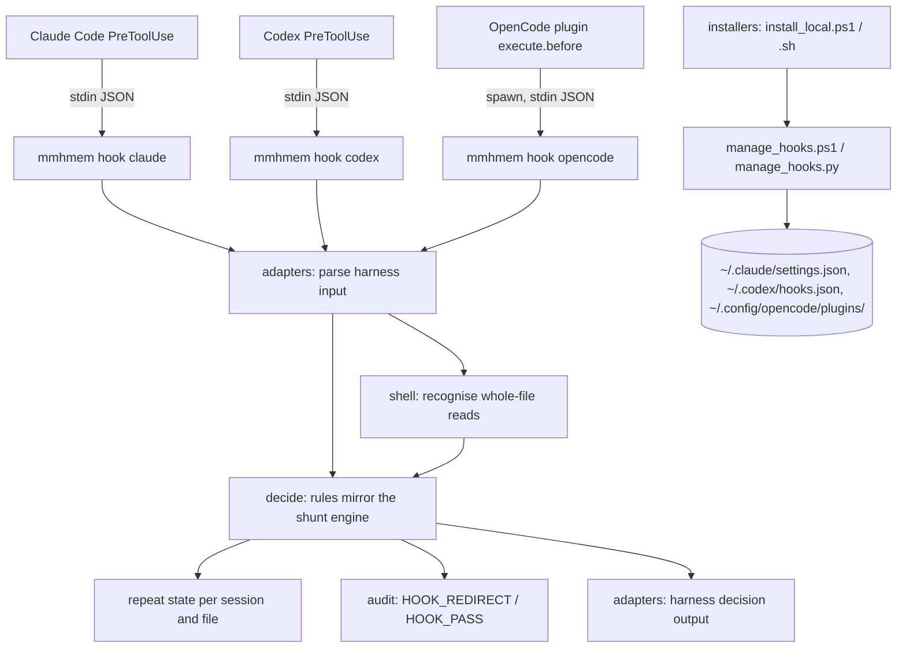

# Design Document: read-routing-hooks

## Overview

**Purpose:** Turn advisory read routing into deterministic routing where a
harness allows it, so full reads of large files become `smart_read`
summaries and mmhmem actually saves frontier tokens.

**Users:** Developers running Claude Code, Codex or OpenCode with mmhmem
installed, who opt in to the hook.

**Impact:** A new `mmhmem hook <harness>` command decides each pre-tool
event in a few milliseconds and tells the harness to pass the call or to
decline it with a pointer to `smart_read`. The installers gain an opt-in
`hooks` option that shows, adds and removes one entry per harness at user
scope, respecting each harness's approval model and policy. Statistics and
measurement come last (Delivery Order).

### Goals

- Redirect only full reads of files at or above the shunt threshold that are
  not security-critical, while a worker is configured.
- Never stop an agent: fail open, keep exact-range reads, allow a repeated
  full read, never touch edits.
- Be acceptable to users and harnesses: opt-in, inspectable, user scope,
  policy-aware, approval left to the harness, stable across updates.

### Non-Goals

- Intercepting MCP tools, search, edit or write tools.
- Rewriting a tool call into an MCP call (no harness supports that).
- Project-scope hooks, managed-policy installation, or writing trust records.

## Boundary Commitments

### This Spec Owns

- The hook decision engine and its per-harness input and output adapters.
- The `mmhmem hook <harness>` command, its repeat-read state and its audit
  events.
- The OpenCode plugin file that forwards to that command.
- Installer options and helpers that show, install and remove hook entries,
  including policy detection.
- Adoption statistics and the effect report (Delivery Order step 4).

### Out of Boundary

- The shunt engine's routing and summaries (only its security rule is
  shared).
- Harness internals, approval storage and policy files (read, never written).
- MCP registration and routing guidance (agent-tool-routing).

### Allowed Dependencies

- Existing crates only (`serde`, `serde_json`, `regex`); no new Rust
  dependency.
- The local profile configuration loader (`shunt_min_lines`, worker
  settings) and `AuditWriter`.
- Installers: PowerShell's JSON cmdlets and Python 3's `json` on Unix, as
  the existing JSON merges already use.

### Revalidation Triggers

- Any harness change to its pre-tool hook input, output, matcher, failure or
  trust behaviour.
- A change of the shunt engine's security rule or threshold semantics.
- A change of the installed binary path (changes the hook entry and, in
  Codex, its trust hash).

## Architecture

### Existing Architecture Analysis

- `main.rs` dispatches `stdio`, `serve`, `stats`, `prune`, `healthcheck`;
  local subcommands load the local profile configuration.
- `ShuntEngine::evaluate` routes: targeted when offset and limit are set;
  direct when the path matches `SECURITY_CRITICAL_RE` or the file has fewer
  than `shunt_min_lines` lines; shuntable otherwise; shunting needs a
  configured worker.
- `AuditWriter::write_event` appends one line per record with a per-record
  SHA-256 and `O_APPEND`, so a separate short-lived process can write
  safely next to the server.
- `serde_json` here sorts object keys on re-serialization, so harness
  settings files are edited by the installers (order-preserving JSON), not
  by the binary.

### Architecture Pattern & Boundary Map



- **Pattern:** one decision core with thin adapters, as the research table
  recommends; the shell parser is shared by Claude Code's shell tools,
  Codex and OpenCode's `shell`.
- **Fail-open wrapper:** the command catches every error and panic and
  answers "pass" with exit 0.

### Technology Stack

| Layer | Choice | Role |
|---|---|---|
| Decision command | Rust, in the mmhmem binary | Fast, no runtime dependency, same rules as the server |
| OpenCode bridge | JavaScript ES module (v2 plugin API) | Spawns the decision command, catches everything |
| Hook configuration | PowerShell JSON cmdlets; Python 3 `json` on Unix | Order-preserving edits of harness settings |

## File Structure Plan

### Directory Structure

```
src/hook/
├── mod.rs        # NEW: ReadRequest, Decision, decide(); thresholds and worker check
├── shell.rs      # NEW: recognise single whole-file reads in a shell command
├── adapters.rs   # NEW: parse Claude Code / Codex / OpenCode input; render each decision
└── state.rs      # NEW: repeat-read window keyed by harness, session and file
src/cli/
└── hook.rs       # NEW: `mmhmem hook <harness>` entry, bounded stdin, fail-open, audit
deploy/
├── opencode/mmhmem-read-routing.js   # NEW: OpenCode v2 plugin forwarding to the command
├── manage_hooks.ps1                  # NEW: show/install/remove/status per harness (Windows)
└── manage_hooks.py                   # NEW: same contract for the Unix installer
```

### Modified Files

- `src/main.rs`: dispatch `hook`.
- `src/lib.rs`: declare `hook`; help text lists `hook`.
- `src/cli/mod.rs`: declare `hook`.
- `src/services/shunt.rs`: expose `is_security_critical_path(path)` as a free
  function over the existing `SECURITY_CRITICAL_RE`; the engine method calls
  it.
- `src/storage/audit.rs`: add `HookRedirect` (`HOOK_REDIRECT`) and
  `HookPass` (`HOOK_PASS`) event types.
- `deploy/install_local.ps1`, `deploy/install_local.sh`, `install.ps1`,
  `install.sh`: `-Hooks`/`--hooks <list>` opt-in and interactive prompt,
  `-RemoveHooks`/`--remove-hooks`, removal with `-Remove`.
- `scripts/test-install.ps1`, `scripts/test-install.sh`: hook management
  cases.
- `docs/installation.md`: opt-in hooks, per-harness approval steps.
- Step 4: `src/cli/stats.rs` and a new `src/cli/stats_activity.rs` read audit
  events for the adoption counts.

## System Flows

```mermaid
sequenceDiagram
    participant H as Harness
    participant C as mmhmem hook
    participant S as repeat state
    participant A as audit log
    H->>C: pre-tool event JSON (stdin)
    C->>C: parse (adapter); non-read tool? -> pass silently
    C->>C: resolve path; regular text file? line count; security rule; worker configured?
    alt redirect candidate
        C->>S: same harness+session+file redirected within 120 s?
        alt yes
            C->>A: HOOK_PASS (repeat)
            C-->>H: pass
        else no
            C->>S: remember redirect
            C->>A: HOOK_REDIRECT
            C-->>H: deny + reason (smart_read or exact range; repeat to read in full)
        end
    else pass
        C->>A: HOOK_PASS (reason) for read calls
        C-->>H: pass
    end
    Note over C: any error or panic -> pass, exit 0, no output
```

## Requirements Traceability

| Requirement | Summary | Components | Interfaces | Flows |
|---|---|---|---|---|
| 1.1 | Per-route counts in stats | stats_activity | audit events | Step 4 |
| 1.2 | Counts without savings rows | stats_activity | — | Step 4 |
| 1.3 | JSON fields | stats.rs | `--json` | Step 4 |
| 1.4 | Savings fields unchanged | stats.rs | — | — |
| 1.5 | Read-only store | stats_activity reads audit JSONL only | — | — |
| 2.1 | Redirect large non-security full reads | decide | `Decision::Redirect` | Hook flow |
| 2.2 | Exact ranges pass | decide | `ReadRequest.range` | Hook flow |
| 2.3 | Short, security, non-text, missing pass | decide, shunt rule | `PassReason` | Hook flow |
| 2.4 | No worker, no redirect | decide | `HookSettings.worker_configured` | Hook flow |
| 2.5 | Repeat read passes | state | `RepeatWindow` | Hook flow |
| 2.6 | Whole-file shell reads only | shell | `recognise()` | Hook flow |
| 2.7 | Never edit, write, search | adapters (non-read → pass) | — | Hook flow |
| 2.8 | Edits still succeed | reason text; exact ranges pass; repeat window | — | Validation |
| 3.1 | Unreadable input → pass | cli/hook | fail-open wrapper | Error path |
| 3.2 | Internal error → pass, record without content | cli/hook | — | Error path |
| 3.3 | ≤ 200 ms, no network | decide (byte scan only) | — | — |
| 3.4 | No MCP dependency | cli/hook (in-process) | — | — |
| 4.1 | Opt-in only | installers | `-Hooks` / prompt | Install |
| 4.2 | Show entry before adding | manage_hooks | `show` | Install |
| 4.3 | User scope only | manage_hooks | fixed paths | Install |
| 4.4 | Respect policy | manage_hooks | `policy_block()` | Install |
| 4.5 | Leave approval to harness | manage_hooks (no trust writes) | messages | Install |
| 4.6 | Clean removal | manage_hooks | `remove` | Remove |
| 4.7 | Idempotent | manage_hooks | entry identity | Install |
| 4.8 | Stable entry across updates | fixed command and args | entry identity | Update |
| 4.9 | Coexist with other hooks | append-only entry, no ordering dependency | — | — |
| 5.1 | Absolute path, no shell interpolation | entry shapes | exec form / quoted path | — |
| 5.2 | Reads only metadata, writes only audit and state | cli/hook | — | — |
| 5.3 | No network, no secrets | cli/hook loads only threshold and worker presence | — | — |
| 5.4 | Audit decisions without content | audit events | details schema | Hook flow |
| 5.5 | Untrusted input, resolve like the harness | adapters | path resolution | Hook flow |
| 6.1 | Claude Code | adapters (claude) | `Read`, `Bash`, `PowerShell` | — |
| 6.2 | Codex | adapters (codex), shell | `Bash` command | — |
| 6.3 | OpenCode v2, catch-all | plugin JS | `execute.before` | — |
| 6.4 | Opt-in as only gate | installers | — | Install |
| 6.5 | Advisory where no hook | installers | message | Install |
| 7.1 | Before and after comparison | validation report | audit events | Step 4 |
| 7.2 | Redirect follow-through metrics | stats_activity | — | Step 4 |
| 7.3 | NOT_VERIFIED rule | validation report | — | Step 4 |

## Components and Interfaces

| Component | Layer | Intent | Req Coverage | Contracts |
|---|---|---|---|---|
| decide (`src/hook/mod.rs`) | Rust | Pure decision over a read request | 2.1–2.5, 3.3 | Service |
| shell (`src/hook/shell.rs`) | Rust | Recognise whole-file reads in shell commands | 2.6 | Service |
| adapters (`src/hook/adapters.rs`) | Rust | Harness input and output mapping | 2.7, 5.5, 6.1–6.3 | API |
| state (`src/hook/state.rs`) | Rust | Repeat-read window | 2.5 | State |
| hook command (`src/cli/hook.rs`) | Rust | Entry, fail-open, audit | 3.1–3.4, 5.2–5.4 | Batch |
| OpenCode plugin | JS | Bridge with catch-all | 6.3 | API |
| manage_hooks (ps1 / py) | Installer | Show, install, remove, policy | 4.x, 5.1, 6.4, 6.5 | Batch |
| stats_activity | Rust | Adoption counts (step 4) | 1.x, 7.x | Service |

### decide (`src/hook/mod.rs`)

```rust
pub struct ReadRequest {
    pub path: PathBuf,              // resolved absolute path
    pub range: Option<(u64, u64)>,  // offset, limit when the call asks for lines
    pub tool: String,               // harness tool name, for the audit record
}

pub struct HookSettings {
    pub shunt_min_lines: u32,       // local profile, default 150
    pub worker_configured: bool,    // worker model present (env or .mmhmem.json)
}

pub enum PassReason { Range, Short, SecurityCritical, NotText, Missing, NoWorker, Repeat, NotARead }

pub enum Decision {
    Pass(PassReason),
    Redirect { lines: u64 },
}

pub fn decide(req: &ReadRequest, settings: &HookSettings) -> Decision;
```

- Order: range → missing/not regular → security rule → no worker → not text
  (a NUL byte in the first 8 KiB) → line count below threshold → redirect.
- Line counting streams bytes and stops at the threshold, so large files
  cost one partial read; files over 10 MiB pass as `NotText` unless the
  first 8 KiB proves text, then count with an early stop.

### shell (`src/hook/shell.rs`)

```rust
/// Some(path) only for one simple command that reads one whole file.
pub fn recognise(command: &str, cwd: &Path) -> Option<PathBuf>;
```

- Accepted: `cat FILE`, `type FILE`, `less FILE`, `more FILE`,
  `Get-Content [-Path|-LiteralPath] FILE` and its aliases `gc`, `cat` in
  PowerShell, with one file argument and no other options.
- Rejected (pass): pipes, redirects, `;`, `&&`, `||`, subshells, command
  substitution, globs, several files, `head`, `tail`, `sed`, `grep`, any
  `Get-Content` range option (`-TotalCount`, `-Head`, `-Tail`, `-ReadCount`).
- Codex arrays such as `["bash", "-lc", "cat x"]` are unwrapped to their
  script before recognition.

### adapters (`src/hook/adapters.rs`)

| Harness | Input | Read requests | Redirect output | Pass output |
|---|---|---|---|---|
| claude | `tool_name`, `tool_input`, `session_id`, `cwd` | `Read` (file_path, offset, limit); `Bash` and `PowerShell` (command via shell) | stdout `{"hookSpecificOutput":{"hookEventName":"PreToolUse","permissionDecision":"deny","permissionDecisionReason":…}}` | exit 0, no output |
| codex | `tool_name`, `tool_input.command`, `session_id`, `cwd` | `Bash` / shell via shell | same JSON shape (documented for Codex) | exit 0, no output |
| opencode | `{tool, sessionID, input, cwd}` from the plugin | `read` (path, offset, limit); `shell` (command) | stdout `{"decision":"deny","reason":…}` | stdout `{"decision":"pass"}` |

- Redirect reason (one line, no file content): `mmhmem: <path> has <n>
  lines. Call smart_read for a summary, or read an exact line range with
  offset and limit. Repeat this read within 2 minutes to read the whole
  file anyway.`
- Stdin is capped at 1 MiB; larger input passes.

### state (`src/hook/state.rs`)

- File `hook-redirects.json` in the local data directory: entries keyed by
  SHA-256 of harness, session id and path, value = redirect time; entries
  older than one hour are pruned; written with temp file and rename;
  concurrent writers may lose an entry, which only means one more redirect.
- Window: 120 seconds.

### hook command (`src/cli/hook.rs`)

- `mmhmem hook <claude|codex|opencode>`: reads stdin, loads only
  `shunt_min_lines` and worker presence from the local profile, decides,
  records the audit event, prints the adapter output, exits 0.
- Any error or panic (`catch_unwind`) prints the pass output and exits 0.
- Audit details: `{"decision", "reason", "tool", "file_path", "lines"}`;
  project is the basename of the harness `cwd`; non-read tool calls record
  nothing.

### OpenCode plugin (`deploy/opencode/mmhmem-read-routing.js`)

- Default export `{id: "mmhmem-read-routing", setup(ctx)}` registering
  `ctx.tool.hook("execute.before", …)` for `read` and `shell` only.
- Spawns the absolute mmhmem path (written into the file by the installer)
  with the event JSON on stdin and a 2-second limit; throws `Error(reason)`
  only on a `deny` answer; every other outcome, including spawn failure,
  returns normally.
- The spawn API available to v2 plugins is unconfirmed (research.md): the
  first OpenCode task proves it against the installed OpenCode 2.2.5 and
  stops for a design revision if no spawn is possible.

### manage_hooks (`deploy/manage_hooks.ps1`, `deploy/manage_hooks.py`)

Contract (both): `show|install|remove|status <harness> --binary <path>`.

| Harness | File | Entry | Identity |
|---|---|---|---|
| claude | `~/.claude/settings.json` | `hooks.PreToolUse[]` group `{"matcher":"Read|Bash|PowerShell","hooks":[{"type":"command","command":"<abs mmhmem>","args":["hook","claude"],"timeout":10}]}` | command ends in `mmhmem`/`mmhmem.exe` and args `["hook","claude"]` |
| codex | `~/.codex/hooks.json` | `PreToolUse[]` group `{"matcher":"^(Bash|shell)$","hooks":[{"type":"command","command":"\"<abs mmhmem>\" hook codex","timeout":10}]}` | same rule on the command string |
| opencode | `~/.config/opencode/plugins/mmhmem-read-routing.js` | the plugin file with the binary path | file name |

- Install adds the entry only when absent, keeps every other key, hook and
  group in place and order, and backs the file up first.
- Remove deletes only the identified entry (and an emptied group), or the
  plugin file.
- Policy checks before install:
  - Claude Code: `disableAllHooks` in user settings or in the managed
    settings file for the OS.
  - Codex: `[features] hooks = false` in `config.toml`; `hooks = false` or
    `allow_managed_hooks_only = true` in a managed `requirements.toml`.
  - OpenCode: a managed policy denying `plugin.use` where the file is
    readable.

  The exact managed file locations are verified in the installer task.
- After install the helper prints the harness's own approval step: Claude
  Code workspace trust; Codex `/hooks` review; OpenCode none (opt-in only).
- The entry text depends only on the binary path, so updates leave it
  byte-identical and Codex's trust hash unchanged.

## Key Decisions

1. **Decision logic in the binary, not in scripts.** One implementation,
   millisecond startup, same rules as the server, no interpreter needed.
2. **Settings edits in the installers.** Order-preserving JSON there, while
   the binary's `serde_json` would reorder user settings.
3. **Repeat window instead of a hard block.** Prevents deadlock when the
   agent needs the whole file (2.5, 2.8).
4. **No redirect without a worker.** A redirect must lead to a usable
   summary (2.4).
5. **Conservative shell recognition.** Only unambiguous single whole-file
   reads are redirected; anything else passes.
6. **Codex via `hooks.json`.** Keeps mmhmem's entry out of the user's
   `config.toml`; to be verified that a user `hooks.json` coexists with
   the existing inline `[hooks.state]` table without the "one
   representation per layer" warning, else fall back to inline `[hooks]`.

## Error Handling

| Condition | Behaviour | Requirement |
|---|---|---|
| Bad or oversized stdin | pass, exit 0 | 3.1 |
| Config unreadable | pass | 3.1 |
| Any error or panic | pass, audit error without input content | 3.2 |
| Plugin spawn failure or timeout | OpenCode call proceeds | 3.1, 6.3 |
| Policy forbids hooks | installer refuses, names the policy | 4.4 |
| Settings file unparsable | installer refuses, file unchanged | 4.6 |

## Testing Strategy

- **Unit (Rust):** decision matrix over range, size, security, text, worker
  and repeat; shell recognition accept and reject cases on Bash and
  PowerShell syntax; adapter golden input and output per harness; state
  window and pruning; fail-open on garbage, oversized and panicking input;
  a 10 MiB file decided under 200 ms.
- **Installer tests:** install twice keeps one entry; remove restores the
  other hooks and keys unchanged; policy refusal; Codex trust state never
  written; a plugin file written with the binary path.
- **Live (validation):** Claude Code headless session redirecting a large
  read, then editing the file successfully; Codex session with a trusted
  hook redirecting `cat`; OpenCode 2.2.5 plugin redirecting `read`.
- **Effect (step 4):** adoption counts before and after enabling per harness.
