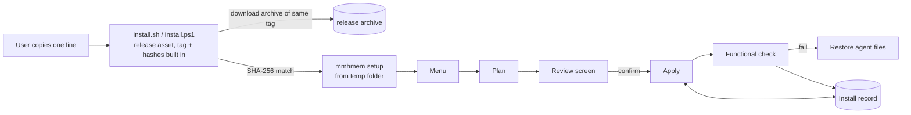

# Design Document: reliable-installers

## Overview

A user installs mmhmem with one line copied from the README:

```sh
curl -fsSL https://github.com/norandom/mmhmem/releases/latest/download/install.sh | sh
```

```powershell
irm https://github.com/norandom/mmhmem/releases/latest/download/install.ps1 | iex
```

Both URLs point at release assets, not the repository. Each release
publishes its own `install.sh` and `install.ps1` with that release's tag and
archive hashes written into them. The script downloads one archive, checks
its hash, unpacks the binary into a temporary folder and starts
`mmhmem setup`. From there one Rust implementation does everything:

- the menu,
- the install record,
- every change to every agent's config,
- the functional check,
- update and removal.

Nothing is fetched from a branch, and nothing is read from a checkout.

### Goals

- A user with no knowledge of mmhmem completes an install on Linux, macOS or
  Windows and sees each agent pass a functional check.
- Config files are never left invalid; anything the installer changed can be
  restored.
- One implementation, one test suite, one CI end-to-end gate.

### Non-goals

- Installing from a source checkout (maintainers run
  `cargo run -- setup --release-dir <dir>` against locally built release
  artifacts; this path is not documented for users).
- Per-project installs. The user installer configures agents for the
  current user only. The old `-ProjectDir` mode is dropped.
- Antigravity automation (no public config path; the menu shows the import
  snippet as today).
- Package managers (winget, Homebrew); possible later on top of the same
  release assets.

## Architecture



### Source layout

All installer code lives in `src/setup/`:

```
src/setup/
  mod.rs            entry: `mmhmem setup` argument handling, terminal detection
  release.rs        thin wrapper around self_update: release lookup, signed download, unpack, replace
  record.rs         install record: load, save atomically, drift detection, rebuild
  plan.rs           Plan / Change types, ordering, apply, rollback
  fsx.rs            atomic write, backup, owner-only permissions (Unix mode, Windows ACL)
  edit/
    json.rs         JSON/JSONC edits via jsonc-parser CST
    toml.rs         TOML edits via toml_edit
  agents/
    mod.rs          Agent trait + registry
    claude_code.rs
    claude_desktop.rs
    codex.rs
    opencode.rs
    antigravity.rs  detect + show snippet only
  check.rs          functional check (MCP handshake, agent CLI checks, hook sample)
  ui/
    app.rs          ratatui state machine (screens below)
    fallback.rs     numbered-list UI with the same screens
    text.rs         every user-facing string, plain language, in one file
  assets.rs         include_str! of playbooks, skills, commands, routing text, hook files
```

Release tooling:

```
deploy/bootstrap/install.sh.tmpl     ~120 lines, POSIX sh
deploy/bootstrap/install.ps1.tmpl    ~120 lines, Windows PowerShell 5.1 compatible
scripts/render-bootstraps.ps1        fills tag + hashes into the templates at publish time
```

Deleted after migration (Requirement 8.6): root `install.ps1`, `install.sh`,
`lib.ps1`, `lib.sh`, `deploy/install_local.*`, `deploy/manage_*.{ps1,py}`,
`deploy/*_onboarding.*`, `deploy/check_worker.*`, `deploy/install_binary.ps1`
and their `scripts/test-*` files. The asset files they copied (skills,
commands, instructions, the OpenCode plugin) move to `assets/setup/` and are
embedded.

## Components

### 1. Bootstrap scripts (Requirements 1, 2)

Steps, same on both platforms:

1. Detect OS and CPU. If the release has no archive for them, say so in plain
   words and exit 1 (2.7).
2. Download `mmhmem-<tag>-<target>.<ext>` from
   `https://github.com/norandom/mmhmem/releases/download/<tag>/` into a new
   temporary folder. The tag is built into the script, so this is always
   the same release (2.1, 2.2).
3. Compute SHA-256 and compare with the hash built into the script. Unix:
   `sha256sum` or `shasum -a 256`. Windows: `Get-FileHash`. On mismatch,
   print expected and actual and exit without touching anything (2.3, 2.5).
4. Unpack. Windows uses `Expand-Archive` on a `.zip`. Linux and macOS use
   `tar -xzf` on a `.tar.gz` (2.8).
5. Start `<temp>/mmhmem setup --bootstrap <tag>`:
   - **Unix:** stdin is redirected from `/dev/tty` when it exists, because
     `curl | sh` uses stdin for the script itself.
   - **Windows:** under `irm | iex` the console is already interactive.
6. Delete the temporary folder; exit with setup's exit code.

The scripts contain no agent names, no paths other than the temp folder and
no flags (7.2, 1.3). They do not change `PATH`. `setup` does that, so it is
recorded and reversible.

**Running from inside a checkout:** the bootstraps are not in the
repository root any more, only templates under `deploy/bootstrap/`. The
README links only to the release URLs (2.2).

### 2. Release assets and trust (Requirement 2)

Per release:

| Asset | Content |
|---|---|
| `mmhmem-<tag>-x86_64-pc-windows-msvc.zip` | `mmhmem.exe` |
| `mmhmem-<tag>-x86_64-unknown-linux-musl.tar.gz` | `mmhmem` (static, per static-linux-release) |
| `mmhmem-<tag>-x86_64-apple-darwin.tar.gz` | `mmhmem` |
| `mmhmem-<tag>-aarch64-apple-darwin.tar.gz` | `mmhmem` |
| `install.sh`, `install.ps1` | rendered bootstraps |
| `SHA256SUMS` | hashes of every asset above, computed after signing |
| `SHA256SUMS.sig` | detached ed25519 signature of `SHA256SUMS`, same key as the archives |

Each archive carries an embedded `zipsign` ed25519 signature. Signing
changes the archive bytes, so hashes are taken afterwards.

The existing bare binaries keep being published for one release so old
one-liners keep working, then stop.

How each part of the chain is trusted:

- **First install:** the bootstrap and the archive come from the same
  GitHub release over TLS. The bootstrap only trusts its built-in hashes,
  never a downloaded `SHA256SUMS`, so a swapped checksum file cannot make it
  accept a different archive. The limit of this protection: an attacker who
  can replace release assets can also replace the bootstrap. For checks
  that don't depend on GitHub, the release pipeline also publishes GitHub
  artifact attestations, and the README gives the `gh attestation verify`
  command.
- **Updates and status (2.4, 2.6):** the installed binary embeds the
  project's ed25519 public keys (a list, to allow rotation). An update goes
  through `self_update` with `verifying_keys` set to those keys, so the
  archive's `zipsign` signature must verify before it is unpacked or used.
  `setup` also downloads `SHA256SUMS` and `SHA256SUMS.sig`, verifies the
  signature with the same keys (`zipsign-api` / `ed25519-dalek`) and checks
  the archive against it. The keys come from the already trusted install, so
  a replaced checksum file or archive is detected. Status re-hashes the
  installed binary against the record.
- **Signing:** the ed25519 secret key lives only in a GitHub Actions
  environment `release` with required reviewers. `publish-ci-release.ps1`
  signs each archive with `zipsign`, signs `SHA256SUMS`, and then runs its
  existing byte-for-byte remote verification.

### 3. Install record (Requirement 5)

The record is stored in a per-user location:

- Linux: `~/.local/state/mmhmem/install.json`
- macOS: `~/Library/Application Support/mmhmem/install.json`
- Windows: `%LOCALAPPDATA%\mmhmem\install.json`

Backups go in a `backups/<timestamp>/` folder next to it.

```json
{
  "schema": 1,
  "release": "v0.5.0",
  "binary": { "path": "C:\\Users\\u\\AppData\\Local\\Programs\\mmhmem\\mmhmem.exe", "sha256": "…" },
  "path_entry": { "added": true, "value": "C:\\Users\\u\\AppData\\Local\\Programs\\mmhmem" },
  "agents": {
    "codex": {
      "features": { "mcp": true, "instructions": true, "recap_command": true, "read_hook": false },
      "managed": [
        { "kind": "toml_table", "file": "~/.codex/config.toml", "key": "mcp_servers.mmhmem",
          "sha256": "<hash of the entry's normalized value>", "backup": "backups/2026-11-04T09-30-00Z/config.toml" },
        { "kind": "file", "file": "~/.agents/skills/unified-memory/SKILL.md", "sha256": "…", "backup": null }
      ],
      "pending_user_steps": ["approve_hook_in_codex"],
      "last_check": { "at": "2026-11-04T09:31:12Z", "result": "pass", "details": [] }
    }
  }
}
```

- **Entry-level hashes:** for shared config files, the hash covers only
  mmhmem's entry, normalized. A user editing other settings in
  `config.toml` is therefore not reported as drift (5.3).
- **Atomic writes:** each change follows the same order. First the backup
  is written. Then the record is saved with the change marked
  `"state": "applying"`. Then the target file is written atomically, and
  finally the record is saved again with `"state": "done"`. After an
  interruption, the next run finds `applying` entries and compares them
  with the disk to finish or undo them (5.2).
- **No secrets:** the record never stores worker keys (5.7). Worker
  settings are kept in the record only as a "configured: yes/no" flag.
- **Skipped agents (3.4):** an agent whose `plan()` returned an
  `AgentProblem` is neither applied nor checked, and no feature is recorded
  for it; an entry from an earlier install stays as it was. What the user
  chose for it is kept as `"skipped": ["mcp", …]` (left out when empty), so
  the next run plans it again and sets it up once the file is fixed.
- **Rebuild:** if the record is missing or unreadable, the installer scans
  each agent's known locations for mmhmem entries and shows what it found,
  and the user confirms before anything is adopted (5.6). This is also how
  installs made by the old scripts are adopted. Their Codex marker block is
  recognised and converted into a normal `[mcp_servers.mmhmem]` table.

### 4. Plan, apply, rollback (Requirements 3, 8.5)

```rust
pub struct Plan { pub changes: Vec<Change> }
pub struct Change {
    pub agent: AgentId,
    pub target: Target,          // File(path) | JsonEntry{file, pointer} | TomlTable{file, key} | PathEntry | Binary
    pub action: Action,          // Add | Update | Remove
    pub before: Option<Vec<u8>>, // current bytes of the entry or file
    pub after: Option<Vec<u8>>,  // exact bytes to write
    pub summary: String,         // one plain-language line for the review screen
}
```

- **Planning:** each agent's `plan()` reads its files, computes the edits
  in memory and returns `Change`s. The review screen renders `summary`
  plus, on request, a diff of `before` → `after`. `apply()` writes exactly
  `after`; nothing is recomputed after the user confirms.
- **Validation before writing (3.2):** the edited file content is parsed
  again with the same parser (`jsonc-parser` / `toml_edit`), and the
  agent's own shape is checked: required keys, types, and no duplicate
  server name. Only then is it written with `tempfile::persist`, which
  writes a temporary file in the same folder and renames it.
- **Invalid existing file (3.4):** `plan()` returns an `AgentProblem`
  instead of changes. That agent is shown as "skipped: <file> is not valid
  <format> (line N: …)", and the other agents continue.
- **Rollback (3.5):** if the functional check fails for an agent, every
  `Change` for that agent is reversed from its backup, in reverse order.
  The record is updated and the screen says "Restored your original
  <agent> settings."
- **Owner-only key file (Requirement 9):**
  - Unix creates the file with `OpenOptions::mode(0o600)`.
  - Windows creates it with a security descriptor that grants access only
    to the current user SID (`windows-sys`, `CreateFileW` with
    `SECURITY_ATTRIBUTES`), so the first byte is already protected.

### 5. Agents (Requirements 3, 6, 8.4)

```rust
pub trait Agent {
    fn id(&self) -> AgentId;
    fn detect(&self, env: &Env) -> Detection;            // Found{version, paths} | NotFound{reason}
    fn features(&self) -> &'static [Feature];
    fn plan(&self, env: &Env, want: &Selection, rec: &AgentRecord) -> Result<Vec<Change>, AgentProblem>;
    fn check(&self, env: &Env, rec: &AgentRecord) -> CheckReport;
    fn plan_remove(&self, env: &Env, rec: &AgentRecord) -> Vec<Change>;
}
```

`Env` holds the home folder, OS and the search `PATH`. Tests construct it
pointing at a temporary home.

| Agent | MCP registration | Other managed items | Agent's own check |
|---|---|---|---|
| Claude Code | `claude mcp add --scope user --transport stdio mmhmem -- <bin> stdio` (the agent's own CLI writes `~/.claude.json`); remove with `claude mcp remove --scope user mmhmem` | `~/.claude/skills/unified-memory/`, `~/.claude/commands/mmhmem-recap.md`, a delimited mmhmem section in `~/.claude/CLAUDE.md` (Markdown has no structure to parse, so this is the one marker-based edit; the record hashes the section and drift is reported), hook entry in `~/.claude/settings.json` (JSON CST) | `claude mcp get mmhmem` must show `Scope: User config`, `Status: ✔ Connected` and the installed command. Not `claude mcp list`, which health-checks every remote server and is slow |
| Claude Desktop | `mcpServers.mmhmem` in `claude_desktop_config.json` (JSON CST); MSIX profile preferred; more than one profile → the user picks one on screen instead of the whole install stopping | skill folder | none (GUI); functional check only, plus "restart Claude Desktop" as a user step |
| Codex | `[mcp_servers.mmhmem]` in `~/.codex/config.toml` (`toml_edit`) | `~/.agents/skills/…`, `~/.codex/prompts/mmhmem-recap.md`, hook in `~/.codex/hooks.json` | `codex mcp list --json` must contain `mmhmem` enabled with the installed command. It's parsed in memory and never logged, because it prints env values unmasked. It reports no connection status, so connectivity comes from the MCP handshake. Hook approval is a pending user step |
| OpenCode | `mcp.servers.mmhmem = {type:"local", command:[<bin>,"stdio"]}` (confirmed: the shape `opencode mcp add` writes; research §8), via JSON CST. OpenCode loads `opencode.json` **and** `opencode.jsonc`, so the installer edits the file that already holds an mmhmem entry, or else `opencode.jsonc` if it exists, or else `opencode.json`. An entry in both is reported as a duplicate for the user to resolve | skill, command, plugin file `~/.config/opencode/plugins/mmhmem-read-routing.js` | `opencode mcp list`, run from the home folder and polled until `✓ mmhmem connected` or 30 s (the first answer comes before servers start; research §8). Never `--standalone`. `mcp list` starts OpenCode's background service; when `opencode service status` said `stopped` before the poll, `opencode service stop` ends it again afterwards, and a service that was already running is left alone |

Where an agent has a CLI command that adds MCP servers without asking
questions, the installer uses it, so the agent writes its own file. The
installer still backs up and hashes the file before and after.

### 6. Functional check (Requirement 6)

For each selected agent, `check()` runs these steps:

1. **Read back the registration** the way the agent will use it: from the
   file just written, or via `claude mcp get` / `codex mcp get`.
2. **Start that exact command and arguments** with the `rmcp` child-process
   client, with a 20 s timeout. Then:
   - run `initialize`;
   - run `tools/list`, which must contain the expected tool names of this
     release;
   - call the read-only `status` tool for project `mmhmem-install-check`
     and harness `mmhmem-setup`, and require `store ok` and this release's
     version. Added in task 1.2: every existing tool writes breadcrumbs.
     `status` changes no store row and writes one `STATUS_CHECK` audit
     record, because the steering requires every action to be audited
     (user decision 2026-11-04).
3. **Run the agent's own check command** from the table above. Its output
   is parsed for mmhmem and its connected state.
4. **Hook sample (if the hook was selected):** run `<bin> hook <agent>`
   with the agent's documented hook input for a whole-file read of a sample
   file, and require the redirect answer.
5. **Load the config:** where the agent can validate its own config, run
   that, e.g. `codex mcp list` exits non-zero on a broken `config.toml`.

The result line per agent is `✔ Codex — mmhmem connected, 9 tools`. For a
failure it reads `✘ OpenCode — mmhmem did not start: <plain reason>. What
you can do: …`. Steps only the user can do are shown as `● Codex — approve
the mmhmem hook: open Codex, type /hooks, approve "mmhmem read routing"`.
The result is stored in `last_check`.

### 7. Menu (Requirement 4)

The menu is a full-screen ratatui app, and the legend line is always
visible: `↑↓ move · space select · enter continue · esc back · q quit`.

```
┌ mmhmem setup ───────────────────────────────────────────────────────────┐
│ Installed: v0.4.1          Newest release: v0.5.0                       │
│                                                                         │
│ Agent            mmhmem      Features            Last check             │
│ Claude Code      installed   memory, recap       ✔ 2026-11-04 09:31     │
│ Codex            installed   memory, read hook   ● approve hook         │
│ OpenCode         not set up  –                   –                      │
│ Claude Desktop   not found   (app not installed)                        │
│                                                                         │
│ > Update to v0.5.0                                                      │
│   Change agents and features                                            │
│   Check that everything works                                           │
│   Remove mmhmem                                                         │
└ ↑↓ move · enter continue · q quit ──────────────────────────────────────┘
```

| Screen | Content | Actions |
|---|---|---|
| Home | state from the record + live detection + newest release | only applicable actions (4.3) |
| Agents | checkbox per detected agent; undetected listed greyed with reason (4.4) | next |
| Features | per agent: "Shared memory (required)", "Recap command", "Agent instructions", "Read-routing hook: sends large file reads through mmhmem to save tokens (off by default)", "Worker model (optional)" (4.5) | next |
| Review | every `Change.summary` grouped by file; `d` shows the diff (4.6) | confirm / back |
| Progress | one line per change, then the check results | done |

- **Cancelling (4.7):** `q`/`esc` at any screen before Review confirm
  exits with no changes.
- **Plain terminals (4.8):** the numbered fallback is used when
  `crossterm` can't enter raw mode or the alternate screen, or when
  `TERM=dumb`. It walks the same screens with numbered prompts.
- **No terminal (4.9):** without a terminal, the default selection is
  installed without prompts and the results are printed as lines, but
  only when setup was started by the install script (`--bootstrap <tag>`).
  A plain `mmhmem setup` without a terminal changes nothing and tells the
  user to run it in a terminal, so an AI agent running it in a
  non-interactive shell cannot change configs unasked.
- **Typed-ahead keys:** the Review only takes keys pressed after it is
  drawn; keys waiting when it appears (typed during an update, a restart
  or planning) are dropped, so they never confirm changes the user has not
  seen (research.md §8, fourth e2e run).
- **Wording:** all text is in `ui/text.rs`, written for people who don't
  know the project (1.4).

### 8. Update and removal (Requirement 7)

- **Update:** fetch release metadata
  (`https://api.github.com/repos/norandom/mmhmem/releases/latest`, falling
  back to the `releases/latest` redirect) through `self_update`'s GitHub
  backend, then verify as in §2. Then:
  - let `self_update` unpack and replace the running binary (it uses
    `self-replace` for the Windows file-in-use case), and record the new
    hash;
  - re-plan every agent with the recorded selection, so changed assets
    become `Update` changes;
  - show the Review screen and run the check.

  An up-to-date install yields an empty plan, and the menu says "Everything
  is current" and offers Check (7.1).
- **Remove:** applies `plan_remove` of each agent, which reverses only
  recorded entries. Shared files are edited with the same parsers, never
  restored wholesale, so later user edits survive (7.3). The binary, the
  `PATH` entry and the record are removed last. The store is kept unless
  the user ticks "Also delete my saved memories" on the Review screen
  (7.4).

### 9. Error handling

- Every error shown to the user has three parts: what happened, which file
  or download, and what to do. Raw OS errors go into
  `~/.local/state/mmhmem/setup.log` (or the platform equivalent) and are not
  shown.
- A network failure before Review means no changes. A failure during Apply
  rolls back the failing agent, and the agents already done stay as they
  are and are reported.
- **Exit codes:**
  - 0: all selected agents pass or have only user steps pending;
  - 1: an agent failed;
  - 2: cancelled;
  - 3: verification of a download failed.

## Testing strategy (Requirement 10)

- **Unit tests:**
  - `edit/json.rs` and `edit/toml.rs`: golden files with comments, odd
    whitespace, trailing commas (JSONC), CRLF and BOM;
  - each edit is applied and then removed, and the result must be
    byte-identical;
  - drift detection and record recovery after a simulated crash at each
    step;
  - signature and hash failures.
- **Agent tests** (`tests/setup_agents.rs`): a temporary home with fake
  `claude`, `codex` and `opencode` CLIs (small test binaries that record
  arguments and edit files as the real ones do). These cover `plan` →
  `apply` → `check` → `plan_remove`, plus invalid existing files.
- **UI tests:** each screen rendered with `ratatui::backend::TestBackend`
  and compared with snapshots, and key sequences driven through the state
  machine, including cancel at every screen.
- **CI end-to-end** (`.github/workflows/installer-e2e.yml`, required for
  `publish`):
  - Matrix: `ubuntu-latest`, `macos-15` (arm64), `macos-15-intel` (x86_64; the macos-13/14 images were retired in 2026), `windows-latest`. On
    Windows it runs under both `powershell.exe` 5.1 and `pwsh`.
  - Release artifacts are built from the commit, the bootstraps are
    rendered, and both are served from a local HTTP server. The test
    bootstrap's base URL is the only difference from the published script,
    and the rendering step is shared.
  - Each run starts from a clean home seeded with real agent configs that
    contain unrelated settings, comments and odd formatting. The real
    `claude`, `codex` and `opencode` CLIs are installed from their official
    packages, and there's no login, because the MCP list commands need
    none.
  - The sequence: run the exact user one-liner (with a terminal provided
    by `script` / ConPTY for the menu path, and without a terminal for the
    default path) → require exit 0 and every agent ✔ → run again and
    require "Everything is current" plus a byte-identical home → update
    from the previous published release → remove → require the seeded
    files to be byte-identical to the start.
  - Failure cases: cancel at Review, a 404 on the archive, a wrong hash, a
    bad signature on update, an already-invalid `opencode.json`. Each must
    leave the home byte-identical.

## Migration

1. Ship `mmhmem setup` and the new release assets alongside the old
   scripts for one release.
2. On first run, `setup` adopts old installs through record rebuild (§3).
3. Point the README at the release URLs. Replace the root `install.ps1` /
   `install.sh` with a 10-line stub that prints the new one-liner and
   exits, so old copies never mix versions again.
4. Next release: delete the old scripts, helpers and their tests.

Until step 1 is released, `main` must not be pushed with the current
hook-installing scripts. At remote `HEAD` they would install hooks that call
`mmhmem hook`, which the v0.4.1 binary lacks.

## Requirements traceability

| Requirement | Design sections |
|---|---|
| 1 One obvious way | Overview, §1, §7 (text.rs), README in Migration |
| 2 Published releases only | §1, §2, §8 |
| 3 Configs never broken | §4, §5, Testing |
| 4 Real menu | §7 |
| 5 Install record | §3 |
| 6 Functional check | §6 |
| 7 Update and removal | §8 |
| 8 One implementation | Source layout, §4, §5 |
| 9 Key protection | §4 |
| 10 Proven before release | Testing strategy |

## Libraries

`research.md` §6 lists the library per task. Adopted:
- `ratatui` + `crossterm` (menu);
- `jsonc-parser` CST and `toml_edit` (config edits);
- `tempfile` and `fs-err` (writes);
- `rmcp` client (check);
- `self_update` with `zipsign` signatures (download, unpack, replace);
- `similar`, `indicatif`, `which`, `etcetera`, `winreg`;
- for tests, `insta`, `assert_cmd`, `assert_fs`, `expectrl` and `httpmock`.

The first bootstrap download can't use `self_update`: no binary is
installed yet, and the shell can't verify ed25519. It relies on the hashes
built into the script (§2).

## Open points resolved in tasks

All three are resolved:
- OpenCode schema and `mcp list` behaviour: task 1.1, research §8.
- Check call: task 1.2, the new `status` tool (§6).
- Windows `.tgz`: task 1.3, research §9 (not from mmhmem).
