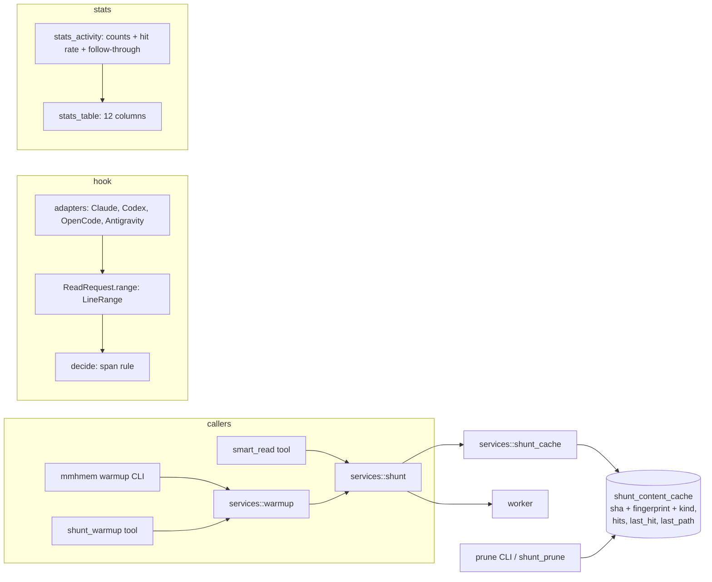

# Design Document: shunt-cache-efficiency

## Overview

**Purpose**: make the token savings of the read-routing path real for a
user who runs several agents over the same repositories: one summary per
file content shared by every agent and by warm-up, a hook that sizes ranged
reads, a threshold where a summary pays off, a repository-wide warm-up, and
statistics that show the cache hit rate and the redirect follow-through.

**Users**: every agent that reads through `smart_read` or through a
read-routing hook (Claude Code, Codex, OpenCode, Antigravity); the operator
reading `mmhmem stats`; the user warming a repository before a session.

**Impact**: the file-read summary moves from `shunt_file_cache` (keyed by
path, content and question) to the existing `shunt_content_cache` (keyed by
content and question, with LRU, hits and audited eviction) under a
canonical question; `smart_read` gains `answer_question`; the hook's
`ReadRequest.range` becomes a typed line range that `decide` sizes; the
default threshold becomes 300; `mmhmem stats` gains two rate columns;
`mmhmem warmup` is a new subcommand; prune reads the new table.

### Goals
- A file read by agent A is a cache hit for agent B on the same content,
  whatever path or question B uses, unless B explicitly asks a question.
- A ranged read at or above the threshold is treated as a whole-file read.
- `mmhmem stats` shows hit rate and follow-through per day, project, harness.
- `mmhmem warmup` makes a repository's large files hits before any agent reads them.

### Non-Goals
- Changing the worker prompts or the summary format.
- Expiring cache rows by age (content addressing makes age irrelevant).
- A new hook event or any change to the per-harness hook protocol beyond
  the range handling and the redirect text.
- Cross-machine or shared-server cache semantics beyond what the single
  store already provides.

## Boundary Commitments

### This Spec Owns
- The file-read summary cache: its table (`shunt_content_cache` with
  `last_path`), key, lookup policy for default and custom questions,
  cap, eviction audit, hit accounting, and the migration from
  `shunt_file_cache`.
- The `smart_read` parameter `answer_question` and its description, the
  one-line "question not applied" note, and the playbook wording about
  questions and warm-up.
- `ReadRequest.range` as a typed line range, each adapter's conversion into
  it, the span rule in `decide`, and the redirect texts of all four harnesses.
- `DEFAULT_SHUNT_MIN_LINES` and every place that states the default.
- The two new `mmhmem stats` columns and their computation.
- The `mmhmem warmup` subcommand.
- Prune's staleness check on the new table.

### Out of Boundary
- `shunt_warmup` tool contract (explicit paths, batch cap 25) and the prune
  report format (`corpus-warmup-prune`): reused as they are.
- The hook adapters' parsing of harness payloads beyond building the range
  (`read-routing-hooks`, `antigravity-native-setup`).
- The `shunt_content` tool's own request path (it keeps its `kind` values;
  only the table is shared).
- Installer behaviour, except the text that names the threshold.

### Allowed Dependencies
- `services::shunt` → `services::shunt_cache` → `storage` (unchanged direction).
- `cli::warmup` → `services::warmup` → `services::shunt` (no direct storage access from the CLI).
- `cli::stats_activity` → the records it already reads; no new storage table.
- `hook::decide` → `hook::ReadRequest` only; adapters build `LineRange`; `hook` never imports `setup`.

### Revalidation Triggers
- `shunt_content_cache` key or `kind` values change (shared with `shunt-content-tool`).
- `ReadRequest.range` shape changes (every adapter and the check's hook sample).
- `DEFAULT_SHUNT_MIN_LINES` changes again (docs, steering, tests pinning it).
- The audit record fields used for follow-through (`HOOK_REDIRECT.details.file_path`, `IO_*.details.file`) change.

## Architecture

### Existing Architecture Analysis
- Shunt stages: eligibility (threshold, security, text) → fingerprint →
  cache → worker → store, with audit events `IO_SHUNT_CACHE_HIT`,
  `IO_SHUNT_DELEGATED`, `IO_TARGETED_READ`, `IO_DIRECT_READ` and
  `token_stats` rows of kinds `shunt_cache_hit`, `shunt_delegated`.
- Two caches: `shunt_file_cache` (file reads; path + content + question; no
  cap) and `shunt_content_cache` (content tool; content + question + kind;
  LRU cap `SHUNT_CONTENT_CACHE_MAX_ROWS`, `hits`, `last_hit_epoch`,
  `CONTENT_CACHE_EVICT` audit).
- Hook: `decide(req, settings, project)` with `req.range: Option<(u64,u64)>`
  passing any range; `scan` counts lines up to the threshold.
- Stats: `token_stats` aggregated by day × project × harness; activity
  counts from the audit records in `stats_activity.rs`; ten numeric columns
  with fit priorities.

### Architecture Pattern & Boundary Map



**Architecture Integration**:
- Selected pattern: extend the existing stages; no new layer. The file read
  path adopts the content cache's row type and policies.
- Existing patterns preserved: audit-first writes, honest stats, fail-open
  hook, per-harness adapters, `render_report` style reports.
- New components rationale: `LineRange` (one meaning for ranges across
  harnesses); `cli::warmup` (repository traversal belongs to the CLI, not to
  the tool's explicit-list contract); two rate columns (visibility).
- Steering compliance: `mcp → services → storage` direction; no runtime
  config file beyond `.mmhmem.json`; audit for every state change.

### Technology Stack

| Layer | Choice / Version | Role in Feature | Notes |
|-------|------------------|-----------------|-------|
| Storage | SQLite via rusqlite (bundled) | `shunt_content_cache` + `last_path`; guarded migration in `schema.rs` | no new crates |
| Service | Rust `services::{shunt, shunt_cache, warmup}` | lookup policy, canonical fingerprint, eviction | |
| Hook | Rust `hook::{mod, adapters, codex, opencode, antigravity, shell}` | `LineRange`, span rule, texts | |
| CLI | Rust `cli::{warmup, stats_activity, stats_table, prune}` | new subcommand, columns, prune on new table | `git ls-files` via `std::process::Command` when available |

## File Structure Plan

### Directory Structure
```
src/services/
├── shunt_cache.rs          # canonical fingerprint; lookup/store on shunt_content_cache for kind file_read; last_path; legacy fallback removed after migration
├── shunt.rs                # stage 3–4 policy: default vs custom question, answer_question, the note
├── shunt_types.rs          # ShuntRequest gains answer_question; response gains `note`
└── warmup.rs               # unchanged contract; reused by the CLI
src/storage/
└── schema.rs               # SCHEMA_VERSION 3; ALTER ADD COLUMN last_path; copy from shunt_file_cache
src/hook/
├── mod.rs                  # LineRange; decide span rule; scan_from(start)
├── adapters.rs             # Claude: offset/limit → LineRange; render text
├── codex.rs                # shell ranges → LineRange; render text
├── opencode.rs             # offset/limit → LineRange; render text
├── antigravity.rs          # StartLine/EndLine → LineRange; render text
└── shell.rs                # recognise() returns LineRange for sed/head/tail forms
src/cli/
├── warmup.rs               # `mmhmem warmup [--root] [--dry-run] [--max-files]`
├── stats_activity.rs       # hit rate, follow-through
├── stats_table.rs          # two columns, rate formatting
└── prune.rs                # staleness via last_path on shunt_content_cache
src/mcp/tools.rs            # smart_read: answer_question param + description
src/config.rs               # DEFAULT_SHUNT_MIN_LINES = 300
deploy/skills/unified-memory/SKILL.md  # question + warmup lines
docs/configuration.md, docs/installation.md, README.md, .kiro/steering/tech.md  # threshold text
tests/
├── shunt_cache_migration.rs   # v2 store fixture → rows served after open
├── hook_cli.rs                # ranged reads at/above threshold per harness
├── stats_cli.rs               # rate columns
└── warmup_cli.rs              # repository warm-up end to end with a stub worker
tests/fixtures/store/v2-file-cache.db   # small store with shunt_file_cache rows
```

### Modified Files
- `src/services/shunt_cache.rs` — `canonical_fingerprint()`; `summary_lookup(db, sha, fp)` / `summary_store_and_evict(db, row, max_rows)` on `shunt_content_cache` with `kind = "file_read"`, touching `hits`, `last_hit_epoch`, `last_path`; delete `cache_lookup`/`cache_store` on the old table after the migration lands.
- `src/services/shunt.rs` — lookup policy (below), `answer_question`, note text, audit details gain `question: "default" | "custom"` and `served: "canonical" | "custom"`.
- `src/storage/schema.rs` — version bump and the guarded migration; `shunt_file_cache` DDL kept so old stores still open, table no longer written.
- `src/hook/*.rs` — as in the structure plan; `PassReason::Range` keeps its name but means "range below the threshold".
- `src/setup/check_hook.rs` — the hook sample's ranged variant (if any) uses a sub-threshold span.
- `src/cli/stats_activity.rs`, `stats_table.rs`, `stats.rs` — rates.
- `src/cli/mod.rs` — `warmup` subcommand dispatch; `src/lib.rs` help text.
- `src/cli/prune.rs` — reads `shunt_content_cache` rows of kind `file_read`, checks `last_path`.

## System Flows

### smart_read lookup policy

```mermaid
flowchart TD
  R[smart_read(path, question?, answer_question?)] --> E{eligible: >= threshold, not security, text}
  E -- no --> X[direct or slice as today]
  E -- yes --> Q{question is default or absent?}
  Q -- yes --> C1{canonical cached for sha?}
  C1 -- yes --> S1[serve canonical; hits+1; cache_hit]
  C1 -- no --> P1[worker: canonical; store; delegated]
  Q -- no --> C2{custom answer cached for sha+fp?}
  C2 -- yes --> S2[serve custom; hits+1; cache_hit]
  C2 -- no --> A{answer_question true?}
  A -- yes --> P2[worker: custom answer; store sha+fp; delegated]
  A -- no --> C3{canonical cached?}
  C3 -- yes --> S3[serve canonical + note; cache_hit]
  C3 -- no --> P3[worker: canonical; store; serve + note; delegated]
```

The note (one line, appended to the summary): "Served the shared structural
summary; the question was not applied. Call smart_read again with
answer_question: true for an answer to it."

### Hook range rule

```mermaid
flowchart TD
  I[ReadRequest] --> R{range?}
  R -- none --> W[whole-file rules as today]
  R -- start,end --> S{end-start+1 >= threshold?}
  S -- yes --> W
  S -- no --> P[Pass(Range)]
  R -- start,none --> T{lines from start >= threshold?}
  T -- yes --> W
  T -- no --> P
```

## Requirements Traceability

| Requirement | Summary | Components | Interfaces | Flows |
|-------------|---------|------------|------------|-------|
| 1.1 | canonical served for default question | shunt, shunt_cache | `summary_lookup` | lookup policy |
| 1.2 | produce + cache under sha | shunt | `summary_store_and_evict` | lookup policy |
| 1.3 | other path hits | shunt_cache (no path in key) | — | — |
| 1.4 | no age expiry | shunt_cache | — | — |
| 1.5 | migration carries rows | schema | `apply` v3 step | — |
| 2.1 | custom answer served | shunt | lookup (sha, fp) | lookup policy |
| 2.2 | canonical + note | shunt | `note` in response | lookup policy |
| 2.3 | answer_question produces custom | shunt, mcp tools | `answer_question` param | lookup policy |
| 2.4 | description + playbook | mcp tools, SKILL.md | — | — |
| 2.5 | custom hit counts | shunt (stats kind) | — | — |
| 3.1 | span ≥ threshold → whole | hook::decide | `LineRange` | range rule |
| 3.2 | open-ended range → scan from start | hook::decide, scan_from | — | range rule |
| 3.3 | small span passes | hook::decide | — | range rule |
| 3.4 | redirect texts | adapters, codex, opencode, antigravity | render | — |
| 3.5 | uninterpretable range passes | adapters | `LineRange` build → None | — |
| 3.6 | slice mention where exact ranges exist | render texts | — | — |
| 4.1 | default 300 | config | `DEFAULT_SHUNT_MIN_LINES` | — |
| 4.2 | docs/steering/installer text | docs, tech.md, setup worker guide | — | — |
| 4.3 | old rows still served | shunt_cache | — | — |
| 5.1 | hits + last served | shunt_cache (existing columns) | — | — |
| 5.2 | cap + audited eviction | shunt_cache, config | `SHUNT_CONTENT_CACHE_MAX_ROWS` | — |
| 5.3 | hit rate column | stats_activity, stats_table | — | — |
| 5.4 | follow-through column | stats_activity | audit records | — |
| 5.5 | totals + hiding rules | stats_table | — | — |
| 5.6 | honesty | stats | — | — |
| 6.1 | warmup subcommand | cli::warmup, services::warmup | `run_warmup` | — |
| 6.2 | skips | cli::warmup | security rule, allowed roots, git ls-files | — |
| 6.3 | second run free | shunt_cache | — | — |
| 6.4 | dry run, cap | cli::warmup | flags | — |
| 6.5 | report | cli::warmup | `render_report` | — |
| 6.6 | no worker | cli::warmup | existing error | — |
| 6.7 | playbook line | SKILL.md | — | — |
| 7.1–7.3 | prune on new table | cli::prune, shunt_prune | `last_path` | — |

## Components and Interfaces

| Component | Domain/Layer | Intent | Req Coverage | Key Dependencies (P0/P1) | Contracts |
|-----------|--------------|--------|--------------|--------------------------|-----------|
| Summary cache | services/storage | content-keyed summaries with LRU | 1.1–1.5, 4.3, 5.1, 5.2, 7.x | storage (P0) | Service, State |
| Lookup policy | services | default vs custom question, note | 2.1–2.3, 2.5 | Summary cache (P0), worker (P0) | Service |
| LineRange + span rule | hook | size ranges uniformly | 3.1–3.3, 3.5 | adapters (P0) | Service |
| Redirect texts | hook adapters | steer to summary or small range | 3.4, 3.6 | — | — |
| Threshold | config/docs | 300 | 4.1, 4.2 | — | — |
| Stats rates | cli | hit rate, follow-through | 5.3–5.6 | stats_activity (P0) | Service |
| Warmup CLI | cli | repository warm-up | 6.1–6.7 | services::warmup (P0) | Service |

### Summary cache (`services::shunt_cache`, `storage::schema`)

| Field | Detail |
|-------|--------|
| Intent | One row per (content, question fingerprint, kind) with hits, LRU clock and last path |
| Requirements | 1.1–1.5, 4.3, 5.1, 5.2, 7.1–7.3 |

**Responsibilities & Constraints**
- `canonical_fingerprint() == query_fingerprint(DEFAULT_QUESTION)`; the default is used when `question` is absent, empty, or equal (after the existing normalisation) to the default.
- Rows live in `shunt_content_cache` with `kind = "file_read"`; `last_path` (new column, nullable) is set on store and updated on hit.
- `summary_store_and_evict` reuses `content_cache_store_and_evict` (same cap `SHUNT_CONTENT_CACHE_MAX_ROWS`, same `CONTENT_CACHE_EVICT` audit with `evicted` count).
- Migration (`SCHEMA_VERSION` 2 → 3): add `last_path` if missing; `INSERT OR IGNORE INTO shunt_content_cache (content_sha256, query_fingerprint, kind, structural_summary, line_count, created_at_epoch, last_hit_epoch, hits, last_path) SELECT content_sha256, query_fingerprint, 'file_read', structural_summary, line_count, created_at_epoch, created_at_epoch, 0, file_path FROM shunt_file_cache`; audit one `CACHE_MIGRATED { rows }` record (new event type; `AuditEventType::ALL` count test updated). `shunt_file_cache` is no longer read or written; its DDL stays so older stores open.

**Contracts**: Service [x] / State [x]

##### Service Interface (Rust)
```rust
pub fn canonical_fingerprint() -> &'static str;
pub async fn summary_lookup(db: &Db, sha: &str, fp: &str, path: &Path) -> Result<Option<String>, ShuntError>; // touches hits/last_hit/last_path on hit
pub async fn summary_store_and_evict(db: &Db, row: SummaryRow<'_>, max_rows: u32) -> Result<u64, ShuntError>; // returns evicted count
pub struct SummaryRow<'a> { pub sha: &'a str, pub fingerprint: &'a str, pub summary: &'a str, pub line_count: u64, pub path: &'a Path }
```
- Invariants: `kind` is always `file_read` for file reads; the canonical row is never replaced by a custom answer (different fingerprint).

### Lookup policy (`services::shunt`)

| Field | Detail |
|-------|--------|
| Intent | Decide which row to serve or produce for a request |
| Requirements | 1.1, 1.2, 2.1, 2.2, 2.3, 2.5 |

- `ShuntRequest { …, question: Option<&str>, answer_question: bool }`; response carries `note: Option<String>`.
- Policy exactly as the flow above. Audit details add `question` (`"default"` / `"custom"`) and `served` (`"canonical"` / `"custom"`); `token_stats` kinds unchanged (`shunt_cache_hit` for any served row, `shunt_delegated` for any worker call).
- `smart_read` tool: new optional `answer_question: bool` (default false); description rewritten: "Omit `question` to get the shared structural summary (cached per file content for every agent). Pass `question` with `answer_question: true` only when the summary is not enough."

### LineRange and span rule (`hook`)

```rust
pub struct LineRange { pub start: u64, pub end: Option<u64> } // 1-based inclusive; end None = to the end
pub struct ReadRequest { pub path: PathBuf, pub range: Option<LineRange>, pub tool: String }
pub fn span_at_or_above(range: &LineRange, path: &Path, threshold: u64) -> Result<bool, io::Error>;
```
- Adapters: Claude/OpenCode `offset`/`limit` → `start = offset.max(1)`, `end = limit.map(|l| start + l - 1)` (limit 0 or absent → None); Antigravity `StartLine`/`EndLine` → direct; Codex/shell `recognise()` returns the range it parses (`sed -n a,bp` → a..=b; `head -n N` → 1..=N; `tail -n N` → start = max(total − N + 1, 1), end None; forms it cannot size → `None` range = whole read, as today).
- `decide`: unchanged order, with the range check replaced by `span_at_or_above`; `Pass(Range)` only for spans below the threshold; an `io::Error` in the span check passes as `Missing` (fail open, Req 3.5).
- Redirect texts (all four): "… has at least N lines. Call smart_read … for a summary with exact line ranges. For exact text, read a range under 300 lines around what you need (or ask smart_read for a slice with offset and limit). Only if the summary is not enough, repeat this full read within 2 minutes." (threshold filled from settings).

### Stats rates (`cli::stats_activity`, `stats_table`)

- `ActivityCounts` gains `followed_redirects: u64` (redirects with a `smart_read` record for the same normalised file path within 10 minutes). Both rates are derived at render time: `hit rate = cache_hits / (cache_hits + summary_reads)`, `follow-through = followed_redirects / hook_redirects`; shown as `NN%` or `-` when the denominator is 0; headers `hit rate (rate)`, `follow-through (rate, 10 min)`; priority 3. Totals: recomputed from summed counts. `--json` exposes the counts, not the rates.

### Warmup CLI (`cli::warmup`)

```
mmhmem warmup [--root <dir>] [--dry-run] [--max-files <n>]
```
- Candidates: `git ls-files -z` under `--root` when `git rev-parse --is-inside-work-tree` succeeds, else a depth-bounded walk skipping `.git`, `target`, `node_modules`; keep regular text files with ≥ threshold lines (same `scan` as the hook); drop security-critical paths and paths outside the allowed roots; stop at `--max-files` (default 200) with the message "stopped at N files; raise --max-files to continue".
- Batches of 25 through `run_warmup` with the default question; dry run prints the list and "would summarise K files (worker calls)"; report in the existing `render_report` style plus "second run: hits only".
- No worker configured and any candidate uncached → the existing worker-unconfigured message, exit 1, no changes.

### Prune (`cli::prune`, `shunt_prune`)

- Iterate `shunt_content_cache` rows with `kind = 'file_read'`; stale when `last_path` is NULL or missing on disk, or when the file's content hash differs from `content_sha256`; report groups unchanged.

## Data Models

### `shunt_content_cache` (v3)
| Column | Type | Note |
|---|---|---|
| content_sha256 | TEXT | key |
| query_fingerprint | TEXT | key; `canonical_fingerprint()` for the shared summary |
| kind | TEXT | key; `file_read` for file reads |
| structural_summary | TEXT | |
| line_count | INTEGER | |
| created_at_epoch | INTEGER | |
| last_hit_epoch | INTEGER | LRU clock |
| hits | INTEGER | served count |
| last_path | TEXT NULL | new; informational, used by prune and audit |

### Audit additions
- `IO_SHUNT_CACHE_HIT` / `IO_SHUNT_DELEGATED` details: `question`, `served`, `range` (hook records).
- New event type `CACHE_MIGRATED { rows }`.

## Error Handling
- Migration failure → the store fails to open with the existing schema error text naming the step; no partial state (single transaction).
- Worker failure on a custom answer → the existing fallback (bounded targeted read); the canonical row is untouched.
- Hook span check I/O error → `Pass(Missing)`.
- Warmup: per-file failures are counted, never fatal (as `run_warmup` does today).

## Testing Strategy

### Unit Tests
- Cache: default question → canonical row keyed by sha; two paths, same content → one row, second is a hit with `last_path` updated; custom question → separate row; cap eviction audited; migration from a v2 fixture serves copied rows (1.1–1.5, 2.1, 2.3, 5.1, 5.2).
- Policy: custom question without `answer_question` → canonical + note, no worker call; with it → worker call, custom row; audit `question`/`served` fields (2.2, 2.3, 2.5).
- Hook: for each adapter, a range of exactly threshold lines → redirect; threshold − 1 → pass; open-ended from line 2 of a long file → redirect; `tail -n 50` → pass; unparsable range → pass; redirect texts name the threshold and `smart_read` first (3.1–3.6).
- Threshold: `DEFAULT_SHUNT_MIN_LINES == 300`; hook and shunt tests use the constant, not literals (4.1, 4.3).
- Stats: synthetic `ActivityCounts` → rates rendered and hidden correctly; totals recomputed (5.3–5.5).
- Prune: row with missing `last_path` file → stale; changed content → stale; present → kept (7.1–7.3).

### Integration Tests
- `tests/hook_cli.rs`: Claude `Read` with `limit: 2000` on a 400-line file → deny; `offset: 10, limit: 100` → pass; Antigravity `StartLine 1, EndLine 350` → deny; Codex `sed -n 1,400p` → deny.
- `tests/warmup_cli.rs`: temp git repository with three large files and one `.gitignore`d file, stub worker → first run summarises three, second run reports three hits and zero worker calls; `--dry-run` lists three; no worker → message and no rows.
- `tests/stats_cli.rs`: seeded audit/stats → the two columns appear with the right percentages.
- `tests/shunt_cache_migration.rs`: open the v2 fixture store → `user_version` 3, rows served, `CACHE_MIGRATED` audited once.

### E2E
- The existing `E2E_LLM=1` measurement suite re-run once after implementation; expected: hit rate above 50 percent on the second session over the same repository.
