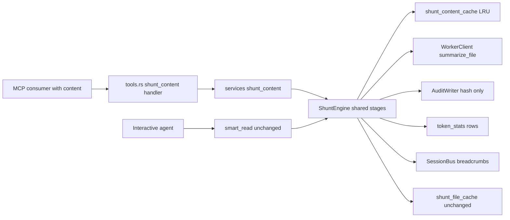
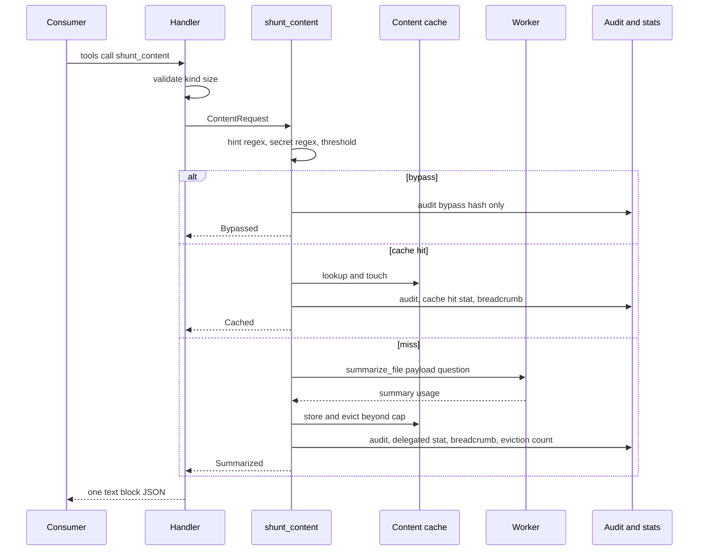

# Technical Design: shunt-content-tool

## Overview

**Purpose**: Add `shunt_content`, a content-based entry point into the existing shunt engine, so that programmatic MCP consumers (first: the mvibe proxy) obtain deterministic structural summaries for file-read tool output they hold as a string.

**Users**: LLM-API proxies and other automation that cannot hand mmhmem a confined path. Interactive agents keep using `smart_read`.

**Impact**: One new service module, one new storage table, one new MCP tool (ten in total), a `ShuntSource` seam inside the shunt engine, config for the cache cap, tests over both transports and modes, README/help updates. No change to existing tool contracts or file-cache semantics.

### Goals
- Same evaluation order, worker, audit and statistics discipline as `smart_read` (Req 1, 3, 5).
- Machine-readable JSON result with stable cached bytes (Req 2).
- Dedicated bounded content cache, invisible to prune (Req 4).
- Non-regression and size caps (Req 6).

### Non-Goals
- Parsing LLM request bodies; correlating tool calls; any proxy behaviour.
- New worker prompts; kinds other than `file_read`; TTL eviction for the file cache; playbook or routing-instruction changes.

## Boundary Commitments

### This Spec Owns
- `src/services/shunt_content.rs`: content evaluation (size guard, secret patterns, hint regex, threshold), orchestration of cache/delegate via the shared engine, result struct.
- `shunt_content_cache` table, its helpers and LRU eviction (`src/storage/schema.rs`, `src/services/shunt_cache.rs`).
- `ShuntSource` seam in `shunt_types.rs` and the minimal plumbing in `shunt.rs` so file and content share `delegate`/`serve_cached`/audit/stat recording.
- `SHUNT_CONTENT_CACHE_MAX_ROWS` config (env; `.mmhmem.json` for local profile).
- The MCP handler, params, description and annotations for `shunt_content`; tool-count test updates; README/help text.

### Out of Boundary
- `smart_read`, `shunt_warmup`, `shunt_prune` behaviour and the file cache's semantics.
- Worker client, prompts and timeouts (`src/services/worker.rs`).
- Session bus, memory, breadcrumb schema, statistics reporting formats.
- The consumer's eligibility, marker text and memo (`../mvibe` spec).

### Allowed Dependencies
- `services` may import `config` and `storage`, never `mcp` (steering structure.md).
- rmcp `=3.8.0` tool macros; rusqlite `=0.41.1`; existing `sha256_hex`, `stats`, `AuditWriter`, `SessionBus` breadcrumbs, `WorkerClient::summarize_file`.
- No new crates.

### Revalidation Triggers
- Result JSON field changes → consumer (`proxy-econ-client`) must re-check its `ShuntResult` parser.
- Bypass reason vocabulary changes → consumer memo semantics.
- Tool count or annotation matrix changes → `agent-tool-routing` enumeration tests.
- Schema version bump policy → `store_startup` tests.
- Worker prompt or `line_numbered_payload` format changes → summary line references.

## Architecture

### Existing Architecture Analysis
- `McpServer` tool handlers (`src/mcp/tools.rs`) are thin: parse params, call a service, render text, map errors; each wrapped in a telemetry span.
- `ShuntEngine` stages: targeted → security-critical → below-threshold → cache → delegate. Stages 3–4 depend on the path only for the cache key, `raw_chars`, the worker payload and audit details.
- Storage: schema applied with `CREATE TABLE IF NOT EXISTS` statements; `db.rs:189` lists expected tables for startup checks.
- Config: `Config::from_env` fail-fast parsing; local profile merges `.mmhmem.json` for worker settings.

### Architecture Pattern & Boundary Map



- Selected pattern: **source-polymorphic engine**. One `ShuntSource` enum selects cache table, payload builder and audit labels; stages are shared.
- Existing patterns preserved: thin handlers, services-never-import-mcp, fail-fast config, hash-only audit, labelled estimates.
- New component rationale: `shunt_content.rs` keeps `shunt.rs` under the LOC cap and isolates content-only policy (size guard, secret patterns).

### Technology Stack

| Layer | Choice / Version | Role in Feature | Notes |
|---|---|---|---|
| Protocol | Rust, rmcp =3.8.0 | tool, params, annotations | no upgrade |
| Services | existing `ShuntEngine`, `WorkerClient`, `stats` | shared stages | `ShuntSource` seam |
| Storage | rusqlite =0.41.1, SQLite | new table + LRU delete | additive DDL |
| Config | `Config::from_env`, `.mmhmem.json` | cache cap | new key |
| Verification | cargo test, existing stub worker TCP listener, stdio + HTTP integration tests | both transports, both modes | no network |

## File Structure Plan

| Files | Action and responsibility |
|---|---|
| `src/services/shunt_content.rs` | NEW: `ContentRequest`, `ContentOutcome`, `CONTENT_SECRET_RE`, `MAX_CONTENT_BYTES`, `ShuntEngine::shunt_content()` impl block (evaluation + orchestration) |
| `src/services/shunt_types.rs` | Modify: add `ShuntSource { File(PathBuf), Content { hint: Option<String> } }`, `BypassReason` reuse, `ContentOutcome` type if not in the new file |
| `src/services/shunt.rs` | Modify: `Miss`, `ShuntAuditMeta`, `delegate`, `serve_cached`, `audit_shunt`, `record_stat`, `crumb` take `&ShuntSource`; file behaviour unchanged |
| `src/services/shunt_cache.rs` | Modify: `content_cache_lookup`, `content_cache_store_and_evict`, `payload_from_content`; file helpers unchanged |
| `src/services/mod.rs` | Modify: `pub mod shunt_content;` |
| `src/storage/schema.rs` | Modify: `CREATE TABLE IF NOT EXISTS shunt_content_cache (...)`; schema version policy per existing convention |
| `src/storage/db.rs` | Modify: expected-tables list includes `shunt_content_cache` |
| `src/config.rs` | Modify: `ENV_SHUNT_CONTENT_CACHE_MAX_ROWS`, default 5000, u32 > 0, local-profile JSON key `shunt_content_cache_max_rows` |
| `src/mcp/params.rs` | Modify: `ShuntContentParams { project, agent_harness, content, kind, source_hint?, question? }` |
| `src/mcp/tools.rs` | Modify: `shunt_content` handler; JSON text block; description + annotations; `with_span("shunt_content", …)` |
| `src/mcp/instructions.rs` | Unchanged (agents keep `smart_read`); optional one clause if LOC allows |
| `tests/shunt_content.rs` | NEW: engine-level tests with the stub worker (bypass, threshold, delegate, cache hit, eviction, worker error, size guard) |
| `tests/mcp_tools.rs`, `tests/local_stdio.rs`, `tests/tool_routing.rs` | Modify: ten-tool enumeration, annotations, round trips over HTTP and stdio, local mode |
| `tests/prune_cli.rs`, `tests/warmup_prune.rs` | Modify: assert content rows survive prune |
| `tests/audit_redaction.rs` | Modify: content with secrets ⇒ bypass audit contains hash only |
| `README.md`, CLI help | Modify: tool list (ten), one-line distinction from `smart_read`, cache cap setting |

Keep every `src/` file under 500 lines (`tests/loc_caps.rs`); move helpers rather than exceed.

## Components and Interfaces

| Component | Domain/Layer | Intent | Req Coverage | Key Dependencies (P0/P1) | Contracts |
|---|---|---|---|---|---|
| ShuntContentParams / handler | mcp | parse, call, render JSON, map errors | 1.1, 1.3, 1.4, 2.1, 2.3, 2.4 | services (P0) | API |
| shunt_content service | services | evaluation + orchestration for content | 1.2, 1.5, 1.6, 3.1–3.5, 5.1–5.5 | ShuntEngine (P0), WorkerClient (P1) | Service |
| ShuntSource seam | services | one code path for file and content | 6.2 | — | State |
| Content cache | storage/services | keyed lookup, store, LRU evict | 4.1–4.5 | Db (P0) | State |
| Config key | config | cache cap | 4.3 | — | State |

### mcp

#### `shunt_content` tool

| Field | Detail |
|---|---|
| Intent | Content-based shunt for programmatic consumers |
| Requirements | 1.1, 1.3, 1.4, 2.1, 2.3, 2.4 |

**API Contract**

| Field | Type | Rule |
|---|---|---|
| `project` | string | required |
| `agent_harness` | string | required (consumer sends `mvibe-proxy`) |
| `content` | string | required; 1 ≤ bytes ≤ `MAX_CONTENT_BYTES` (1 MiB) else error |
| `kind` | string | required; v1 accepts `file_read` only; other ⇒ error listing supported kinds |
| `source_hint` | string, optional | label only; path regex applied; echoed back trimmed to 256 chars |
| `question` | string, optional | default `Summarize exported symbols, signatures, and control flow with exact line ranges.` (same as smart_read default) |

Result: one text block, JSON object:
```json
{"outcome":"summarized|cached|bypassed","summary":"...","bypass_reason":"security_critical|below_threshold","content_sha256":"<64 hex>","line_count":171,"avoided_input_tokens_est":1234,"latency_ms":812,"worker_model":"qwen2.5-coder:7b"}
```
Absent fields are omitted, not null. Errors: rmcp tool error (`isError`) with messages: `unsupported kind '<k>'; supported: file_read`, `content is empty`, `content exceeds 1048576 bytes`, and the existing worker errors (`worker not configured: set WORKER_API_URL…`, timeout, HTTP status).

Description (wire): "Content-based shunt for programmatic consumers that hold a tool result string (e.g. an LLM-API proxy). Not for agents reading repository files: use smart_read. Returns a cached or worker-generated structural summary as one JSON object; summaries are not exact source evidence. Security-critical content and short content are bypassed, never summarized. Cache, audit and statistics are written; eviction may replace cached rows."
Annotations: `read_only_hint=false, destructive_hint=true, idempotent_hint=false, open_world_hint=true`.

### services

#### shunt_content

| Field | Detail |
|---|---|
| Intent | Evaluate content and run shared stages |
| Requirements | 1.2, 1.5, 1.6, 3.1–3.5, 5.1–5.5 |

**Service Interface**
```rust
pub struct ContentRequest<'a> { pub project: &'a str, pub harness: &'a str, pub task: Option<&'a str>,
    pub content: &'a str, pub kind: ContentKind, pub source_hint: Option<&'a str>, pub question: &'a str }
pub enum ContentKind { FileRead }
pub enum ContentOutcome {
    Bypassed { reason: BypassReason, content_sha256: String, line_count: usize },
    Cached { summary: String, content_sha256: String, line_count: usize, avoided_input_tokens_est: u64, latency_ms: u64 },
    Summarized { summary: String, content_sha256: String, line_count: usize, avoided_input_tokens_est: u64, latency_ms: u64, usage: WorkerUsage, worker_model: String },
}
impl ShuntEngine {
    pub async fn shunt_content(&self, req: &ContentRequest<'_>) -> Result<ContentOutcome, ShuntError>;
}
pub fn is_secret_content(content: &str) -> bool;   // CONTENT_SECRET_RE, line-anchored where noted
pub const MAX_CONTENT_BYTES: usize = 1 << 20;
```
- Preconditions: `content` non-empty and ≤ cap (checked by the handler before the service; the service re-checks and returns `ShuntError::Invalid`).
- Order: hint regex → content secret regex → `line_count < shunt_min_lines` → content cache lookup → delegate (`summarize_file(payload_from_content(content), question)`) → store + evict.
- Postconditions: exactly one audit event; stats row only for `Cached`/`Summarized`; breadcrumb for non-error outcomes; `Bypassed` writes no cache row.
- Payload: `payload_from_content` prefixes each line with `L<n>: ` exactly like `line_numbered_payload`, so worker ranges refer to original line positions.

#### ShuntSource seam (in `shunt_types.rs` / `shunt.rs`)
```rust
pub enum ShuntSource { File(PathBuf), Content { hint: Option<String> } }
```
- `delegate`/`serve_cached` choose cache helpers by source; audit `details` carry `"source": "file"|"content"`, `"file"` for File, `"hint"` (trimmed) for Content, plus sha, line count, estimate; `record_stat` passes the same `file`-column value (`path` or `content:<sha12>`), which keeps `token_stats` columns unchanged.

### storage

#### Content cache

**Physical model**
```sql
CREATE TABLE IF NOT EXISTS shunt_content_cache (
  content_sha256 TEXT NOT NULL,
  query_fingerprint TEXT NOT NULL,
  kind TEXT NOT NULL,
  structural_summary TEXT NOT NULL,
  line_count INTEGER NOT NULL,
  created_at_epoch INTEGER NOT NULL,
  last_hit_epoch INTEGER NOT NULL,
  hits INTEGER NOT NULL DEFAULT 0,
  PRIMARY KEY (content_sha256, query_fingerprint, kind)
);
CREATE INDEX IF NOT EXISTS idx_shunt_content_cache_lru ON shunt_content_cache (last_hit_epoch, created_at_epoch);
```
- Helpers: `content_cache_lookup(db, sha, fp, kind) -> Option<String>` (also `UPDATE … SET last_hit_epoch=?, hits=hits+1`); `content_cache_store_and_evict(db, row, max_rows) -> evicted: u32` (insert with `ON CONFLICT … DO UPDATE SET structural_summary=excluded.structural_summary, last_hit_epoch=…`, then `DELETE … WHERE rowid IN (SELECT rowid … ORDER BY last_hit_epoch, created_at_epoch LIMIT -1 OFFSET ?max)`), executed in one transaction with the existing busy-timeout contract.
- Prune: `classify()` reads only `shunt_file_cache`; a test asserts content rows persist across `prune` and `shunt_prune`.
- Startup: additive DDL under `CREATE … IF NOT EXISTS`; follow the existing `SCHEMA_VERSION` convention (bump only if the convention requires it for new tables; `store_startup` tests decide).

### config
- `ENV_SHUNT_CONTENT_CACHE_MAX_ROWS = "SHUNT_CONTENT_CACHE_MAX_ROWS"`, `DEFAULT_SHUNT_CONTENT_CACHE_MAX_ROWS: u32 = 5000`, parse as u32 > 0 with the same fail-fast error style; local profile reads `shunt_content_cache_max_rows` from `.mmhmem.json` with precedence env > project > global > default.

## System Flows



Flow decisions: the stats row is committed before the response (as amended for warmup, Req 1.2 of corpus-warmup-prune); worker errors audit `WorkerError` with the hash and return the actionable error; eviction audits one `CONTENT_CACHE_EVICT` event with a count.

## Requirements Traceability

| Requirement | Implementation contract | Verification |
|---|---|---|
| 1.1 | handler registered in `tool_router`; both transports/modes | stdio + HTTP + local tests list ten tools and call it |
| 1.2 | order in `shunt_content()` | engine tests per stage |
| 1.3 | kind validation in handler and service | error text test, no side-effect rows |
| 1.4 | size guard | empty and >1 MiB tests, worker stub untouched |
| 1.5 | no `confine`, no fs calls | code review + test with nonexistent hint path |
| 1.6 | default question constant shared with smart_read | cache identity test across callers |
| 2.1 | JSON object in one text block | round-trip parse in integration tests |
| 2.2 | cached bytes identical | delegate then hit, byte compare |
| 2.3 | result carries no content | assertion on result keys and values |
| 2.4 | description + annotations | wire enumeration test |
| 3.1 | hint regex | hint `auth/token.rs` ⇒ bypass |
| 3.2 | `CONTENT_SECRET_RE` | fixture corpus (PEM, AKIA, api_key=, bearer, ENV=) ⇒ bypass |
| 3.3 | threshold | 149 vs 150 lines |
| 3.4 | bypass audit | audit line has reason + sha, no content |
| 3.5 | no stats on bypass | stats count unchanged |
| 4.1 | dedicated table/key | schema + lookup tests |
| 4.2 | hit path touches LRU, no worker | stub worker call count 0 on hit |
| 4.3 | cap + LRU evict + audit count | insert cap+3 ⇒ 3 oldest-hit evicted, one audit event |
| 4.4 | prune untouched | prune CLI/tool tests |
| 4.5 | additive DDL | store_startup on pre-existing store |
| 5.1 | delegated stat committed pre-response | stats row visible from another connection after call |
| 5.2 | cache-hit stat | stats delta |
| 5.3 | audit fields | audit redaction + fields test |
| 5.4 | breadcrumb | breadcrumb search |
| 5.5 | worker errors | unconfigured/timeout/500 stub cases |
| 6.1 | nine → ten pins | updated tests cite this spec |
| 6.2 | LOC caps, shared path | `loc_caps` test; `shunt.rs` diff limited to seam |
| 6.3 | help/README | docs diff |
| 6.4 | both transports/modes | integration tests |

## Error Handling
- Invalid args (`kind`, size): tool error, no side effects.
- Worker unconfigured/timeout/HTTP: existing `ShuntError::WorkerNotConfigured|Worker`, audited with hash, mapped by `err()`.
- Storage busy/IO: `ShuntError::Io`, mapped to tool error; no partial cache rows (single transaction).
- Eviction failure after a successful insert: logged and audited as error; summary still returned (cache correctness over cap strictness).

## Testing Strategy
- **Engine (`tests/shunt_content.rs`, stub worker TCP listener)**: bypass by hint, bypass by each secret pattern, threshold boundary, delegate then cache hit with byte-identical summary and zero second worker call, eviction order and audit count, size guard, empty content, worker timeout/unconfigured, question default shared identity, payload line numbering.
- **Protocol (`tests/mcp_tools.rs`, `tests/local_stdio.rs`, `tests/tool_routing.rs`)**: ten tools enumerated with annotations; `tools/call` round trip over HTTP (SSE framing) and stdio; local mode; JSON parse of the text block; error mapping.
- **Storage (`tests/store_startup.rs`, `tests/prune_cli.rs`, `tests/warmup_prune.rs`)**: table created on old stores; prune leaves content rows.
- **Audit (`tests/audit_redaction.rs`)**: secrets in content never reach audit or breadcrumbs.
- **Gates**: `cargo test`, `cargo fmt --check`, strict clippy, `loc_caps`, installer/distribution gates unchanged.

## Security Considerations
- Content never touches the filesystem or the confinement layer; `source_hint` is never opened.
- Secret patterns bypass before any worker call; audit stores hashes and reasons only.
- Bearer auth and constant-time comparison unchanged for the HTTP transport.
- The worker may be remote per operator config; this tool adds no new egress beyond the existing worker call.

## Performance & Scalability
- Cache hit target < 50 ms (same as file hits); eviction is one bounded `DELETE` per insert on an indexed order.
- 1 MiB content cap bounds worker payloads.

## Design Review Gate
Requirements 1.1–6.4 are mapped. Boundary, dependencies, concrete files, contracts, failure modes and executable validation are defined. Review repaired one ambiguity: content rows must not share the file cache because prune classifies by on-disk existence, so a dedicated table with its own eviction is mandatory, not optional. Gate passed.
