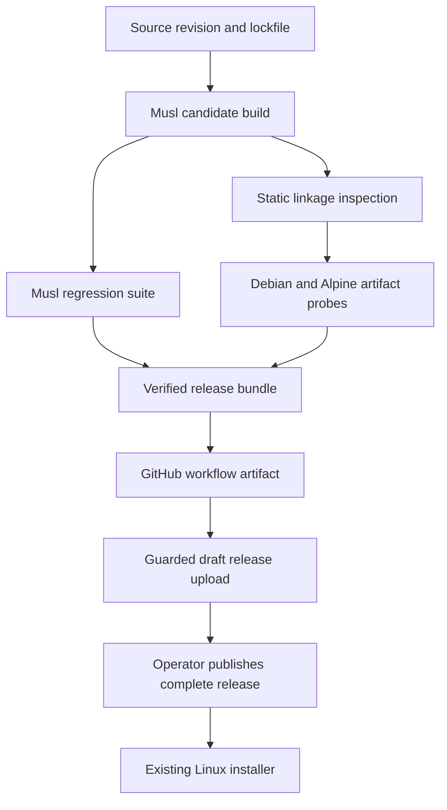

# Technical Design: Static Linux Release

## Overview

Provide one static musl executable for Linux x86_64 while preserving the
existing latest-release asset name and application contracts. The canonical
Dagger pipeline builds, inspects and exercises the candidate, then exports
the exact bytes with evidence for publication.

This extends distribution infrastructure. It does not change the memory
service architecture or introduce a second Linux build pipeline.

### Goals
- Eliminate glibc, dynamic-loader and shared-library dependencies from the plain Linux executable.
- Prove actual artifact behavior on Debian 12 and Alpine 3.22.
- Bind release publication to the tested artifact and its source revision.

### Non-Goals
- New architectures, a static OTel Docker image, application/storage changes,
  or changes to Windows/macOS and marketplace packages.
- Bit-for-bit reproducibility across arbitrary toolchain rebuilds.
- Certification of every historical Linux kernel or distribution.

## Boundary Commitments

### This Spec Owns
- The plain Linux musl build and its target-specific cache/configuration.
- Binary inspection, black-box artifact probes and verified bundle metadata.
- Linux artifact export and a guarded upload to an existing draft release.
- Documentation of the release transition and supported runtime environment.

### Out of Boundary
- Rust application business logic, persistent schemas, MCP API changes and TLS-policy changes.
- Windows/macOS build mechanics and skill/plugin versions.
- Dockerfile and the existing OTel-enabled GNU container runtime.
- Automatic creation or publication of a multi-platform release.

### Allowed Dependencies
- CI orchestration imports the static-release helper; that helper uses Dagger
  and invokes repository-owned validation scripts. Validation scripts may
  inspect the binary or communicate through CLI/MCP/HTTP, not import mmhmem
  internals or write its database directly.
- The publication script consumes GitHub run metadata and the verified bundle;
  it cannot compile a binary.
- Existing Cargo dependencies remain locked. New tools are build/test-only:
  musl-tools, binutils, Python standard library and OpenSSL CLI for disposable
  test certificates. Native compiler packages satisfy SQLite and crypto builds.

### Revalidation Triggers
Changes to compiler, target flags, native crypto/SQLite dependencies, worker
TLS behavior, runtime images, asset naming, source-revision capture or bundle
schema require linkage, regression, runtime and provenance checks again.
Any need to change production Rust behavior or the Docker image returns to
scope review rather than becoming an incidental build workaround.

## Architecture

### Existing Architecture Analysis
- `release(src)` currently returns a GNU-built Dagger File.
  `deploy_artifacts()` consumes it; `all()` returns a text summary.
- CI uploads Windows/macOS artifacts but does not export the Linux candidate.
- `install.sh` already stages downloads and uses the stable
  `mmhmem-linux-x86_64` latest-release endpoint.
- Rust subprocess tests select `CARGO_BIN_EXE_mmhmem`. These prove target
  behavior but do not prove the final exported file.
- The worker uses reqwest's existing rustls platform verifier. SQLite is
  bundled; AWS-LC and possibly target-selected ring introduce native compilation.

### Architecture Pattern & Boundary Map



The bundle is returned only after all gates succeed. Publication does not
rebuild, strip, recompress or otherwise modify the executable.

### Technology Stack

| Area | Choice | Role |
|---|---|---|
| Rust build | Rust 1.98.1, target `x86_64-unknown-linux-musl` | Explicit static release toolchain |
| Build environment | Existing Debian bookworm Rust image family, exact compiler installed/selected | Host tools plus musl C cross-compiler |
| Native linker | musl-gcc and target-specific cc configuration | Compile bundled SQLite and active crypto libraries for musl |
| Inspection | GNU readelf from binutils | ELF machine, interpreter and shared-library checks |
| Orchestration | Existing Dagger Python module | One local/hosted pipeline |
| Runtime matrix | Debian bookworm-slim and Alpine 3.22, linux/amd64 | Same executable on GNU and musl userlands |
| Probes | Python 3 standard library | Process, JSON-RPC, HTTP and bounded assertions |
| Publication | Native PowerShell 5.1+ and gh | Verify run provenance and upload an existing bundle |

Resolve and record container image digests and installed tool versions in the
evidence. Cargo uses `--locked`; no dependency update is implied.

### Runtime Support Contract

The initial declared support floor is Linux kernel **5.10** and baseline
**x86-64/SSE2**. This is a conservative product support policy, not a claim
that Linux 5.10 is the first kernel capable of executing the binary.
Do not use `target-cpu=native`, mandatory AVX/AES flags, or host-specific C flags.
Crypto implementations may use their existing runtime CPU dispatch.

CI records the actual host kernel and CPU information. Debian and Alpine
containers share that kernel: passing both establishes userland portability,
not a test of two kernel versions. Documentation must distinguish the support
floor from the recorded tested kernel; older kernels are outside the support
promise. A dependency that raises this floor triggers design revalidation.

DNS uses the deployed resolver configuration. HTTPS retains the current
platform-verifier trust behavior. Users should supply their distribution's
CA bundle, and custom/private roots must be trusted through the existing
platform mechanisms. Static linking does not embed a new trust policy.

## File Structure Plan

| File | Change | Responsibility |
|---|---|---|
| `ci/src/mmhmem_ci/static_release.py` | New | Musl build, target regression, runtime orchestration and bundle assembly |
| `ci/src/mmhmem_ci/main.py` | Modify | Expose static-release gate/export; route release and all through it |
| `ci/scripts/inspect_static.py` | New | Validate ELF metadata and produce linkage evidence |
| `ci/scripts/probe_release.py` | New | Black-box CLI/MCP/persistence/server probe with an explicit binary path |
| `ci/scripts/worker_fixture.py` | New | Deterministic HTTPS worker stub and request receipt evidence |
| `ci/scripts/check_bundle.py` | New | Validate bundle schema/checksum and evidence consistency |
| `scripts/publish-linux-release.ps1` | New | Validate hosted run/tag provenance and upload Linux bundle files to a draft |
| `scripts/test-publish-linux-release.ps1` | New | Offline negative tests of the publisher using fake gh responses |
| `scripts/dagger-ci.ps1` | Modify | Capture source/dirty state and validation ID in native PowerShell; export under repo tmp |
| `.github/workflows/ci.yml` | Modify | Pass revision/run identity and export/upload the verified Linux bundle |
| `scripts/test-install.sh` | Modify | Add install/update preservation scenario for a supplied candidate fixture |
| `README.md` | Modify at release transition | Published asset portability and runtime prerequisites |
| `deploy/README.md` | Modify | Maintainer build, export, upload and rollback procedure |
| `.kiro/steering/tech.md` | Modify after verification | Distinguish static plain Linux release from unchanged GNU Docker build |

`Cargo.toml`, `Cargo.lock`, `Dockerfile`, `install.ps1`, plugin manifests and
production `src/` have no planned modifications. `install.sh` keeps its URL
and platform mapping; change it only if regression evidence demonstrates a
necessary installer correction within Requirement 4.

## Components and Interfaces

| Component | Intent | Requirements | Critical dependencies | Contract |
|---|---|---|---|---|
| Static builder | Produce candidate and static-target test results | 1.1, 1.3, 1.4, 3.1, 3.2, 3.3 | Rust/musl/native compiler P0 | Batch |
| Artifact verifier | Inspect and exercise the exact file | 1.2, 2.1, 2.2, 2.3, 2.4, 2.5, 2.6, 2.7 | readelf and runtime containers P0 | Batch |
| Bundle exporter | Bind checks to artifact/source | 3.4, 3.5, 3.6, 3.7 | Dagger and host revision capture P0 | Batch |
| Draft publisher | Deliver verified bytes | 4.1, 4.6 | GitHub run/tag metadata P0 | Batch |
| Installer and guidance | Preserve deployment contract | 4.2, 4.3, 4.4, 4.5, 5.1, 5.2, 5.3, 5.4, 5.5 | Latest-release endpoint P0 | Existing CLI |

### Static Builder

**Contracts: Batch.** Internal helper takes `dagger.Directory` source plus
typed provenance inputs, and returns a candidate File and regression evidence.
It is not a public unverified release export.

- Pin/select Rust 1.98.1 explicitly instead of trusting the repository's
  currently floating `stable` channel or the mutable image tag.
- Install the musl target and musl-tools in the existing Linux builder family.
  Set `CARGO_TARGET_X86_64_UNKNOWN_LINUX_MUSL_LINKER=musl-gcc` and
  `CC_x86_64_unknown_linux_musl=musl-gcc`. Apply `+crt-static` and
  `target-cpu=x86-64` only to the musl target, not host build scripts.
- Use a dedicated musl target cache, two build jobs and disabled incremental
  compilation. Reuse the registry cache without sharing GNU target outputs.
- Run default-feature clippy and the deterministic suite for the musl target,
  then build the release with `--release --locked --target ...`.
  Preserve existing GNU and OTel quality gates.
- Copy the final binary out of its cache mount before hashing or testing.
  No post-verification stripping is allowed.
- Inspect the active target dependency graph for unwanted OTel or native
  dynamic TLS linkage. Do not infer active dependencies from Cargo.lock alone.
- If a native dependency cannot build with this setup, fail visibly; do not
  substitute a GNU binary or switch crypto providers automatically.

### Artifact Verifier

**Contracts: Batch.** Scripts accept an explicit `--binary PATH`,
`--expected-sha256 HEX` and output JSON report path. Every process has a
deadline and captured stderr; failures terminate child processes and fail CI.

Inspection checks ELF64, x86-64 machine identity, no PT_INTERP segment,
no DT_NEEDED entries and no GLIBC version requirements. Accept static PIE:
ET_DYN or a dynamic metadata section alone is not evidence of shared linkage.
Reject a known dynamic fixture to prove the gate can detect the original issue.

Before adding probe tools, run the candidate's version command in each pristine
runtime image and in a scratch image containing only the candidate. This
separately proves startup without test-tool library dependencies.
Runtime probes then copy the same File into both instrumented images and recheck its hash.
Python and CA-management tools are test instrumentation, not application
runtime dependencies. Neither probe installs glibc compatibility, system
SQLite or OpenSSL libraries to satisfy the application; linkage evidence is
the primary proof that probe-tool dependencies are not masking mmhmem linkage.

Each image performs:
1. Version, MCP initialize/initialized and tools/list.
2. Observation insertion, checkpoint write, clean exit, restart against the
   same store, memory search and detail retrieval. Use only public tools.
3. Plain and JSON statistics after the recorded session.
4. Server startup, health 200, MCP without token 401, authenticated initialize
   success, then bounded shutdown.
5. A worker-backed smart read of a fresh non-security-sensitive file exceeding
   the configured shunt threshold. Verify the fixture's unique response and
   receipt log, so a cache hit or raw-read fallback cannot masquerade as success.
6. Repeat using an untrusted test CA in a fresh process/store/file. Assert
   the worker does not receive an accepted HTTP request and the tool reports
   the existing failure/fallback contract without exposing a successful
   delegated result.

The worker fixture runs as a separate Dagger service bound by a hostname
present in its generated certificate SAN. This tests actual service DNS,
not only /etc/hosts or a loopback IP. Certificates are generated inside CI
with fresh validity per validation ID; keys are never published.
Trusted roots are installed through each image's normal CA-store mechanism.
No `danger_accept_invalid_certs`, production bypass flag or new Rust dependency.

### Bundle Exporter

**Contracts: Batch.** Public Dagger function:

```python
async def static_release(
    src: dagger.Directory,
    revision: str,
    validation_id: str,
    source_clean: bool = False,
) -> dagger.Directory
```

Validate revision as a full commit ID, validation ID as a nonempty safe label,
and cleanliness as explicit provenance. Local dirty trees may be tested but
produce `publishable: false`; a host-supplied SHA alone is not evidence of
cleanliness. The hosted publisher also verifies the trusted workflow run.

`all()` invokes this gate and retains its success in the normal summary.
A subsequent export call with identical source, revision and validation ID
reuses the same Dagger graph; it must not generate a new build artifact.
`release()` remains a File-returning compatibility entrypoint that selects
the verified bundle's executable, so deploy-artifact verification cannot
accidentally consume an unverified alternate binary.

The canonical Windows wrapper captures revision and worktree cleanliness
before its sanctioned CI sync, since the synced tree excludes .git. It
generates a fresh validation ID and permits export only into repo `tmp/`.
Hosted CI verifies the checkout is clean immediately before source capture,
then passes `github.sha` and a run/attempt identifier. A fresh validation
ID invalidates verification-result caching across runs while allowing compiled
dependency caching.

Bundle contents:
- `mmhmem-linux-x86_64`
- `SHA256SUMS` naming that file
- `verification.json`
- `reports/` containing target-suite, linkage and per-image probe results

Return the bundle only after success; retain failed logs in CI diagnostics
without writing a success report or advertising a publishable artifact.

### Draft Publisher

**Contracts: Batch.** Native PowerShell accepts `-Tag` and `-RunId`.
It resolves the tag commit and GitHub run metadata, downloads the uniquely
named Linux bundle from that run into repo scratch, and verifies:
- Expected repository and CI workflow identity; successful run on the tag's
  exact commit, with all required native and Dagger jobs successful.
- Bundle `revision` equals the tag commit; `publishable` is true and all
  required evidence entries passed.
- Executable hash equals both SHA256SUMS and verification.json.
- Destination is an existing draft release and has no conflicting Linux asset.

Upload only the executable and verification/checksum files from this validated
bundle. No arbitrary local binary path, rebuild, force overwrite or automatic
release publication. Re-download the draft asset and compare its hash before
reporting success. An identical existing asset is idempotent success; a
different existing asset is a hard failure.

The release owner assembles the existing Windows/macOS assets for the same
tag, publishes the complete release and verifies the latest-release asset
hash. Publication permissions remain confined to this explicitly invoked
maintainer step; normal CI stays read-only.

## Data Models

`verification.json` schema version 1 has:
- `revision: string`, `source_clean: bool`, `publishable: bool`,
  `validation_id: string`, `package_version: string`.
- `target: string`, `rustc_version: string`, `cargo_version: string`,
  `lockfile_sha256: string`, build image digest and native tool versions.
- `artifact: {name: string, sha256: string, size_bytes: int}`.
- `linkage` and `regression` records with explicit passed status and report names.
- `runtimes`: exactly the required Debian and Alpine entries, each with
  image digest, actual kernel, architecture, artifact hash and named case results.

The checker rejects unknown schema versions, missing required fields, duplicate
runtime entries, wrong target/architecture, malformed hashes and inconsistent
case outcomes. Existing application storage models remain unchanged.

## Requirements Traceability

| Requirement | Summary | Components | Interfaces | Flows |
|---|---|---|---|---|
| 1.1, 1.2, 1.3, 1.4 | Static plain executable | Builder, verifier | Candidate File, ELF report | Build then inspect |
| 2.1, 2.2, 2.3, 2.4 | Same-artifact local functionality | Verifier | CLI and MCP | Probe then restart |
| 2.5, 2.6, 2.7 | Server authentication and DNS/TLS | Verifier, worker fixture | HTTP and MCP | Trusted/untrusted cases |
| 3.1, 3.2, 3.3 | Canonical locked build and suite | Builder, exporter | Dagger functions | Local/hosted CI |
| 3.4, 3.5 | Blocking gates and provenance | Exporter | Bundle schema | Verify then export |
| 3.6, 3.7 | Windows/WSL execution boundaries | Exporter, wrapper | Native PowerShell entrypoint | Container-only Linux execution |
| 4.1 | Published bytes equal tested bytes | Publisher | Run/tag and checksum checks | Upload then re-download |
| 4.2, 4.3, 4.4, 4.5 | Installer compatibility | Installer tests | Existing bootstrap arguments | Install/update/failure |
| 4.6 | Other releases and marketplace preserved | Publisher scope | Existing asset names | Complete-release checklist |
| 5.1, 5.2 | Accurate transition timing | Guidance | Release confirmation | Publish before claim |
| 5.3, 5.4, 5.5 | Runtime prerequisites and target limits | Guidance | Support contract | Installation instructions |

## Error Handling

- Build/link/test failure: stop the gate with target and failing phase; never
  silently fall back to GNU.
- Incorrect or mismatched artifact: reject before execution or upload.
- Probe timeout: terminate the process tree and retain bounded stdout/stderr.
- Untrusted TLS: retain normal application error/fallback semantics; fixture
  receipt and fresh inputs distinguish failure from cache/fallback success.
- Failed upload: leave the draft unpublished; retry only after checking remote
  checksum. Never replace an existing published asset as a migration shortcut.
- Dirty local tree or absent revision: testable local result, never publishable.
- Missing trust configuration: documentation explains installing CA roots;
  do not alter TLS validation to make the smoke test pass.

## Testing Strategy

- **Build and linkage (1.1–1.4, 3.2–3.4):** musl-target deterministic suite and
  lint; positive static ELF and negative dynamic ELF inspection; active
  dependency/feature evidence.
- **Actual artifact (2.1–2.7):** run every defined probe in both runtime images;
  verify artifact checksum before and after the run. Read/write through public
  tools and prove persistence across process restart.
- **Provenance (3.5, 4.1):** tamper the executable, revision, runtime list and
  success fields; each must fail bundle validation. Mock failed/wrong workflow,
  wrong tag, conflicting asset and missing artifact responses in publisher tests.
- **Installer (4.2–4.6):** isolated install/update with preserved memory/config
  fixtures, no-op dry run, failed-download preservation and unsupported-platform
  refusal. Existing native Windows tests remain in CI.
- **Documentation (5.1–5.5):** review against the actually published release;
  retain the current glibc caveat until the static asset is downloadable.
- **Review limits:** container tests do not certify the oldest supported kernel
  or every CPU. Record tested kernel/CPU instead of implying such coverage.

## Migration Strategy

1. Implement build and verification behind the release gate; keep current
   user-facing glibc limitations while the downloadable release is unchanged.
2. Export the verified bundle from a green tagged-commit CI run.
3. Upload it to the complete release draft, preserving all other platform
   assets; confirm the draft checksum.
4. Publish through the existing maintainer release process and verify the
   latest endpoint serves that checksum. Then update the README portability
   claim and steering.
5. If validation fails, leave the current release active. If a regression is
   found after publication, use an explicit corrective release or restore
   the previous latest release designation with matching documentation;
   never mutate the original tested bytes in place.

## Design Review Gate

Requirements coverage, boundary/file alignment, concrete batch contracts,
failure paths and rollout ordering reviewed. All 29 acceptance criteria map
to design elements. No production implementation has started. Technical
review permits design generation; human approval remains required before
task generation.
